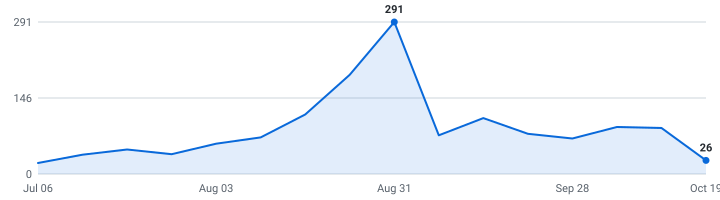

# 🍁 Canada, Japan & more Tech Internships

**A self-updating engine that tracks tech internships so you don't have to.**

&nbsp;&nbsp;&nbsp;

### 352 open roles (281 listed below) · 99 new this week

4,788 employers tracked · data as of Oct 18, 2026 at 22:04 UTC

_166 have a cycle the employer stated · 186 are recent postings whose cycle isn't stated (listed separately, never mixed in)._

**[🖥️ Live dashboard](https://parkerhayashi.github.io/Automated-List-Of-Summer-2027-and-Fall-2026-Tech-Internships/)** · **[📡 RSS](https://parkerhayashi.github.io/Automated-List-Of-Summer-2027-and-Fall-2026-Tech-Internships/feed.xml)** · **[⚙️ JSON API](https://parkerhayashi.github.io/Automated-List-Of-Summer-2027-and-Fall-2026-Tech-Internships/api/jobs.json)**

> [!TIP]
> **⭐ Star this repo** to save it and get updates when new roles are added.

Instead of refreshing a dozen career pages by hand, it reads company hiring feeds directly and keeps one live list — newest roles on top, refreshed automatically throughout the day.

**🔔 New roles in your inbox:** [RSS](https://parkerhayashi.github.io/Automated-List-Of-Summer-2027-and-Fall-2026-Tech-Internships/feed.xml) or [Feedrabbit](https://feedrabbit.com/subscriptions/new?url=https%3A%2F%2Fraw.githubusercontent.com%2Fparkerhayashi%2FAutomated-List-Of-Summer-2027-and-Fall-2026-Tech-Internships%2Fmain%2Fdocs%2Ffeed.xml).

---

## What this is

This is an engine, not a hand-kept list. It polls company career feeds every 30 minutes, finds the internships, removes duplicates, and rebuilds this page on its own.

Every link comes straight from the source — so it's real and current, not a stale list someone forgot to update. Speed matters.

## What makes this different

| | |
|---|---|
| 📅 **[Drop Radar](#drop-radar)** | A forecast of **what's coming**. Each marquee company's typical opening window, replaced by the real drop date the moment the engine catches it live. Windows are estimates and labelled as such; only dates the engine saw itself are marked verified. |
| 🛂 **Work authorization, from the posting** | 🇨🇦 / 🇯🇵 / 🛂 flags detected automatically from every job description — citizenship required, or the employer says it won't sponsor a work permit. Most postings say nothing either way, and those show as unknown rather than guessed. |
| 📆 **A real date on nearly every role** | Taken from the job portal itself wherever the portal states one, so newest-first actually means newest. The exact coverage figure is printed at the bottom of this page every run. |
| 🧰 **Skill tags + pay, extracted** | Every posting's text is scanned for the stack it wants (Python, C++, PyTorch, …) and the pay it states — searchable on the [dashboard](https://parkerhayashi.github.io/Automated-List-Of-Summer-2027-and-Fall-2026-Tech-Internships/), and included in the CSV and API. |
| 🔔 **Alerts your way** | [RSS](https://parkerhayashi.github.io/Automated-List-Of-Summer-2027-and-Fall-2026-Tech-Internships/feed.xml) — point any reader, or a Slack/Discord RSS integration, at it. Plus a [live dashboard](https://parkerhayashi.github.io/Automated-List-Of-Summer-2027-and-Fall-2026-Tech-Internships/) with search, filters, and a saved-roles list that never leaves your browser. |
| ⚙️ **An engine, not a spreadsheet** | 5,077 job-board endpoints (4,788 distinct employers; some run more than one board) polled every 30 minutes across 12 ATS platforms. Full source and tests in this repo. |

## Scope

| | |
|---|---|
| **Roles** | Software, Data & ML/AI, Quant, Product (PM / TPM), VC, and Product Design / UX internships — not marketing, recruiting, or general business |
| **Region** | Canada, Japan, United Kingdom, Ireland, Netherlands, Germany, Switzerland, Hong Kong, Sweden, Australia, South Korea, Taiwan, New Zealand, France, Spain, Italy, Denmark, Belgium, Austria, Portugal, Greece, and Czechia |
| **Cycles** | Summer 2027 |

## About

This fork of the internship engine tracks software, data, ML, quant, product (PM/TPM), venture capital, and product-design internships and co-ops located in Canada, Japan, and 20 other countries for Summer 2027, plus recent postings that don't name a cycle. The Scope table lists every country.

Use it to spot roles early and apply before they fill up. Being first genuinely helps.

## Where this is going

I'm building this in the open and adding to it as it grows.

**Recently shipped:** the Drop Radar · auto-detected sponsorship flags · the live dashboard

**Next up:** personalized alerts (pick your categories) · per-company hiring pages · a ghost-posting detector

If it helps you, a star means a lot and tells me to keep going.

## How to use

<b>Reading the table — flags, dates, and the cycle split</b> (click to expand)

- Roles are grouped by **region** (Canada, then Japan & IEC countries), then by cycle - **newest posting on top, oldest at the bottom.**
- A cycle section holds only roles whose **employer stated that cycle** - in the title, or in the posting's own text. Postings that name no cycle anywhere are in *Recently posted — cycle not stated* under the same region, with **no cycle guessed for them**. Same quality bar, different amount of evidence.
- The **Posted** column is the date the company published the role.
- **_(3 openings)_ after a role title** = the employer has that many separate live requisitions for the same job, in the same place, for the same cycle. They're all real and each takes its own application, so they're linked individually (**Apply**, then **#2**, **#3**) instead of repeating the row. Counts still count requisitions, and the CSV export is never grouped.
- **🆁 after a company name** = **this role is remote** — the posting's own location or title says so. It marks the role on that row, not the whole company.
- **Flags after a role title:** 🇨🇦 = requires Canadian citizenship, permanent residency, or a security clearance · 🇯🇵 = requires Japanese citizenship or nationality · 🛂 = the posting says it won't sponsor a work permit · 🆕 = spotted in the last 48 hours. Sponsorship flags are detected automatically from each job description - treat them as a strong hint and confirm on the posting.

- Track your applications with [`data/internships.csv`](data/internships.csv) (opens in Excel / Google Sheets).
- Missing a company? Adding one takes a single line, see [CONTRIBUTING.md](CONTRIBUTING.md).

---

**Jump to:** [Canada](#canada) · [Japan & IEC countries](#iec)

## Summer 2027 — Canada  (25 employer-stated)

| Company | Role | Category | Location | Skills | Posted | Apply |
|---|---|---|---|---|---|---|
| Manulife Financial | Summer Intern 2027 - Product Management & Risk Technology | PM | Toronto, Ontario | HTML/CSS | Oct 08, 2026 | [Apply](https://manulife.wd3.myworkdayjobs.com/MFCJH_Jobs/job/Toronto-Ontario/Summer-Intern-2027---Product-Management---Risk-Technology_JR26080875) |
| Capital One | Intern, Full Stack Software Engineer - Summer 2027 | Software | Toronto, ON | Java, Go, JavaScript, React | Oct 06, 2026 | [Apply](https://capitalone.wd12.myworkdayjobs.com/Capital_One/job/Toronto-ON/Intern--Full-Stack-Software-Engineer---Summer-2027_R1003143) |
| AltaGas | AltaGas - 2027 Digital (NextGen AI & Data) Intern | Data & ML/AI | Calgary, AB | Python, SQL, Azure, Git | Oct 05, 2026 | [Apply](https://wgl.wd5.myworkdayjobs.com/altagas/job/Calgary-AB/AltaGas---2027-Digital--NextGen-AI---Data--Intern_R7312) |
| Capital One | Intern, Data Scientist - Summer 2027 | Data & ML/AI | Toronto, ON | Python, SQL, AWS, Linux | Oct 05, 2026 | [Apply](https://capitalone.wd12.myworkdayjobs.com/Capital_One/job/Toronto-ON/Intern--Data-Scientist---Summer-2027_R1002165-1) |
| Marvell | Firmware Engineer Intern - BS/MS - 2027 Co-Op | Hardware | Toronto, Canada | Python, C++, LLMs | Oct 02, 2026 | [Apply](https://marvell.wd1.myworkdayjobs.com/MarvellCareers/job/Toronto-Canada/Firmware-Engineer-Intern---BS-MS---2027-Co-Op_2604959) |
| Pinterest | Software Engineering Intern 2027 (Toronto) | Software | Toronto, ON, CA | Python, Java, C++, TypeScript | Oct 01, 2026 | [Apply](https://www.pinterestcareers.com/jobs/?gh_jid=8138039) |
| Pinterest | Machine Learning Intern 2027 (Toronto) | Data & ML/AI | Toronto, ON, CA | Python, Java, C++, PyTorch | Oct 01, 2026 | [Apply](https://www.pinterestcareers.com/jobs/?gh_jid=8138080) |
| Autodesk | Software Development Internship (Summer 2027) | Software | Toronto, ON, CAN | Python, Java, C++, C# | Oct 01, 2026 | [Apply](https://autodesk.wd1.myworkdayjobs.com/uni/job/Toronto-ON-CAN/Software-Development-Internship--Summer-2027-_26WD101436) |
| Semtech | Firmware Design Intern | Hardware | CAN - Ottawa, ON | Python, C++ | Sep 24, 2026 | [Apply](https://semtech.wd1.myworkdayjobs.com/SemtechCareers/job/CAN---Ottawa-ON/Firmware-Design-Intern_REQ3617) |
| Amazon | Software Development Engineer Intern - Summer 2027 (CAN) | Software | Vancouver, International | Python, Java, C++, C# | Sep 18, 2026 | [Apply](https://www.amazon.jobs/en/jobs/10553947/software-development-engineer-intern-summer-2027-can) |
| Tower Research Capital | Stagiaire en développement de logiciels (été 2027) / Software Developer Intern (Summer 2027) | Software | Montreal | Python, Java, C++, Go | Sep 17, 2026 | [Apply](https://www.tower-research.com/open-positions/?gh_jid=8212179) |
| Manulife Financial | Summer Intern 2027 - Software Engineering (12 Months) | Software | Waterloo, Ontario | Python, Java, JavaScript, HTML/CSS | Sep 17, 2026 | [Apply](https://manulife.wd3.myworkdayjobs.com/MFCJH_adminJobs/job/Waterloo-Ontario/Summer-Intern-2027---Software-Engineering--12-Months-_JR26091053-1) |
| Manulife Financial | Summer Intern 2027 - Infrastructure Equity Internship | Software | Toronto, Ontario | HTML/CSS | Sep 17, 2026 | [Apply](https://manulife.wd3.myworkdayjobs.com/MFCJH_Jobs/job/Toronto-Ontario/Summer-Intern-2027---Infrastructure-Equity-Internship_JR26081107) |
| DoorDash | Software Engineer, Intern (Summer 2027) - TOR | Software | Toronto, ON | Python, Java, SQL, Kotlin | Sep 14, 2026 | [Apply](https://job-boards.greenhouse.io/doordashcanada/jobs/8170944) |
| Amazon | ML Systems Software Development Engineer Intern, Annapurna Labs - 2027 | Data & ML/AI | Toronto, International | Python, C++, TypeScript, PyTorch | Sep 11, 2026 | [Apply](https://www.amazon.jobs/en/jobs/10538066/ml-systems-software-development-engineer-intern-annapurna-labs-2027) |
| Lyft | UX Research Intern (Summer 2027) | Design | Toronto, Canada | SQL | Sep 11, 2026 | [Apply](https://app.careerpuck.com/job-board/lyft/job/8797069002?gh_jid=8797069002) |
| Lyft | Software Engineer Intern, Machine Learning (Summer 2027 - Toronto) | Data & ML/AI | Toronto, Canada | Python, PyTorch, TensorFlow, scikit-learn | Sep 11, 2026 | [Apply](https://app.careerpuck.com/job-board/lyft/job/8802332002?gh_jid=8802332002) |
| Lyft | Software Engineer Intern, Test Automation (Summer 2027) | Software | Montreal, Canada | No skills listed | Sep 11, 2026 | [Apply](https://app.careerpuck.com/job-board/lyft/job/8767534002?gh_jid=8767534002) |
| Amazon | Software Development Engineer Intern, ROBOTICS - 2027 | Hardware | Toronto, International | Python, Java, C++, C# | Sep 09, 2026 | [Apply](https://www.amazon.jobs/en/jobs/10535280/software-development-engineer-intern-robotics-2027) |
| PricewaterhouseCoopers (PwC) | May 2027 - Cyber as a Service - Summer Intern - Ottawa | Security | Ottawa | Python, Java, C++, HTML/CSS | Sep 04, 2026 | [Apply](https://pwc.wd3.myworkdayjobs.com/Global_Campus_Careers/job/Ottawa/May-2027---Cyber-as-a-Service---Summer-Intern---Ottawa_759780WD) |
| Tranetechnologies | 2027 BrainBox AI Intern | Data & ML/AI | Montreal, Quebec | Python, SQL | Aug 31, 2026 | [Apply](https://tranetechnologies.wd12.myworkdayjobs.com/trane_technologies_careers/job/Montreal-Quebec/XMLNAME-2027-BrainBox-AI-Intern_JR-7608-1) |
| Lumentum | Software Verification Engineer (Co-op/Intern) _(2 openings)_ | Software | Canada - Ottawa (Bill Leathem) | Python, C#, Bash, Linux | Aug 28, 2026 | [Apply](https://lumentum.wd5.myworkdayjobs.com/LITE/job/Canada---Ottawa-Bill-Leathem/Software-Verification-Engineer--Co-op-Intern-_20261135) [#2](https://lumentum.wd5.myworkdayjobs.com/LITE/job/Canada---Ottawa-Bill-Leathem/Software-Verification-Engineer--Co-op-Intern-_20261136) |
| Georgian Partners Growth | AI/ML Engineer Intern (2027) | Data & ML/AI | Toronto Headquarters | Python, PyTorch, TensorFlow, scikit-learn | Jul 14, 2026 | [Apply](https://jobs.ashbyhq.com/georgian/2ae71a4b-dd9d-4068-8ef2-81351ee74cab) |
| Squarepoint Capital | Intern Software Developer - Montreal - 2027 | Software | Montreal | Python, Java, C++, Rust | May 07, 2026 | [Apply](https://www.squarepoint-capital.com/open-opportunities?id=7905463&gh_jid=7905463) |
| Databricks | Software Engineering Intern (2027) | Software | Bellevue +7 more | Python, Java, C++, Databricks | Aug 04, 2023 | [Apply](https://databricks.com/company/careers/open-positions/job?gh_jid=6865687002) |

## Recently posted — cycle not stated — Canada  (42 roles)

These postings never name a cycle — not in the title, not in the posting text — so neither do we. They're recent tech internships (posted within the last few weeks), often exactly the early drops worth applying to first; we just can't tell you which cycle they're for, and we'd rather say so than guess. The moment a posting's own text states a cycle, the role moves up into that section automatically.

| Company | Role | Category | Location | Skills | Posted | Apply |
|---|---|---|---|---|---|---|
| Altera Corporation | Software Engineer -  Intern | Software | Toronto, Ontario, Canada | Python, C++, Verilog | Oct 16, 2026 | [Apply](https://altera.wd1.myworkdayjobs.com/altera/job/Toronto-Ontario-Canada/Software-Engineer----Intern_R03320) |
| Alexion | Regulatory Innovation & AI Transformation Intern | Data & ML/AI | Canada - Mississauga | No skills listed | Oct 16, 2026 | [Apply](https://astrazeneca.wd3.myworkdayjobs.com/alexion/job/Canada---Mississauga/Regulatory-Innovation---AI-Transformation-Intern_R-262017) |
| AstraZeneca | AI Business Support Specialist Intern | Data & ML/AI | Canada - Mississauga | No skills listed | Oct 16, 2026 | [Apply](https://astrazeneca.wd3.myworkdayjobs.com/Careers/job/Canada---Mississauga/AI-Business-Support-Specialist-Intern_R-261993) |
| Tower Research Capital | Machine Learning Intern | Data & ML/AI | Montreal | Python, SQL, Bash, PyTorch | Oct 15, 2026 | [Apply](https://www.tower-research.com/open-positions/?gh_jid=7077280) |
| Intel | Compiler Engineering Intern | Software | Canada, Toronto | C++, PyTorch, CUDA, Linux | Oct 15, 2026 | [Apply](https://intel.wd1.myworkdayjobs.com/external/job/Canada-Toronto/Compiler-Engineering-Intern_JR0287934) |
| Loblaw Companies | Associate Product Manager - Co-op Student | PM | 500 Lake Shore Blvd W, Toronto, ON | No skills listed | Oct 15, 2026 | [Apply](https://myview.wd3.myworkdayjobs.com/paradox_careers/job/500-Lake-Shore-Blvd-W-Toronto-ON/Associate-Product-Manager---Co-op-Student_R2000694175-1) |
| Tenstorrent | Systems Intern - Validation, Software, Design, Architecture & Packaging (Canada) | Software | Toronto +8 more | Python, C++, Verilog | Oct 14, 2026 | [Apply](https://job-boards.greenhouse.io/tenstorrentuniversity/jobs/5264407007) |
| Astera Labs | Firmware Engineer Intern Fall Co-op | Hardware | Vancouver. BC, Canada | Python, C++, Git | Oct 13, 2026 | [Apply](https://job-boards.greenhouse.io/asteraearlycareer2027/jobs/4739956005) |
| Astera Labs | Firmware Engineer Intern Summer Co-op | Hardware | Vancouver, BC, Canada | Python, C++, Git | Oct 13, 2026 | [Apply](https://job-boards.greenhouse.io/asteraearlycareer2027/jobs/4739957005) |
| Pebl | Software Engineering, Intern | Software | Toronto, Ontario | TypeScript, JavaScript, SQL, AWS | Oct 13, 2026 | [Apply](https://jobs.ashbyhq.com/pebl/49d8b355-620b-4dde-be4b-5489abf4c9cf) |
| Astera Labs | Firmware Engineer Intern Spring Co-Op | Hardware | Vancouver, BC, Canada | Python, C++, Git | Oct 13, 2026 | [Apply](https://job-boards.greenhouse.io/asteraearlycareer2027/jobs/4739544005) |
| Aptiv | Software Engineering Intern | Software | CAN Kanata (2), ON - WR | C++ | Oct 12, 2026 | [Apply](https://aptiv.wd5.myworkdayjobs.com/aptiv_careers/job/CAN-Kanata-2-ON---WR/Software-Engineering-Intern_J000704368-1) |
| Aptiv | Cloud Engineer Intern _(2 openings)_ | Software | CAN Kanata (2), ON - WR | Python, Linux | Oct 12, 2026 | [Apply](https://aptiv.wd5.myworkdayjobs.com/aptiv_careers/job/CAN-Kanata-2-ON---WR/Cloud-Engineer-Intern_J000704376) [#2](https://aptiv.wd5.myworkdayjobs.com/aptiv_careers/job/CAN-Kanata-2-ON---WR/Cloud-Engineer-Intern_J000704380) |
| Aptiv | Cloud Engineering Intern | Software | CAN Kanata (2), ON - WR | Python, Linux | Oct 12, 2026 | [Apply](https://aptiv.wd5.myworkdayjobs.com/aptiv_careers/job/CAN-Kanata-2-ON---WR/Cloud-Engineering-Intern_J000704383) |
| Tenstorrent | AI Software Intern (Canada) | Data & ML/AI | Toronto, Ontario, Canada | Python, C++, PyTorch, TensorFlow | Oct 08, 2026 | [Apply](https://job-boards.greenhouse.io/tenstorrentuniversity/jobs/5259347007) |
| Motorola | Software Developer, Embedded Appliances Co-Op | Software | Vancouver, Canada | Python, C++, Go, Linux | Oct 07, 2026 | [Apply](https://motorolasolutions.wd5.myworkdayjobs.com/Careers/job/Vancouver-Canada/Software-Developer--Embedded-Appliances-Co-Op_R69581) |
| Bosch | Product Management Internship (1 Year) | PM | Breda, NB, International (NL) (Hybrid) | No skills listed | Oct 07, 2026 | [Apply](https://jobs.smartrecruiters.com/BoschGroup/744000154135589) |
| Teledyne | Stagiaire en conception de logiciels pour stations de validation 3D /Intern - 3D Validation Station Software Designer | Software | Canada - Montreal, QC (TDY) | Python, C++, C#, Ruby | Oct 07, 2026 | [Apply](https://flir.wd1.myworkdayjobs.com/flircareers/job/Canada---Montreal-QC-TDY/Intern---3D-Validation-Station-Software-Designer_REQ36804) |
| PA Consulting | AI to accelerate realisation of the intelligent enterprise - internship | Data & ML/AI | Utrecht, International (NL) | No skills listed | Oct 07, 2026 | [Apply](https://jobs.smartrecruiters.com/PAConsulting/744000154016350) |
| CAE | Software Developer Coop | Software | Montreal (St. Laurent) | Python, Java, C#, TypeScript | Oct 06, 2026 | [Apply](https://cae.wd3.myworkdayjobs.com/career/job/Montreal-St-Laurent/Software-Developer-Coop_123904) |
| Lumentum | Embedded Software Engineer Co-op/Intern | Software | Canada - Ottawa (Bill Leathem) | C++ | Oct 06, 2026 | [Apply](https://lumentum.wd5.myworkdayjobs.com/LITE/job/Canada---Ottawa-Bill-Leathem/Embedded-Software-Engineer-Co-op-Intern_20261370) |
| Tenstorrent | AI Software Intern - Cloud, Infrastructure & Data Centre Deployment (Canada) | Data & ML/AI | Toronto, Ontario, Canada | Python, Bash, Kubernetes, Linux | Oct 06, 2026 | [Apply](https://job-boards.greenhouse.io/tenstorrentuniversity/jobs/5256579007) |
| Semtech | AI Workflow & Operations Intern | Data & ML/AI | CAN - Richmond, BC | Python, SQL, LLMs, Tableau | Oct 05, 2026 | [Apply](https://semtech.wd1.myworkdayjobs.com/SemtechCareers/job/CAN---Richmond-BC/AI-Workflow---Operations-Intern_REQ3640) |
| Semtech | Software Developer – Web/Cloud Application, Co-op | Software | CAN - Richmond, BC | Java, JavaScript, AWS, Docker | Oct 05, 2026 | [Apply](https://semtech.wd1.myworkdayjobs.com/SemtechCareers/job/CAN---Richmond-BC/Software-Developer---Web-Cloud-Application--Co-op_REQ3644) |
| Montreal Institute for Learning Algorithms | Stagiaire de recherche - Sécurité de l'IA / Research Intern - AI Safety | Data & ML/AI | Montreal, Quebec, Canada (Hybrid) | Python | Oct 02, 2026 | [Apply](https://apply.workable.com/mila-2/j/1E81635604/) |
| Stripe | Data Analyst, Intern | Data & ML/AI | Toronto | SQL | Oct 01, 2026 | [Apply](https://stripe.com/jobs/search?gh_jid=8194287) |
| Foresters Financial | Software Engineer Co-op Student (AI) (4-month contract) | Data & ML/AI | Toronto, Ontario | Python, Java, C#, PyTorch | Sep 30, 2026 | [Apply](https://foresters.wd3.myworkdayjobs.com/ForestersFinancialCareers/job/Toronto-Ontario/Software-Engineer-Co-op-Student--AI---4-month-contract-_R-2332) |
| AECOM | Engineering Intern – Tunnelling & Underground Infrastructure 🛂 | Software | Markham, ON, Canada (Hybrid) | No skills listed | Sep 29, 2026 | [Apply](https://jobs.smartrecruiters.com/AECOM2/744000152519710) |
| Foresters Financial | Software Engineer Co-op Student (4-months contract) | Software | Toronto | Python, Java, PyTorch, TensorFlow | Sep 29, 2026 | [Apply](https://foresters.wd3.myworkdayjobs.com/ForestersFinancialCareers/job/Toronto/Software-Engineer-Co-op-Student--4-months-contract-_R-2329) |
| Entrust | Intern, Software Development - Hybrid in Ottawa | Software | Canada - Ottawa | C#, React, .NET, Git | Sep 23, 2026 | [Apply](https://entrust.wd1.myworkdayjobs.com/entrustcareers/job/Canada---Ottawa/Intern--Software-Development---Hybrid-in-Ottawa_R004360) |
| Entrust | Intern – Software Development  - 8 months - Hybrid Ottawa | Software | Canada - Ottawa | Java, TypeScript, JavaScript, React | Sep 23, 2026 | [Apply](https://entrust.wd1.myworkdayjobs.com/entrustcareers/job/Canada---Ottawa/XMLNAME--Intern---Software-Development----8-months---Hybrid-Ottawa_R004359) |
| Marvell | Firmware Engineer Intern | Hardware | CA-ON - Toronto - TOR | Python, C++, LLMs | Sep 22, 2026 | [Apply](https://marvell.wd1.myworkdayjobs.com/MarvellCareers/job/CA-ON---Toronto---TOR/Firmware-Engineer-Intern_2603751) |
| Marvell | Software/Firmware Engineer Intern | Hardware | CA-ON - Toronto - TOR | Python, C++, LLMs | Sep 22, 2026 | [Apply](https://marvell.wd1.myworkdayjobs.com/MarvellCareers/job/CA-ON---Toronto---TOR/Software-Firmware-Engineer-Intern_2604053) |
| Autodesk | Product Management Intern, Stagiaire Gestion de Produit | PM | Montreal, QC, CAN | LLMs | Sep 19, 2026 | [Apply](https://autodesk.wd1.myworkdayjobs.com/uni/job/Montreal-QC-CAN/Product-Management-Intern--Stagiaire-Gestion-de-Produit_26WD101135-1) |
| Rockwell Automation | Co-op, Robotics Research - Physical AI (OTTO at Rockwell Automation) 🛂 | Data & ML/AI | Waterloo, Ontario, Canada | PyTorch, ROS | Sep 17, 2026 | [Apply](https://rockwellautomation.wd1.myworkdayjobs.com/External_Rockwell_Automation/job/Waterloo-Ontario-Canada/Co-op--Robotics-Research---Physical-AI--OTTO-at-Rockwell-Automation-_R26-6872-1) |
| Rockwell Automation | Co-op, User Experience - Robotics (OTTO by Rockwell Automation) 🛂 | Design | Waterloo, Ontario, Canada | LLMs, React, ROS | Sep 17, 2026 | [Apply](https://rockwellautomation.wd1.myworkdayjobs.com/External_Rockwell_Automation/job/Waterloo-Ontario-Canada/Co-op--User-Experience---Robotics_R26-6732-1) |
| Nokia | Hardware Developer Eng Co-op/Intern | Hardware | Canada | No skills listed | Sep 15, 2026 | [Apply](https://fa-evmr-saasfaprod1.fa.ocs.oraclecloud.com/hcmUI/CandidateExperience/en/sites/CX_1/job/39600) |
| Eurofins | AI Compliance Internship | Data & ML/AI | Maastricht, LI, International (NL) | No skills listed | Sep 14, 2026 | [Apply](https://jobs.smartrecruiters.com/Eurofins/744000149363579) |
| AstraZeneca | Data & Ai Solutions Intern | Data & ML/AI | Canada - Mississauga | Python, SQL, LLMs, AWS | Sep 11, 2026 | [Apply](https://astrazeneca.wd3.myworkdayjobs.com/Careers/job/Canada---Mississauga/Data---Ai-Solutions-Intern_R-259890) |
| Micron Technology | INTERNSHIP - NAND Cell Characterization & AI Tools | Data & ML/AI | Vimercate (MB), Italy | Python, C++, LLMs | Sep 11, 2026 | [Apply](https://micron.wd1.myworkdayjobs.com/External/job/Vimercate-MB-Italy/INTERNSHIP---NAND-Cell-Characterization---AI-Tools_JR111212) |
| AstraZeneca | AI Solutions & Automation Intern | Data & ML/AI | Canada - Mississauga | LLMs | Sep 10, 2026 | [Apply](https://astrazeneca.wd3.myworkdayjobs.com/Careers/job/Canada---Mississauga/AI-Solutions---Automation-Intern_R-259241) |
| Brave | Software Engineering Intern - Waterloo University | Software | Canada | Python, C++, Rust, TypeScript | Sep 04, 2026 | [Apply](https://job-boards.greenhouse.io/brave/jobs/8161945) |

## Summer 2027 — Japan & IEC countries  (98 employer-stated)

Located in Japan, United Kingdom, Ireland, Netherlands, Germany, Switzerland, Hong Kong, Sweden, Australia, South Korea, Taiwan, New Zealand, France, Spain, Italy, Denmark, Belgium, Austria, Portugal, Greece, and Czechia.

| Company | Role | Category | Location | Skills | Posted | Apply |
|---|---|---|---|---|---|---|
| Airbus | ATR – Internship 2027  -  Cybersecurity CTI | Security | Toulouse Area | No skills listed | Oct 16, 2026 | [Apply](https://ag.wd3.myworkdayjobs.com/Airbus/job/Toulouse-Area/ATR---Internship-2027-----Cybersecurity-CTI_JR10450775) |
| Airbus | ATR – Internship 2027  - AI & Data Engineering - Automated Technical Knowledge Extraction | Data & ML/AI | Toulouse Area | Python, SQL, Pandas | Oct 16, 2026 | [Apply](https://ag.wd3.myworkdayjobs.com/Airbus/job/Toulouse-Area/ATR---Internship-2027----AI---Data-Engineering---Automated-Technical-Knowledge-Extraction_JR10447326) |
| JPMorganChase | 2027 AI Research Associate Program - Internship | Data & ML/AI | LONDON, United Kingdom | Python, PyTorch, TensorFlow, LLMs | Oct 15, 2026 | [Apply](https://jpmc.fa.oraclecloud.com/hcmUI/CandidateExperience/en/sites/CX_1/job/210800615) |
| PA Consulting | 2027 Summer Internship - Applied Scientist - Cambridge | Data & ML/AI | Melbourn, , United Kingdom | No skills listed | Oct 15, 2026 | [Apply](https://jobs.smartrecruiters.com/PAConsulting/744000155679795) |
| PA Consulting | 2027 Summer Internship - Software & AI Systems – Cambridge | Data & ML/AI | Melbourn, , United Kingdom | Python, C++, C#, Rust | Oct 15, 2026 | [Apply](https://jobs.smartrecruiters.com/PAConsulting/744000155685700) |
| Expedia Group | Mobile Engineering Intern - 2027 - London | Software | UK - London | No skills listed | Oct 15, 2026 | [Apply](https://expedia.wd108.myworkdayjobs.com/private/job/UK---London/Mobile-Engineering-Intern---2027---London_R-110545) |
| Expedia Group | Software Development Engineering Intern - 2027 - London | Software | UK - London | Python, Java, Kotlin | Oct 15, 2026 | [Apply](https://expedia.wd108.myworkdayjobs.com/private/job/UK---London/Software-Development-Engineering-Intern---June-2027---London_R-110551) |
| LSEG | Intern - Software Engineer | Software | London, United Kingdom | Python, AWS, Linux | Oct 14, 2026 | [Apply](https://lseg.wd3.myworkdayjobs.com/Graduate_Careers/job/London-United-Kingdom/Intern---Software-Engineer_R0124267) |
| BNY | 2027 BNY Summer Internship Program - Product Management (Manchester) | PM | Greater Manchester, United Kingdom | No skills listed | Oct 14, 2026 | [Apply](https://eofe.fa.us2.oraclecloud.com/hcmUI/CandidateExperience/en/sites/CX_1001/job/83098) |
| BP | Summer Internship - Digital - Data, AI & Engineering - UK | Data & ML/AI | GB: London - 25 North Colonnade | AWS, Azure | Oct 14, 2026 | [Apply](https://bpinternational.wd3.myworkdayjobs.com/bpEarlyCareers/job/GB-London---25-North-Colonnade/Summer-Internship---Digital---Data--AI---Engineering---UK_RQ117182) |
| Jain Global | Quant Research Intern (Summer 2027 – London) | Quant | London, United Kingdom | Python | Oct 13, 2026 | [Apply](https://jainglobal.wd5.myworkdayjobs.com/ExternalSite/job/London-United-Kingdom/Quant-Research-Intern--Summer-2027---London-_JR100620-2) |
| NBCUniversal | Media Product Management Intern | PM | London, , United Kingdom (Hybrid) | No skills listed | Oct 13, 2026 | [Apply](https://jobs.smartrecruiters.com/NBCUniversal3/744000155271954) |
| Bosch | Undergraduate Placement Year 2027 - AI Business Solutions Intern | Data & ML/AI | Coventry, England, United Kingdom | No skills listed | Oct 12, 2026 | [Apply](https://jobs.smartrecruiters.com/BoschGroup/744000154992819) |
| NVIDIA | System Software Engineering Intern, GPU and SOC - Summer 2027 | Software | Taiwan, Taipei | C++, Linux | Oct 12, 2026 | [Apply](https://nvidia.wd5.myworkdayjobs.com/NVIDIAExternalCareerSite/job/Taiwan-Taipei/System-Software-Engineering-Intern--GPU-and-SOC---Summer-2027_JR2026406) |
| RTX | Software Engineering Intern (Summer 2027) _(2 openings)_ | Software | US-FL-MELBOURNE-312 ~ 795 W Nasa Blvd ~… | Python, C++, MATLAB, LLMs | Oct 09, 2026 | [Apply](https://globalhr.wd5.myworkdayjobs.com/rec_rtx_ext_gateway/job/US-FL-MELBOURNE-312--795-W-Nasa-Blvd--BLDG-312/Software-Engineering-Intern--Summer-2027-_01876467) [#2](https://globalhr.wd5.myworkdayjobs.com/rec_rtx_ext_gateway/job/US-FL-MELBOURNE-312--795-W-Nasa-Blvd--BLDG-312/Software-Engineering-Intern--Summer-2027-_01876918) |
| MongoDB | 2027 - Software Engineer Intern, Dublin - 6 Month Internship | Software | Dublin | Python, Java, C++, JavaScript | Oct 09, 2026 | [Apply](https://www.mongodb.com/careers/job/?gh_jid=8258279) |
| WTW | 2027 Software Developer Internship – Reigate | Software | Reigate, Surrey, United Kingdom | Python, Java, C++, C# | Oct 09, 2026 | [Apply](https://eedu.fa.em3.oraclecloud.com/hcmUI/CandidateExperience/en/sites/CX_1003/job/202605435) |
| Bosch | Business Digitalisation & AI Automation Intern | Data & ML/AI | Denham, England, United Kingdom | Python, JavaScript, SQL, LLMs | Oct 08, 2026 | [Apply](https://jobs.smartrecruiters.com/BoschGroup/744000154478885) |
| Bosch | Powertrain Software Intern | Software | Coventry, England, United Kingdom | Python, MATLAB | Oct 08, 2026 | [Apply](https://jobs.smartrecruiters.com/BoschGroup/744000154385425) |
| Marshall Wace | Quant Developer Intern - Hong Kong 2027 | Quant | Hong Kong | Python, Java, C++, MATLAB | Oct 07, 2026 | [Apply](https://job-boards.greenhouse.io/mwinternshipprogram/jobs/8857614002) |
| Ankura Consulting Group | Summer Internship 2027 Digital AI Advisory (Graduate programme conversion 2028) | Data & ML/AI | UK London | Git | Oct 07, 2026 | [Apply](https://ankura.wd5.myworkdayjobs.com/ankura/job/UK-London/Summer-Internship-2027-Digital-AI-Advisory--Graduate-programme-conversion-2028-_R105080) |
| SailPoint 🆁 | Software Engineer Intern - Platform Engines 🛂 | Software | Remote (United Kingdom) | Go, TypeScript, SQL, Angular | Oct 07, 2026 | [Apply](https://sailpoint.wd1.myworkdayjobs.com/SailPoint/job/Remote-United-Kingdom/Software-Engineer-Intern---Platform-Engines_R014164) |
| Amazon | Data Center Infrastructure Engineer Internship 2027 | Data & ML/AI | Dublin, International | AWS | Oct 07, 2026 | [Apply](https://www.amazon.jobs/en/jobs/10571575/data-center-infrastructure-engineer-internship-2027) |
| Anduril | 2027 Software Engineer Intern | Software | London, England, United Kingdom | Python, Java, Computer Vision | Oct 07, 2026 | [Apply](https://boards.greenhouse.io/andurilindustries/jobs/5255902007?gh_jid=5255902007) |
| Amazon | 2027 Software Dev Engineer Intern - Netherlands | Software | Amsterdam, International | Python, Java, C++, C# | Oct 05, 2026 | [Apply](https://www.amazon.jobs/en/jobs/10568017/2027-software-dev-engineer-intern-netherlands) |
| Pinterest | Machine Learning Intern 2027 (Dublin) | Data & ML/AI | Dublin, IE | Python, Java, C++, PyTorch | Oct 05, 2026 | [Apply](https://www.pinterestcareers.com/jobs/?gh_jid=8244922) |
| Hudson River Trading | Data Scientist Intern - 2027 | Data & ML/AI | London +4 more | Python, Pandas | Oct 05, 2026 | [Apply](https://www.hudsonrivertrading.com/careers/job/?gh_jid=8257369) |
| NBCUniversal | Product Intern (Hayu) | PM | London, , United Kingdom (Hybrid) | No skills listed | Oct 05, 2026 | [Apply](https://jobs.smartrecruiters.com/NBCUniversal3/744000153466369) |
| Arondite | Software Engineer - Summer 2027 Intern | Software | London, England, United Kingdom (Hybrid) | Python, Java, C++, Rust | Oct 05, 2026 | [Apply](https://apply.workable.com/arondite/j/D3211449EF/) |
| Databricks | Software Engineering Intern (2027 Start) - London | Software | London, United Kingdom | Python, Java, C++, Databricks | Oct 02, 2026 | [Apply](https://databricks.com/company/careers/open-positions/job?gh_jid=8847738002) |
| TTP | Summer Internship - Cyber / AI Consultant - 2027 | Data & ML/AI | Melbourn, England, United Kingdom | No skills listed | Oct 02, 2026 | [Apply](https://jobs.smartrecruiters.com/TTP1/744000153148930) |
| Pinterest | Software Engineering Intern 2027 (Dublin) | Software | Dublin, IE | Python, Java, C++, TypeScript | Oct 01, 2026 | [Apply](https://www.pinterestcareers.com/jobs/?gh_jid=8138034) |
| Pinterest | Software Engineering Intern 2027 (Zurich) | Software | Zurich, CH | Python, Java, C++, TypeScript | Oct 01, 2026 | [Apply](https://www.pinterestcareers.com/jobs/?gh_jid=8214745) |
| Capstone Investment Advisors | Summer 2027 - Quant Internship | Quant | London | No skills listed | Sep 30, 2026 | [Apply](https://job-boards.greenhouse.io/capstoneinvestmentadvisors/jobs/8859054002) |
| American Express | Campus - Internship Programme - Undergraduate - ECMX Product Analyst - 2027 (UK - London) | PM | LONDON, United Kingdom | HTML/CSS | Sep 30, 2026 | [Apply](https://egug.fa.us2.oraclecloud.com/hcmUI/CandidateExperience/en/sites/CX_1/job/26014784) |
| TD Bank | 2027 Technology Internship - AI-Native Data Platform Engineering - 6-month Internship (January – July) | Data & ML/AI | Dublin, Ireland | Python, Java, C#, JavaScript | Sep 30, 2026 | [Apply](https://td.wd3.myworkdayjobs.com/TD_Bank_Careers/job/Dublin-Ireland/XMLNAME-2027-Technology-Internship---AI-Native-Data-Platform-Engineering---6-month-Internship--January---July-_R_1513790-1) |
| TD Bank | 2027 Technology Internship - Valuation Services Software Engineer - 6-month Internship (January – July) | Software | Dublin, Ireland | Python, SQL, Pandas, HTML/CSS | Sep 30, 2026 | [Apply](https://td.wd3.myworkdayjobs.com/TD_Bank_Careers/job/Dublin-Ireland/XMLNAME-2027-Technology-Internship---Valuation-Services-Software-Engineer---6-month-Internship--January---July-_R_1513793) |
| Schonfeld | 2027 Quantitative Research Intern | Quant | Hong Kong, Hong Kong | No skills listed | Sep 29, 2026 | [Apply](https://job-boards.greenhouse.io/schonfeld/jobs/8238448) |
| Schonfeld | 2027 Quantitative C++ Developer Intern | Quant | Hong Kong, Hong Kong | C++, Python, LLMs, Linux | Sep 29, 2026 | [Apply](https://job-boards.greenhouse.io/schonfeld/jobs/8238451) |
| NVIDIA | AI Computing Software Development Intern - 2027 | Data & ML/AI | Taiwan, Taipei | Python, C++, PyTorch, LLMs | Sep 29, 2026 | [Apply](https://nvidia.wd5.myworkdayjobs.com/NVIDIAExternalCareerSite/job/Taiwan-Taipei/AI-Computing-Software-Development-Intern---2027_JR2026298) |
| Monzo | Associate Software Engineer - Intern | Software | London | Swift, Kotlin, React, AWS | Sep 28, 2026 | [Apply](https://job-boards.greenhouse.io/monzo/jobs/8156261) |
| Mastercard | Product Management Intern, Summer 2027 - Lisbon, Portugal | PM | Lisbon, Portugal | No skills listed | Sep 28, 2026 | [Apply](https://mastercard.wd1.myworkdayjobs.com/Campus/job/Lisbon-Portugal/Product-Management-Intern--Summer-2027---Lisbon--Portugal_R-287709-1) |
| Barclays | 2027 Technology Developer Summer Internship Programme Glasgow | Software | Glasgow Campus | Python, Java, C++, C# | Sep 25, 2026 | [Apply](https://barclays.wd3.myworkdayjobs.com/External_Career_Site_Barclays/job/Glasgow-Campus/XMLNAME-2027-Technology-Developer-Summer-Internship-Programme-Glasgow_JR-0000129387) |
| Hewlett Packard Enterprise | Software Engineering Internship (Placement Year) | Software | Bristol, Avon, United Kingdom | Python, Java, C++, C# | Sep 23, 2026 | [Apply](https://hpe.wd5.myworkdayjobs.com/Jobsathpe/job/Bristol-Avon-United-Kingdom/Software-Engineering-Internship--Placement-Year-_1215804) |
| Snowflake | Software Engineer Intern - Berlin (2027) | Software | DE-Berlin-Trion Building | Java, C++, SQL, AWS | Sep 22, 2026 | [Apply](https://jobs.ashbyhq.com/snowflake/ab028e3c-c1cf-4455-8915-8e4e6b0cc9e8) |
| DV Trading | Security Engineer Intern - Summer 2027 | Security | London | Python, Linux | Sep 22, 2026 | [Apply](https://job-boards.greenhouse.io/dvtrading/jobs/4736603005) |
| Amazon | 2027 Software Dev Engineer Intern - Spain | Software | Madrid, International | Python, Java, C++, C# | Sep 22, 2026 | [Apply](https://www.amazon.jobs/en/jobs/10555855/2027-software-dev-engineer-intern-spain) |
| JPMorganChase | 2027 Quantitative Research – Asset Management - Summer Analyst Internship - London | Quant | LONDON, LONDON, United Kingdom | Python, Java, C++, SQL | Sep 22, 2026 | [Apply](https://jpmc.fa.oraclecloud.com/hcmUI/CandidateExperience/en/sites/CX_1/job/210792010) |
| Brevan Howard | 2027 Summer Internship Program - AI & Quantitative Analyst, London | Quant | London | Python, LLMs | Sep 22, 2026 | [Apply](https://wd3.myworkdaysite.com/recruiting/brevanhoward/BH_ExternalCareers/job/London/AI---Quantitative-Analyst--London_JR101605) |
| Capstone Investment Advisors | Summer 2027 - Investment Internship LDN | Other | London | Python, Java | Sep 21, 2026 | [Apply](https://job-boards.greenhouse.io/capstoneinvestmentadvisors/jobs/8828058002) |
| American Express | Campus - Internship Programme - Undergraduate - GMNS Digital Product Management - 2027 (UK - London) | PM | LONDON, United Kingdom | No skills listed | Sep 21, 2026 | [Apply](https://egug.fa.us2.oraclecloud.com/hcmUI/CandidateExperience/en/sites/CX_1/job/26014306) |
| WTW | 2027 Data Scientist Internship Programme - P&C Insurance - London/Reigate | Data & ML/AI | London +5 more | Python, SQL, LLMs | Sep 18, 2026 | [Apply](https://eedu.fa.em3.oraclecloud.com/hcmUI/CandidateExperience/en/sites/CX_1003/job/202605997) |
| Schroders | 2027 Product Internship Programme | Other | London, United Kingdom | No skills listed | Sep 18, 2026 | [Apply](https://ekbq.fa.em2.oraclecloud.com/hcmUI/CandidateExperience/en/sites/CX_2/job/1952) |
| Cogna | Software Engineer Intern (2027 Cohort) | Software | London, England, United Kingdom (Hybrid) | Python, Java, C++, C# | Sep 18, 2026 | [Apply](https://apply.workable.com/cogna/j/45A6283F88/) |
| Rothesay | 2027 Summer Internship Programme - Quantitative Strategist | Quant | London | Python, C++ | Sep 17, 2026 | [Apply](https://job-boards.greenhouse.io/rothesaygraduates/jobs/8811533002) |
| Talos | Software Engineer Intern, Trading | Quant | London | Java, C++, Git, PostgreSQL | Sep 16, 2026 | [Apply](https://jobs.ashbyhq.com/talos-trading/42cad756-c312-4142-a9b7-18ed76f61c5d) |
| Talos | Software Engineer Intern, Infrastructure | Software | London | Python, Java, Bash, AWS | Sep 16, 2026 | [Apply](https://jobs.ashbyhq.com/talos-trading/f2a0aaa2-af88-4715-9f2d-8f61bd5e2935) |
| Schonfeld | 2027 DMFI Quant Developer Intern | Quant | London, England, United Kingdom | Python, C++ | Sep 16, 2026 | [Apply](https://job-boards.greenhouse.io/schonfeld/jobs/8207942) |
| DV Trading | 2027 Quantitative Research Intern (DV Equities) | Quant | Hong Kong | Python, Pandas | Sep 15, 2026 | [Apply](https://job-boards.greenhouse.io/dvtrading/jobs/4733877005) |
| DV Trading | 2027 Software Developer Intern  (DV Equities) | Software | Hong Kong | Python, C++, Linux | Sep 15, 2026 | [Apply](https://job-boards.greenhouse.io/dvtrading/jobs/4733880005) |
| JPMorganChase | 2027 Markets Quantitative Trading & Research Associate Program – Off-Cycle Internship - Hong Kong | Quant | Hong Kong | Python, Java, C++, C# | Sep 14, 2026 | [Apply](https://jpmc.fa.oraclecloud.com/hcmUI/CandidateExperience/en/sites/CX_1/job/210784369) |
| Figma | Software Engineer Intern (London, United Kingdom) (Summer 2027) | Software | London, England | Python, Java, C++, JavaScript | Sep 14, 2026 | [Apply](https://boards.greenhouse.io/figma/jobs/6152695004?gh_jid=6152695004) |
| Scale AI | Software Engineering Intern (Summer 2027) | Software | London, UK | Python, TypeScript, LLMs, React | Sep 14, 2026 | [Apply](https://job-boards.greenhouse.io/scaleai/jobs/4730846005) |
| American Express | Campus - Internship Programme - Undergraduate - AI Engineer - 2027 (UK - Burgess Hill) | Data & ML/AI | BURGESS HILL +2 more | Python, Java, JavaScript, SQL | Sep 14, 2026 | [Apply](https://egug.fa.us2.oraclecloud.com/hcmUI/CandidateExperience/en/sites/CX_1/job/26013756) |
| Nex | Summer 2027 / Software Engineer Intern (Engineering, Core Technology) | Software | Hong Kong | Java, C++, C#, Computer Vision | Sep 11, 2026 | [Apply](https://job-boards.greenhouse.io/nex/jobs/5419756008) |
| Nex | Summer 2027 / Software Engineer Intern - Game Development (Creative & Party) | Software | Hong Kong | No skills listed | Sep 11, 2026 | [Apply](https://job-boards.greenhouse.io/nex/jobs/5420003008) |
| Nex | Summer 2027 / Software Engineer Intern (Developer Experience) | Software | Hong Kong | Python, Node.js, GCP | Sep 11, 2026 | [Apply](https://job-boards.greenhouse.io/nex/jobs/5420203008) |
| Garrett Motion | International Internship Czech Republic 2027- AI in Embedded SW development | Data & ML/AI | BRNO MĚSTO, Czech Republic | Python, MATLAB | Sep 11, 2026 | [Apply](https://ehth.fa.em2.oraclecloud.com/hcmUI/CandidateExperience/en/sites/CX_2001/job/15037) |
| TTP | Summer Internship - Software Engineering Consultant - 2027 | Software | Melbourn, England, United Kingdom | No skills listed | Sep 11, 2026 | [Apply](https://jobs.smartrecruiters.com/TTP1/744000149038758) |
| Sentry | Software Engineer, Intern (Summer 2027) | Software | Vienna, Austria | Python, JavaScript, AWS, Git | Sep 10, 2026 | [Apply](https://jobs.ashbyhq.com/sentry/fa522ac5-fc9f-4ce1-a191-842496a235a2) |
| Talos | Quantitative Analyst Intern | Quant | London, NYC | Python, SQL, Pandas, Git | Sep 08, 2026 | [Apply](https://jobs.ashbyhq.com/talos-trading/d6d0c99a-f281-4efe-89c4-026f7f5edc2b) |
| Datadog | Software Engineering Intern | Software | Paris, France | Kubernetes | Sep 08, 2026 | [Apply](https://careers.datadoghq.com/detail/8114186/?gh_jid=8114186) |
| Datadog | Product Management Intern | PM | Paris, France | No skills listed | Sep 08, 2026 | [Apply](https://careers.datadoghq.com/detail/8143729/?gh_jid=8143729) |
| BNY | 2027 BNY Summer Internship Program - Product Management (London) | PM | London, United Kingdom | No skills listed | Sep 08, 2026 | [Apply](https://eofe.fa.us2.oraclecloud.com/hcmUI/CandidateExperience/en/sites/CX_1001/job/81922) |
| Marshall Wace | Quant Research Intern - London - 2027 | Quant | London | Python, MATLAB | Sep 02, 2026 | [Apply](https://job-boards.greenhouse.io/mwinternshipprogram/jobs/8772688002) |
| Maven Securities | Software Developer Summer Internship London 2027 | Software | London | Python, C++, C#, TypeScript | Sep 01, 2026 | [Apply](https://job-boards.greenhouse.io/mavensecuritiesholdingltd/jobs/7806987) |
| Tower Research Capital | Quantitative Trader/Researcher Summer Internship 2027 (2028 Graduates) | Quant | London | Python, C++ | Sep 01, 2026 | [Apply](https://www.tower-research.com/open-positions/?gh_jid=8037860) |
| NVIDIA | Developer Technology Engineering Intern, HPC and AI - 2027 | Data & ML/AI | Taiwan, Taipei | C++, CUDA | Sep 01, 2026 | [Apply](https://nvidia.wd5.myworkdayjobs.com/NVIDIAExternalCareerSite/job/Taiwan-Taipei/Developer-Technology-Engineering-Intern--HPC-and-AI---2027_JR2024509) |
| PIMCO | 2027 Summer Intern - Client Solutions & Analytics Quantitative Research Analyst (MFE), London | Quant | London, GBR | Python, MATLAB | Sep 01, 2026 | [Apply](https://pimco.wd1.myworkdayjobs.com/pimco-careers/job/London-GBR/XMLNAME-2027-Summer-Intern---Client-Solutions---Analytics-Strategist--London--MBA-_R106804) |
| FTI Consulting | 2027 Intern, Forensic & Litigation Consulting, Cyber | Security | Paris, France | No skills listed | Aug 31, 2026 | [Apply](https://fticonsulting.wd108.myworkdayjobs.com/FTIConsultingCareers/job/Paris-France/XMLNAME-2027-Intern--Forensic---Litigation-Consulting--Cyber_JR260757) |
| PIMCO | 2027 Summer Intern – Product Analyst, EMEA | PM | London, GBR | No skills listed | Aug 31, 2026 | [Apply](https://pimco.wd1.myworkdayjobs.com/pimco-careers/job/London-GBR/XMLNAME-2027-Summer-Intern---Product-Analyst--EMEA_R106780) |
| PIMCO | 2027 Summer Intern - Technology Analyst, Software Engineering, EMEA | Software | London, GBR | Python, Java, C++, C# | Aug 31, 2026 | [Apply](https://pimco.wd1.myworkdayjobs.com/pimco-careers/job/London-GBR/XMLNAME-2027-Summer-Intern---Technology-Analyst--Software-Engineering--EMEA_R106800) |
| TELUS Digital | Data & AI Intern (Brazil) - Year Round 2027 | Data & ML/AI | Porto Alegre, Brazil | Python, SQL, LLMs | Aug 28, 2026 | [Apply](https://jobs.ashbyhq.com/telus-digital/89730055-fa03-444d-aa05-0058946fa436) |
| TELUS Digital | Software Engineering Intern (Brazil) - Year Round 2027 | Software | Porto Alegre, Brazil | No skills listed | Aug 28, 2026 | [Apply](https://jobs.ashbyhq.com/telus-digital/98495440-1a32-4c7e-8183-f38beebfd1d0) |
| BNY | 2027 BNY Internship Program -Engineering (Developer) (Manchester) | Software | Greater Manchester, United Kingdom | Python, Java, JavaScript, HTML/CSS | Aug 24, 2026 | [Apply](https://eofe.fa.us2.oraclecloud.com/hcmUI/CandidateExperience/en/sites/CX_1001/job/81318) |
| Xantium | Quantitative Developer Intern | Quant | London, England, New York, New York | Python, C++ | Aug 17, 2026 | [Apply](https://job-boards.greenhouse.io/xantium/jobs/4360768009) |
| Xantium | Quantitative Researcher Intern | Quant | London, England, New York, New York | No skills listed | Aug 17, 2026 | [Apply](https://job-boards.greenhouse.io/xantium/jobs/4371217009) |
| IMC Trading | Quantitative Trader Intern 2027 | Quant | Hong Kong, Hong Kong | No skills listed | Aug 12, 2026 | [Apply](https://job-boards.eu.greenhouse.io/imc/jobs/4941205101) |
| IMC Trading | Software Engineer Intern 2027 | Software | Hong Kong, Hong Kong | Python, Java, C++ | Aug 12, 2026 | [Apply](https://job-boards.eu.greenhouse.io/imc/jobs/4941206101) |
| IMC Trading | Quantitative Research Intern 2027 | Quant | Hong Kong, Hong Kong | Python, Java, C++, MATLAB | Aug 12, 2026 | [Apply](https://job-boards.eu.greenhouse.io/imc/jobs/4941208101) |
| Chicago Trading Company | Quant Trading Internship - Summer 2027 | Quant | London, England, United Kingdom | Python | Jul 21, 2026 | [Apply](https://job-boards.greenhouse.io/ctccampusboard/jobs/4709545005) |
| Virtu Financial | 2027 Internship - Software Engineer | Software | Dublin, Ireland | No skills listed | Jul 20, 2026 | [Apply](https://job-boards.greenhouse.io/virtu/jobs/8551566002) |
| Hudson River Trading | Algorithm Development (Quant Research & Trading) Internship – Summer 2027 | Quant | London +5 more | Python, C++, MATLAB, Pandas | Jul 13, 2026 | [Apply](https://www.hudsonrivertrading.com/careers/job/?gh_jid=7964062) |
| Hudson River Trading | Software Engineering Internship (C++ or Python) – Summer 2027 | Software | Austin +11 more | Python, C++ | Jul 13, 2026 | [Apply](https://www.hudsonrivertrading.com/careers/job/?gh_jid=8052083) |
| Virtu Financial | 2027 Internship - Quantitative Trading | Quant | Dublin, Ireland | Python, Java, C++, SQL | Jul 01, 2026 | [Apply](https://job-boards.greenhouse.io/virtu/jobs/8547254002) |
| Aquatic Capital Management | Quantitative Researcher, Intern (Summer 2027) | Quant | Chicago; London | Python | Apr 01, 2026 | [Apply](https://job-boards.greenhouse.io/aquaticcapitalmanagement/jobs/8489186002) |
| Databricks | Software Engineering Intern (2027 Start) - Aarhus | Software | Aarhus, Denmark | Python, Java, C++, Databricks | Aug 29, 2025 | [Apply](https://databricks.com/company/careers/open-positions/job?gh_jid=8133710002) |
| Databricks | Product Management Intern (2027) - Berlin | PM | Berlin, Germany | Python, SQL, Databricks | Aug 29, 2025 | [Apply](https://databricks.com/company/careers/open-positions/job?gh_jid=8145776002) |

## Recently posted — cycle not stated — Japan & IEC countries  (106 roles)

These postings never name a cycle — not in the title, not in the posting text — so neither do we. They're recent tech internships (posted within the last few weeks), often exactly the early drops worth applying to first; we just can't tell you which cycle they're for, and we'd rather say so than guess. The moment a posting's own text states a cycle, the role moves up into that section automatically.

| Company | Role | Category | Location | Skills | Posted | Apply |
|---|---|---|---|---|---|---|
| Sereact | Cybersecurity Intern | Security | Stuttgart Schockenriedstr. 17 | Python, TypeScript, JavaScript, GCP | Oct 16, 2026 | [Apply](https://jobs.ashbyhq.com/sereact/baae4b51-6e24-4044-93aa-9d7f1b7671dd) |
| Citco | Product Intern | PM | London, United Kingdom | No skills listed | Oct 16, 2026 | [Apply](https://fa-euxc-saasfaprod1.fa.ocs.oraclecloud.com/hcmUI/CandidateExperience/en/sites/CX_1/job/19073) |
| Procter & Gamble (P&G) | Data Engineer Internship (m/f/x) | Data & ML/AI | LISBON GENERAL OFFICE | Python, SQL, Git, Databricks | Oct 16, 2026 | [Apply](https://pg.wd5.myworkdayjobs.com/1000/job/LISBON-GENERAL-OFFICE/Data-Engineer-Internship--m-f-x-_R000161204) |
| AstraZeneca | AI & Data Science Internship Program – AstraZeneca Barcelona | Data & ML/AI | Spain - Barcelona | No skills listed | Oct 16, 2026 | [Apply](https://astrazeneca.wd3.myworkdayjobs.com/Careers/job/Spain---Barcelona/AI---Data-Science-Internship-Program---AstraZeneca-Barcelona_R-261531) |
| ING | INTERNSHIP SOFTWARE ENGINEER | Software | ACT (Amsterdam - Acanthus) | Python, GCP, Azure | Oct 16, 2026 | [Apply](https://ing.wd3.myworkdayjobs.com/icsgblcor/job/ACT-Amsterdam---Acanthus/INTERNSHIP-SOFTWARE-ENGINEER_REQ-10119555) |
| Airbus | ATR - Internship- Geospatial Data Science (F/M) | Data & ML/AI | Toulouse Area | Python, Azure, Spark, Databricks | Oct 16, 2026 | [Apply](https://ag.wd3.myworkdayjobs.com/Airbus/job/Toulouse-Area/ATR---Internship--Geospatial-Data-Science--F-M-_JR10448360) |
| Fidelity Investments | Enterprise Infrastructure & Operations Internship | Software | Galway, Ireland | No skills listed | Oct 15, 2026 | [Apply](https://fmr.wd1.myworkdayjobs.com/fidelitycareers/job/Galway-Ireland/Enterprise-Infrastructure---Operations-Internship_2137044) |
| SCOR | Quantitative Finance & Data Analyst Intern | Quant | Paris, Ile-de-France, France | Python, SQL | Oct 15, 2026 | [Apply](https://fa-errt-saasfaprod1.fa.ocs.oraclecloud.com/hcmUI/CandidateExperience/en/sites/CX_2001/job/5504) |
| NXP Semiconductors | AI & Future of HR Research Intern | Data & ML/AI | Eindhoven | No skills listed | Oct 15, 2026 | [Apply](https://nxp.wd3.myworkdayjobs.com/careers/job/Eindhoven/AI---Future-of-HR-Research-Intern_R-10067318) |
| Tencent | AI Product Manager Intern, Game Development | PM | Netherlands-Amsterdam | No skills listed | Oct 15, 2026 | [Apply](https://tencent.wd1.myworkdayjobs.com/Tencent_Careers/job/Netherlands-Amsterdam/AI-Product-Manager-Intern--Game-Development_R108258) |
| Tencent | Product Manager Intern, User Acqusition | PM | Netherlands-Amsterdam | No skills listed | Oct 15, 2026 | [Apply](https://tencent.wd1.myworkdayjobs.com/Tencent_Careers/job/Netherlands-Amsterdam/Product-Manager-Intern--User-Acqusition_R108259) |
| Tencent | Product Manager Intern | PM | Netherlands-Amsterdam | No skills listed | Oct 15, 2026 | [Apply](https://tencent.wd1.myworkdayjobs.com/Tencent_Careers/job/Netherlands-Amsterdam/Product-Manager-Intern_R108260) |
| NXP Semiconductors | AI Software developer - Intern | Data & ML/AI | Brno | Python, C++, PyTorch, TensorFlow | Oct 15, 2026 | [Apply](https://nxp.wd3.myworkdayjobs.com/careers/job/Brno/AI-Software-developer---Intern_R-10064017-1) |
| Sopra Steria | Internship AI & Software Engineering | Data & ML/AI | Machelen, Flanders, International (BE) | Java | Oct 14, 2026 | [Apply](https://jobs.smartrecruiters.com/SopraSteria1/744000155419129) |
| Altera Corporation | High Level Synthesis (HLS) Compiler Engineer (Intern)) | Software | Marlow, Buckinghamshire, United Kingdom | C++, Git, Verilog | Oct 14, 2026 | [Apply](https://altera.wd1.myworkdayjobs.com/altera/job/Marlow-Buckinghamshire-United-Kingdom/High-Level-Synthesis--HLS--Compiler-Engineer--Intern--_R03313) |
| Intel | MLIR Compiler Engineering Graduate Intern (f/m/d) | Software | Germany, Munich | Python, C++, PyTorch, Linux | Oct 14, 2026 | [Apply](https://intel.wd1.myworkdayjobs.com/external/job/Germany-Munich/MLIR-Compiler-Engineering-Graduate-Intern--f-m-d-_JR0287943) |
| Intel | MLIR Compiler Engineering Undergraduate Intern (f/m/d) | Software | Germany, Munich | C++, Linux, Git | Oct 14, 2026 | [Apply](https://intel.wd1.myworkdayjobs.com/external/job/Germany-Munich/MLIR-Compiler-Engineering-Undergraduate-Intern--f-m-d-_JR0287942) |
| NVIDIA | System Software Engineer - Base OS (RDSS Intern) | Software | Taiwan, Taipei | Python, Linux, Git | Oct 14, 2026 | [Apply](https://nvidia.wd5.myworkdayjobs.com/NVIDIAExternalCareerSite/job/Taiwan-Taipei/System-Software-Engineer---Base-OS--RDSS-Intern-_JR2025948) |
| Eurostar International | Intern Software Developer - 12-month fixed-term contract | Software | London, England, United Kingdom (Hybrid) | TypeScript, JavaScript, React, Next.js | Oct 13, 2026 | [Apply](https://apply.workable.com/eurostar/j/D69651A000/) |
| Fidelity Investments | Cybersecurity Internship | Security | Dublin, Ireland | No skills listed | Oct 13, 2026 | [Apply](https://fmr.wd1.myworkdayjobs.com/fidelitycareers/job/Dublin-Ireland/Cybersecurity-Internship_2136904) |
| Avanade | Internship: Software Engineer Avanade Agentic Engineering Factory | Software | Brussels | Python, Java, C++, C# | Oct 12, 2026 | [Apply](https://accenture.wd103.myworkdayjobs.com/AvanadeCareers/job/Brussels/Internship--Software-Engineer-Avanade-Agentic-Engineering-Factory_R00363529) |
| ASML | Artificial Intelligence / Computer Science internship: AI-Driven Cloud Cost Intelligence | Data & ML/AI | Veldhoven, Netherlands | Python, Java, JavaScript, LLMs | Oct 12, 2026 | [Apply](https://asml.wd3.myworkdayjobs.com/asmlext1/job/Veldhoven-Netherlands/Artificial-Intelligence---Computer-Science-internship--AI-Driven-Cloud-Cost-Intelligence_J-00352655) |
| ASML | Artificial Intelligence / Computer Science internship: ai-driven software quality | Data & ML/AI | Veldhoven, Netherlands | Python, Java, JavaScript, LLMs | Oct 12, 2026 | [Apply](https://asml.wd3.myworkdayjobs.com/asmlext1/job/Veldhoven-Netherlands/Artificial-Intelligence---Computer-Science-internship--ai-driven-software-quality_J-00352656) |
| NXP Semiconductors | Intern (f/m/d) AI Automation for Safety Engineering | Data & ML/AI | Munich | Python, Pandas, LLMs, Azure | Oct 12, 2026 | [Apply](https://nxp.wd3.myworkdayjobs.com/careers/job/Munich/Intern--f-m-d--AI-Automation-for-Safety-Engineering_R-10066700) |
| Abbott | Intern Data Science - Future Talent Program | Data & ML/AI | Switzerland - Basel | Python, Java, C++, LLMs | Oct 12, 2026 | [Apply](https://abbott.wd5.myworkdayjobs.com/abbottcareers/job/Switzerland---Basel/Intern-Data-Science---Future-Talent-Program_31164223) |
| Zeiss | Internship in Computer Vision / Calibration Pipelines (f/m/x) | Data & ML/AI | Karlsruhe | Computer Vision, Python, C++, PyTorch | Oct 12, 2026 | [Apply](https://zeissgroup.wd3.myworkdayjobs.com/External/job/Karlsruhe/Internship-in-Computer-Vision---Calibration-Pipelines--f-m-x-_JR_1053916) |
| Avanade | Graduation Internship in Customer  Engagement: AI Powered Power Platform  Solution Governance 🛂 | Data & ML/AI | Brussels | C#, TypeScript, JavaScript, Azure | Oct 09, 2026 | [Apply](https://accenture.wd103.myworkdayjobs.com/AvanadeCareers/job/Brussels/Graduation-Internship-in-Customer--Engagement--AI-Powered-Power-Platform--Solution-Governance_R00363212) |
| Avanade | Graduation Internship in ERP Functional  Consulting: AI Powered Dynamics 365 ERP 🛂 | Data & ML/AI | Brussels | Azure | Oct 09, 2026 | [Apply](https://accenture.wd103.myworkdayjobs.com/AvanadeCareers/job/Brussels/Graduation-Internship-in-ERP-Functional--Consulting--AI-Powered-Dynamics-365-ERP_R00363110) |
| ASML | Information Technology / Cyber Security internship: IT controls transformation | Security | Veldhoven, Netherlands | No skills listed | Oct 09, 2026 | [Apply](https://asml.wd3.myworkdayjobs.com/asmlext1/job/Veldhoven-Netherlands/Information-Technology---Cyber-Security-internship--IT-controls-transformation_J-00353784) |
| Arcadis | Internship – Machine learning in flood modelling | Data & ML/AI | Amersfoort, Utrecht, Netherlands | Python | Oct 08, 2026 | [Apply](https://ebcs.fa.em2.oraclecloud.com/hcmUI/CandidateExperience/en/sites/CX_1/job/40481) |
| Intel | Software Engineering Undergraduate Intern (f/m/d) | Software | Germany, Munich | C++, CUDA | Oct 08, 2026 | [Apply](https://intel.wd1.myworkdayjobs.com/external/job/Germany-Munich/Software-Engineering-Undergraduate-Intern--f-m-d-_JR0287923) |
| WPP Media | Intern, Data Science & Architecture | Data & ML/AI | Milan, Italy | Python, SQL, Tableau | Oct 08, 2026 | [Apply](https://job-boards.greenhouse.io/wppmedia/jobs/5447462008) |
| Huntsman | Intern - Data Science | Data & ML/AI | Switzerland - Basel | Python, JavaScript, SQL, LLMs | Oct 08, 2026 | [Apply](https://huntsman.wd1.myworkdayjobs.com/Huntsman/job/Switzerland---Basel/Intern---Data-Science_J-020004) |
| BorgWarner | Software Integration Intern (M/F/D) | Software | Viana do Castelo II - Portugal | Python, C# | Oct 07, 2026 | [Apply](https://borgwarner.wd5.myworkdayjobs.com/BorgWarner_Careers/job/Viana-do-Castelo-II---Portugal/NVH-Testing-Engineering-Intern_R2026-3130) |
| Shift | Data & AI Engineer Intern (6 months) | Data & ML/AI | France - Paris | Python, Java, C++, C# | Oct 07, 2026 | [Apply](https://job-boards.greenhouse.io/shifttechnology/jobs/8014397003) |
| Shift | Full stack Engineer Intern (6 months) | Software | France - Paris | Java, C#, React | Oct 07, 2026 | [Apply](https://job-boards.greenhouse.io/shifttechnology/jobs/8014470003) |
| ABB | Internship - Full Stack Software Developer | Software | Genova, Genova, Italy | C#, TypeScript, JavaScript, LLMs | Oct 07, 2026 | [Apply](https://abb.wd3.myworkdayjobs.com/external_career_page/job/Genova-Genova-Italy/Internship---Full-Stack-Software-Developer_JR00049311) |
| Morningstar | Data Analyst Intern (Italian Speaker) | Data & ML/AI | Madrid | No skills listed | Oct 07, 2026 | [Apply](https://morningstar.wd5.myworkdayjobs.com/Morningstar/job/Madrid/Data-Analyst-Intern_REQ-058468) |
| Bosch | Extracurricular Internship: AI Implementation in Corporate Quality (f/m/div.) | Data & ML/AI | Aveiro, International (PT) (Hybrid) | Python | Oct 06, 2026 | [Apply](https://jobs.smartrecruiters.com/BoschGroup/744000153820750) |
| Artefact | R&D Intern - Fairness in Deep Learning - Paris | Data & ML/AI | 9th arrondissement of Paris +3 more | PyTorch, scikit-learn, Computer Vision | Oct 06, 2026 | [Apply](https://job-boards.greenhouse.io/artefactlinkedin/jobs/8870459002) |
| Bosch | Mandatory Internship Full-Stack Development for Release Automation of Automotive Embedded Middleware Software | Software | Abstatt, BW, Germany | Python, Node.js | Oct 06, 2026 | [Apply](https://jobs.smartrecruiters.com/BoschGroup/744000153769414) |
| Bosch 🆁 | ETAS - Thesis Project Internship – Generative AI for Automotive Safety | Data & ML/AI | Torino +2 more | LLMs, Python | Oct 06, 2026 | [Apply](https://jobs.smartrecruiters.com/BoschGroup/744000153799209) |
| G-Research | Machine Learning Engineer Internship | Data & ML/AI | London, UK | Python, PyTorch | Oct 06, 2026 | [Apply](https://gresearch.wd103.myworkdayjobs.com/G-Research/job/London-UK/Machine-Learning-Engineer-Intern_R3773) |
| Haleon | Data Engineer Intern | Data & ML/AI | Switzerland - Nyon | Python, SQL | Oct 06, 2026 | [Apply](https://gsknch.wd3.myworkdayjobs.com/GSKCareers/job/Switzerland---Nyon/Data-Engineer-Intern_548707) |
| Marsh | Digital Transformation & Software Implementation Consultant Internship | Software | Milan - Viale Bodio | No skills listed | Oct 06, 2026 | [Apply](https://mmc.wd1.myworkdayjobs.com/mmc/job/Milan---Viale-Bodio/IT-Implentation---Ditigal-Transformation-Consulting_R_339872) |
| Resmed | Intern, Software Engineering, Devices | Software | Dublin, Ireland | Python, Java, C++ | Oct 06, 2026 | [Apply](https://resmed.wd3.myworkdayjobs.com/ResMed_External_Careers/job/Dublin-Ireland/Intern--Software-Engineering--Devices_JR_054513) |
| NVIDIA | Software Engineer, Data Center Compute Software Tools (RDSS Intern) | Data & ML/AI | Taiwan, Taipei | Python, C++, Bash, Linux | Oct 06, 2026 | [Apply](https://nvidia.wd5.myworkdayjobs.com/NVIDIAExternalCareerSite/job/Taiwan-Taipei/Software-Engineer--Data-Center-Compute-Software-Tools--RDSS-Intern-_JR2025645) |
| Airbus | Flight Software Engineer Intern, Space Systems Airbus Crisa | Software | Madrid Area | Python, Git, Verilog | Oct 05, 2026 | [Apply](https://ag.wd3.myworkdayjobs.com/Airbus/job/Madrid-Area/Flight-Software-Engineer-Intern--Space-Systems-Airbus-Crisa_JR10446862) |
| Nasdaq | Computer Science Co-Op Student Worker | Software | Sweden - Skolgatan - Umeå | No skills listed | Oct 05, 2026 | [Apply](https://nasdaq.wd1.myworkdayjobs.com/Global_External_Site/job/Sweden---Skolgatan---Ume/Co-op-Student-Worker_R0027078) |
| NVIDIA | Software Engineer – DFT CAD Tools (RDSS Intern) | Software | Taiwan, Taipei | Python, C++, Verilog | Oct 05, 2026 | [Apply](https://nvidia.wd5.myworkdayjobs.com/NVIDIAExternalCareerSite/job/Taiwan-Taipei/Software-Engineer---DFT-CAD-Tools--RDSS-Intern-_JR2026878-1) |
| CME Group | AI Analyst - Placement year internship 🛂 | Data & ML/AI | Belfast - Millennium House | Python, SQL, LLMs | Oct 02, 2026 | [Apply](https://cmegroup.wd1.myworkdayjobs.com/cme_careers/job/Belfast---Millennium-House/AI-Analyst---Placement-year-internship_34865) |
| PricewaterhouseCoopers (PwC) | Software Engineer Intern - Milano [DIG] | Software | Milan | Python, Java, C++, C# | Oct 02, 2026 | [Apply](https://pwc.wd3.myworkdayjobs.com/Global_Campus_Careers/job/Milan/Software-Engineer-Intern---Milano--DIG-_765582WD) |
| Roche | Data Science Intern / Master Thesis Student (Basel, 6 Monate) | Data & ML/AI | Basel | Python, LLMs | Oct 02, 2026 | [Apply](https://roche.wd3.myworkdayjobs.com/roche-ext/job/Basel/Data-Science-Intern---Master-Thesis-Student--Basel--6-Monate-_202609-124516) |
| Air Liquide | Data Analyst Internship (M/F) | Data & ML/AI | Spain, MADRID | No skills listed | Oct 01, 2026 | [Apply](https://airliquidehr.wd3.myworkdayjobs.com/AirLiquideExternalCareer/job/Spain-MADRID/Data-Analyst-Internship--M-F-_R10101926) |
| PricewaterhouseCoopers (PwC) | Data Analyst Intern - Technology Consulting | Data & ML/AI | Prague | Python, SQL, AWS, GCP | Sep 30, 2026 | [Apply](https://pwc.wd3.myworkdayjobs.com/Global_Campus_Careers/job/Prague/Data-Analyst-Intern---Technology-Consulting_765323WD) |
| Stryker | Software Engineering Co-Op | Software | Belfast, United Kingdom | Java, C++, C# | Sep 29, 2026 | [Apply](https://stryker.wd1.myworkdayjobs.com/StrykerCareers/job/Belfast-United-Kingdom/Software-Engineering-Co-Op_R572094) |
| Moloco | Software Engineer Intern (3 months) | Software | Seoul, Korea | No skills listed | Sep 28, 2026 | [Apply](https://job-boards.greenhouse.io/moloco/jobs/8007407003) |
| FTI Consulting | Intern, Consultant Cyber Threat Intelligence (CTI) & Investigation numérique (DFIR) | Security | Paris, France | Python, Bash, LLMs, Docker | Sep 28, 2026 | [Apply](https://fticonsulting.wd108.myworkdayjobs.com/FTIConsultingCareers/job/Paris-France/Intern--Consultant-Cyber-Threat-Intelligence--CTI----Investigation-numrique--DFIR-_JR261446) |
| ING | Machine Learning Engineer Intern | Data & ML/AI | MILAN | Python, scikit-learn, Azure, Git | Sep 28, 2026 | [Apply](https://ing.wd3.myworkdayjobs.com/icsgblcor/job/MILAN/Machine-Learning-Engineer-Intern_REQ-10122304) |
| Monzo | Associate Data Scientist - Intern | Data & ML/AI | London | Python, SQL | Sep 28, 2026 | [Apply](https://job-boards.greenhouse.io/monzo/jobs/8232726) |
| Lonza | Internship Global Master Data Analyst 80-100% | Data & ML/AI | CH - Visp | No skills listed | Sep 28, 2026 | [Apply](https://lonza.wd3.myworkdayjobs.com/lonza_careers/job/CH---Visp/Internship-Global-Master-Data-Analyst-80-100-_R79749-1) |
| Philips | Intern Data Scientist | Data & ML/AI | Taipei | Python, Java, C++, LLMs | Sep 28, 2026 | [Apply](https://philips.wd3.myworkdayjobs.com/jobs-and-careers/job/Taipei/Intern-Data-Scientist_592526) |
| Signify | Data Analyst Intern | Data & ML/AI | Eindhoven | Python, SQL, Snowflake | Sep 24, 2026 | [Apply](https://lighting.wd3.myworkdayjobs.com/jobs-and-careers/job/Eindhoven/Data-Analyst-Intern_366375) |
| Philips | Intern AI Application Developer | Data & ML/AI | Eindhoven | Python, Java, C#, SQL | Sep 24, 2026 | [Apply](https://philips.wd3.myworkdayjobs.com/jobs-and-careers/job/Eindhoven/Intern-Consultancy-data-modelling_581630) |
| Motorola | Software Engineering Internship | Software | Cork, Ireland | C++, Linux, Git | Sep 24, 2026 | [Apply](https://motorolasolutions.wd5.myworkdayjobs.com/Careers/job/Cork-Ireland/Software-Engineering-Internship_R66949-1) |
| Sia Partners | Final Year Internship Consultant - Cybersecurity _(2 openings)_ | Security | Paris, IDF, International (FR) | No skills listed | Sep 24, 2026 | [Apply](https://jobs.smartrecruiters.com/Sia/744000151643504) [#2](https://jobs.smartrecruiters.com/Sia/744000152894409) |
| Ferrovial | AI Program Internship | Data & ML/AI | Madrid | LLMs, Azure | Sep 24, 2026 | [Apply](https://ferrovial.wd3.myworkdayjobs.com/ferrovial_career_site/job/Madrid/AI-Program-Internship_JR19467) |
| Johnson & Johnson | Data Science & Process Modeling Intern | Data & ML/AI | Schaffhausen, Switzerland | Python, MATLAB | Sep 24, 2026 | [Apply](https://jj.wd5.myworkdayjobs.com/JJ/job/Schaffhausen-Switzerland/Data-Science---Process-Modeling-Intern_R-101009) |
| PricewaterhouseCoopers (PwC) | Data Engineer Intern | Data & ML/AI | Prague | Python, LLMs, AWS, GCP | Sep 24, 2026 | [Apply](https://pwc.wd3.myworkdayjobs.com/Global_Campus_Careers/job/Prague/Datov-internship-v-Technology-Consultingu_742242WD-1) |
| Flextronics International | Software Quality Engineer- Internship | Software | Italy, Milano | No skills listed | Sep 23, 2026 | [Apply](https://flextronics.wd1.myworkdayjobs.com/Careers/job/Italy-Milano/Software-Quality-Engineer_WD230181) |
| Johnson Controls | Architecture & AI Intern | Data & ML/AI | Cork-County Cork-Ireland | LLMs, AWS, Azure | Sep 23, 2026 | [Apply](https://jci.wd5.myworkdayjobs.com/JCI/job/Cork-County-Cork-Ireland/Architecture---AI-Intern_WD30279250) |
| Marvell | Software Engineer Intern | Software | Madrid | Python, C++ | Sep 23, 2026 | [Apply](https://marvell.wd1.myworkdayjobs.com/MarvellCareers/job/Madrid/Software-Engineer-Intern_2604258) |
| Procter & Gamble (P&G) | Analysis & Insights Internship (Stagiaire Data Analyst) | Data & ML/AI | PARIS GO-ASNIERES-SUR-SEINE | Python, SQL | Sep 22, 2026 | [Apply](https://pg.wd5.myworkdayjobs.com/1000/job/PARIS-GO-ASNIERES-SUR-SEINE/Analysis---Insights-Internship--Stagiaire-Data-Analyst-_R000159355) |
| Airbus | Internship (d/f/m) within Airbus site Artificial Intelligence Centre (AIC) | Data & ML/AI | Bremen Area | Python, PyTorch, TensorFlow | Sep 22, 2026 | [Apply](https://ag.wd3.myworkdayjobs.com/Airbus/job/Bremen-Area/Internship--d-f-m--within-Airbus-site-Artificial-Intelligence-Centre--AIC-_JR10441522) |
| Procter & Gamble (P&G) | Analysis & Insights Internship (Stagiaire Data Analyst) | Data & ML/AI | PARIS GO: SAINT-OUEN GO | Python, SQL | Sep 22, 2026 | [Apply](https://pg.wd5.myworkdayjobs.com/1000/job/PARIS-GO-SAINT-OUEN-GO/Analysis---Insights-Internship--Stagiaire-Data-Analyst-_R000159355) |
| SOTI | Software Development & QA Intern Opportunities 26/27 | Software | Galway, Ireland | C#, JavaScript, SQL, Node.js | Sep 22, 2026 | [Apply](https://soti.wd3.myworkdayjobs.com/Careers/job/Galway-Ireland/Software-Development---QA-Intern-Opportunities-26-27_R10547) |
| Leidos | Intern Software Developer | Software | Melbourne, Victoria, Australia | No skills listed | Sep 22, 2026 | [Apply](https://leidos.wd5.myworkdayjobs.com/External/job/Melbourne-Victoria-Australia/Intern-Software-Developer_R-00190834) |
| Chanel | Information Security Intern – Governance, Risk & Compliance (GRC) | Security | London | No skills listed | Sep 21, 2026 | [Apply](https://cc.wd3.myworkdayjobs.com/ChanelCareers/job/London/Information-Security-Intern---Governance--Risk---Compliance--GRC-_JOBREQ00115341) |
| G-Research | Software Engineering Internship | Software | London, UK | Java, C++, C# | Sep 21, 2026 | [Apply](https://gresearch.wd103.myworkdayjobs.com/G-Research/job/London-UK/Software-Engineering-Intern_R3746) |
| Ferrovial | AI Engineer Internship | Data & ML/AI | Madrid | Python, PyTorch, TensorFlow, scikit-learn | Sep 18, 2026 | [Apply](https://ferrovial.wd3.myworkdayjobs.com/ferrovial_career_site/job/Madrid/AI-Engineer-Internship_JR19380) |
| Wavestone | Cybersecurity - Consultant Internship from 3 to 6 months | Security | Brussels +2 more | No skills listed | Sep 17, 2026 | [Apply](https://jobs.smartrecruiters.com/Wavestone1/744000150085279) |
| Javelin Global Commodities | Summer Intern: Software Engineering | Software | London, England, United Kingdom | No skills listed | Sep 16, 2026 | [Apply](https://apply.workable.com/javelin-global-commodities/j/C2B7BC10AD/) |
| F5 | Software Engineering Intern | Software | Cork | Python, Kubernetes | Sep 16, 2026 | [Apply](https://ffive.wd5.myworkdayjobs.com/f5jobs/job/Cork/Software-Engineering-Intern_RP1038785) |
| Sia Partners | Final year Internship - CIO, Data & AI Advisory _(3 openings)_ | Data & ML/AI | Paris, IDF, International (FR) | No skills listed | Sep 15, 2026 | [Apply](https://jobs.smartrecruiters.com/Sia/744000149618239) [#2](https://jobs.smartrecruiters.com/Sia/744000151389740) [#3](https://jobs.smartrecruiters.com/Sia/744000155735429) |
| CWAN | Software Development Intern _(2 openings)_ | Software | Office - London | Java | Sep 15, 2026 | [Apply](https://clearwateranalytics.wd1.myworkdayjobs.com/Clearwater_Analytics_Careers/job/Office---London/Software-Development-Intern_R12096) [#2](https://clearwateranalytics.wd1.myworkdayjobs.com/Clearwater_Analytics_Careers/job/Office---London/Software-Development-Intern_R12097) |
| SPAICE Technology | Software Engineering Intern | Software | London | Python, C++, Linux, Git | Sep 14, 2026 | [Apply](https://jobs.ashbyhq.com/spaice-tech/16468d27-11e9-498c-87b6-3469f5f4ee12) |
| Citco | AI Intern - 6 Months (2 positions) | Data & ML/AI | Dublin, Co. Dublin, Ireland | Python, LLMs, AWS, Git | Sep 14, 2026 | [Apply](https://fa-euxc-saasfaprod1.fa.ocs.oraclecloud.com/hcmUI/CandidateExperience/en/sites/CX_1/job/16490) |
| Sia Partners | Final year internship - Data Scientist & AI Consultant _(3 openings)_ | Data & ML/AI | Paris, IDF, International (FR) | Python, PyTorch, TensorFlow, LLMs | Sep 14, 2026 | [Apply](https://jobs.smartrecruiters.com/Sia/744000149281258) [#2](https://jobs.smartrecruiters.com/Sia/744000153414899) [#3](https://jobs.smartrecruiters.com/Sia/744000155061916) |
| Nokia | AI Software Engineer – Intern | Data & ML/AI | Italy | Python, Java, C#, SQL | Sep 11, 2026 | [Apply](https://fa-evmr-saasfaprod1.fa.ocs.oraclecloud.com/hcmUI/CandidateExperience/en/sites/CX_1/job/40280) |
| American Tower | Internship - AI Project Coordinator (6 months) | Data & ML/AI | Bagneux, France | No skills listed | Sep 11, 2026 | [Apply](https://hdsn.fa.us6.oraclecloud.com/hcmUI/CandidateExperience/en/sites/CX_1/job/2948) |
| Fifty-Five | Data Analyst Consultant Intern (H/F) | Data & ML/AI | Paris, Île-de-France, France | SQL, Tableau | Sep 11, 2026 | [Apply](https://apply.workable.com/fifty-five/j/D8F4443694/) |
| Artefact | Intern Data Analyst - Paris | Data & ML/AI | 9th arrondissement of Paris +3 more | Python, SQL, Pandas, AWS | Sep 10, 2026 | [Apply](https://job-boards.greenhouse.io/artefactlinkedin/jobs/8795538002) |
| Red Bull | Internship Data Science _(2 openings)_ | Data & ML/AI | Elsbethen, Salzburg, International (AT) | Python, SQL, Snowflake | Sep 10, 2026 | [Apply](https://jobs.smartrecruiters.com/RedBull/744000148756269) [#2](https://jobs.smartrecruiters.com/RedBull/744000155050519) |
| Zeiss | Internship – Physical AI for Surgical Robotics (f/m/x) | Data & ML/AI | Karlsruhe | Python, PyTorch, Computer Vision | Sep 10, 2026 | [Apply](https://zeissgroup.wd3.myworkdayjobs.com/External/job/Karlsruhe/Internship---Physical-AI-for-Surgical-Robotics--f-m-x-_JR_1052834) |
| Celonis | AI & Management Consulting Intern (Value Engineering - UKI Market) | Data & ML/AI | London, United Kingdom | Python, SQL, LLMs | Sep 09, 2026 | [Apply](https://job-boards.greenhouse.io/celonis/jobs/7986192003?gh_jid=7986192003) |
| Fasanara | Quant Trading Intern | Quant | London, England, United Kingdom | Python, SQL | Sep 09, 2026 | [Apply](https://apply.workable.com/fasanara/j/FC82BCC5C5/) |
| Zeiss | Internship – AI for Neural Signal Processing in Healthcare Innovation (f/m/x) | Data & ML/AI | Karlsruhe | Python, C++, PyTorch, Azure | Sep 09, 2026 | [Apply](https://zeissgroup.wd3.myworkdayjobs.com/External/job/Karlsruhe/Internship---AI-for-Neural-Signal-Processing-in-Healthcare-Innovation--f-m-x-_JR_1052727-1) |
| Artefact | Data Scientist Intern - Paris | Data & ML/AI | 9th arrondissement of Paris +3 more | AWS, GCP, Azure | Sep 08, 2026 | [Apply](https://job-boards.greenhouse.io/artefactlinkedin/jobs/8785636002) |
| Arcadis | Summer Intern - Process Engineer APM | PM | Dublin +6 more | No skills listed | Sep 07, 2026 | [Apply](https://ebcs.fa.em2.oraclecloud.com/hcmUI/CandidateExperience/en/sites/CX_1/job/43788) |
| Arcadis | Summer Intern - Instrumentation Engineer APM | PM | Cork, Munster, Ireland | No skills listed | Sep 07, 2026 | [Apply](https://ebcs.fa.em2.oraclecloud.com/hcmUI/CandidateExperience/en/sites/CX_1/job/43791) |
| Kobo | Software Developer Intern (Dublin) | Software | Dublin, Ireland | Java, C#, JavaScript, SQL | Sep 07, 2026 | [Apply](https://rakuten.wd1.myworkdayjobs.com/Kobo/job/Dublin-Ireland/Software-Developer-Intern--Dublin-_1037090-1) |
| Larian Studios | Engine Programming Internship | Software | Barcelona | C++ | Sep 04, 2026 | [Apply](https://jobs.lever.co/larian/76a2c124-2b6a-4dc3-a586-fe497dba8e7c) |
| Sereact | Product Manager Intern (m/f/d) | PM | Stuttgart Schockenriedstr. 17 | ROS | Sep 04, 2026 | [Apply](https://jobs.ashbyhq.com/sereact/7549093b-0918-4136-ac47-81063ded166d) |
| Jump Trading | Campus C++ Software Engineer (Intern) | Software | Hong Kong; Shanghai | C++, Python, Linux | Sep 03, 2026 | [Apply](https://www.jumptrading.com/hr/job?gh_jid=8027860) |
| Jump Trading | Campus Python Software Engineer (Intern) | Software | Hong Kong; Shanghai | Python, C++, Rust, Linux | Sep 03, 2026 | [Apply](https://www.jumptrading.com/hr/job?gh_jid=8027923) |
| ABB | Internship - OT Cybersecurity | Security | Genova, Genova, Italy | Linux | Sep 02, 2026 | [Apply](https://abb.wd3.myworkdayjobs.com/external_career_page/job/Genova-Genova-Italy/Internship---Cybersecurity-for-OT-Systems_JR00042894) |

## 📅 Drop Radar — when companies usually post for Summer 2027

Stop refreshing career pages. 🎯 = the employer's **own posted date**, read from their careers API. (We may have discovered the role after it went live — the date is the employer's, not our discovery time.) The rest are typical opening **months**, hand-checked against each company's careers page and public recruiting guides. ✅ = already live in the list above.

> **Heads up:** companies trend *earlier* every cycle, and "~Aug" is a month, not a day. Treat "expected" as when to **start watching**, and "rolling" companies as worth checking year-round.

| Company | Typical opening | Expected this cycle | Status |
|---|---|---|---|
| D.E. Shaw | ~Oct | ~Oct · any day now | ⏳ waiting |
| Rocket Lab | ~Oct | ~Oct · any day now | ⏳ waiting |
| Coinbase | ~Dec | ~Dec · in ~44d | ⏳ waiting |
| Ramp | ~Dec | ~Dec · in ~44d | ⏳ waiting |
| Two Sigma | ~Dec | ~Dec · in ~44d | ⏳ waiting |
| Apple | rolling | year-round | ⏳ waiting |
| Jump Trading | rolling | year-round | ⏳ waiting |
| Microsoft | rolling | year-round | ⏳ waiting |
| Millennium | rolling | year-round | ⏳ waiting |
| Palantir | rolling | year-round | ⏳ waiting |
| 🎯 Databricks | Aug 04 | dropped Aug 04 | ✅ [open now](https://databricks.com/company/careers/open-positions/job?gh_jid=6865687002) |
| 🎯 Virtu Financial | Sep 12 | dropped Sep 12 | ✅ [open now](https://job-boards.greenhouse.io/virtu/jobs/8547254002) |
| 🎯 Aquatic Capital Management | Apr 01 | dropped Apr 01 | ✅ [open now](https://job-boards.greenhouse.io/aquaticcapitalmanagement/jobs/8489186002) |
| 🎯 Squarepoint Capital | May 07 | dropped May 07 | ✅ [open now](https://www.squarepoint-capital.com/open-opportunities?id=7905463&gh_jid=7905463) |
| 🎯 Amazon | May 13 | dropped May 13 | ✅ [open now](https://www.amazon.jobs/en/jobs/10418355/2027-software-dev-engineer-intern) |
| 🎯 Anduril | Jun 10 | dropped Jun 10 | ✅ [open now](https://boards.greenhouse.io/andurilindustries/jobs/5255902007?gh_jid=5255902007) |
| 🎯 IMC Trading | Jul 01 | dropped Jul 01 | ✅ [open now](https://job-boards.eu.greenhouse.io/imc/jobs/4956547101) |
| 🎯 Tower Research Capital | Jul 05 | dropped Jul 05 | ✅ [open now](https://www.tower-research.com/open-positions/?gh_jid=8037860) |
| 🎯 Point72 | Aug 15 | dropped Aug 15 · closed | 🗓️ dropped |
| 🎯 WorldQuant | Sep 04 | dropped Sep 04 · closed | 🗓️ dropped |
| 🎯 Ellipsis Labs | Mar 26 | dropped Mar 26 · closed | 🗓️ dropped |
| 🎯 InfiniteQuant | May 29 | dropped May 29 · closed | 🗓️ dropped |

_313 companies on the [full radar](https://parkerhayashi.github.io/Automated-List-Of-Summer-2027-and-Fall-2026-Tech-Internships/#radar). **196** dated from our own live observations 🎯 (this grows every cycle). "~Aug" = hand-verified typical month, not a promise of the day; "rolling" = posts year-round; "waiting" = not seen in our tracked feeds yet, not a guarantee it isn't out somewhere else._

<strong>Recently closed</strong> — 27 roles that left the list in the last 14 days

_Why each one left is in the last column, because the two reasons carry different evidence. **Gone from feed** = two consecutive complete reads of the employer's board no longer returned it (strong, but not the employer telling us directly). **Out of scope** = still posted, but it no longer passes our filters — our call, not theirs. **Not recorded** = closed before we started tracking the reason._

| Company | Role | Cycle | Closed | Why |
|---|---|---|---|---|
| BMO | Quantitative Developer (Alpha Research Team) - GAM, Summer 2027 (Co-op/Internship) - 12 months | Summer 2027 | 2026-10-17 | gone from feed |
| Khan Academy | Software Engineer Intern (Summer 2027) | Summer 2027 | 2026-10-17 | gone from feed |
| Mastercard | Product Management Intern, Summer 2027 - Rome, Italy | Summer 2027 | 2026-10-16 | gone from feed |
| Amazon | 2027 Software Dev Engineer Intern - Luxembourg | Summer 2027 | 2026-10-15 | out of scope |
| Amazon | 2027 Software Dev Engineer Intern - Poland | Summer 2027 | 2026-10-15 | out of scope |
| Tenstorrent | AI Software Intern - Training, Models, Kernel/Ops (Poland - Summer 2027) | Summer 2027 | 2026-10-15 | out of scope |
| Tenstorrent | AI Software Intern - DC Deployment and Infrastructure (Poland - Summer 2027) | Summer 2027 | 2026-10-15 | out of scope |
| Waymo | 2027 Summer Intern, BS/MS, Software Engineer, RO Performance team, Release Evaluation (Simulation) | Summer 2027 | 2026-10-15 | out of scope |
| Waymo | 2027 Summer Intern, BS/MS, Software Engineering, Commercialization | Summer 2027 | 2026-10-15 | out of scope |
| BNY | 2027 BNY Summer Internship Program - Product Management (Luxembourg) | Summer 2027 | 2026-10-15 | out of scope |
| Robinhood | Software Developer Intern, Backend (Summer 2027) | Summer 2027 | 2026-10-14 | gone from feed |
| Robinhood | Software Developer Intern, iOS (Summer 2027) | Summer 2027 | 2026-10-14 | gone from feed |
| Robinhood | Software Developer Intern, Web (Summer 2027) | Summer 2027 | 2026-10-14 | gone from feed |
| BP | Summer Internship - Digital - Data, AI & Engineering - UK | Summer 2027 | 2026-10-14 | gone from feed |
| NBCUniversal | Media Product Intern | Summer 2027 | 2026-10-13 | gone from feed |
| Maven Securities | Quant Trader Internship 2027 (6 months) | Summer 2027 | 2026-10-13 | out of scope |
| NVIDIA | CPU Compiler Intern - 2027 | Summer 2027 | 2026-10-13 | out of scope |
| Amazon | 2027 Software Dev Engineer Intern - Germany | Summer 2027 | 2026-10-12 | out of scope |
| BMO | Investment Intern - GAM, Summer 2027 (Co-op/Internship) - 4 months | Summer 2027 | 2026-10-09 | gone from feed |
| Autodesk | Software Engineering Intern Summer 2027 | Summer 2027 | 2026-10-06 | gone from feed |
| NBCUniversal | Product Intern (Hayu) | Summer 2027 | 2026-10-05 | gone from feed |
| NBCUniversal | Media Product Intern | Summer 2027 | 2026-10-05 | gone from feed |
| Hudson River Trading | Data Scientist Intern - 2027 | Summer 2027 | 2026-10-05 | out of scope |
| BMO | Investment Intern - GAM, Summer 2027 (Co-op/Internship) - 4 months | Summer 2027 | 2026-10-05 | gone from feed |
| Royal Bank of Canada | 2027 Capital Markets, Global Equities, AI Engineer (16 Months, Co-op) | Summer 2027 | 2026-10-05 | out of scope |
| Royal Bank of Canada | 2027 Capital Markets, Global Equities, Algorithmic Trading Developer (16 Months, Co-op) | Summer 2027 | 2026-10-05 | out of scope |
| Royal Bank of Canada | 2027 Capital Markets, Global Equities, Quantitative Trading Analyst (16 Months, Co-op) | Summer 2027 | 2026-10-05 | out of scope |

---

## Hiring timeline

Internships posted per week, from each role's real published date - redrawn automatically on every run. When this line takes off, recruiting season is open:

<picture>
  <source media="(prefers-color-scheme: dark)" srcset="docs/trends-dark.svg">
  
</picture>

## How it stays current

A small Python engine reads public company hiring feeds directly, keeps the roles that match the scope above, de-duplicates across sources, records each role's published date once (so it never shifts), and regenerates this page through GitHub Actions. It polls every company concurrently (async) with retry/backoff and per-host rate limits. The full source is in this repo.

_Engine (last run): 4,571 of 5,077 registered boards returned successfully across 12 ATS platforms (97% of boards attempted, 90% of the full registry) · completed in 1027.9s · 605 board(s) returned a capped result set, so their roles were not eligible to be closed this run · employer or source-derived date on 100% of open roles._

## How this list is built

[METHODOLOGY.md](METHODOLOGY.md) documents exactly what every label claims — what separates a stated cycle from an inferred one, how sponsorship flags are detected, how a role gets closed, and which limitations are known. Anything on this page that doesn't match the code is a bug worth reporting.

## Contributing

Adding a company takes one line, see [CONTRIBUTING.md](CONTRIBUTING.md), or just [open a request](../../issues/new?template=add-company.yml) with the board URL. **Spotted something wrong?** [Report the exact field](../../issues/new?template=wrong-data.yml) — wrong country, wrong cycle, closed role, bad sponsorship flag. Those reports usually fix a rule, which fixes every other role too.

Also here: [PRIVACY.md](PRIVACY.md) (what the email list stores — an address and nothing else) · [SECURITY.md](SECURITY.md) · [ARCHITECTURE.md](ARCHITECTURE.md) · [MIT licensed](LICENSE).

Built by one student with AI assistance, in the open. The part that matters isn't who typed it — it's that the rules, the tests, and every run's output are all public and checkable.

## Note on dates

The **Posted** column shows when a role was published, with the newest at the top. I pull the posting date straight from each job portal, but a lot of them don't expose one publicly, so those rows show a dash (—) for now instead of a guessed date. The ones that do publish a date are dated. Know the real date for a dashed role? Open a PR and I'll merge it.

Roles can close at any time, so always confirm on the company's own site before applying.
