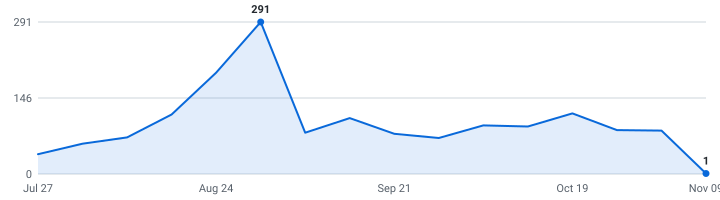

# 🍁 Canada, Japan & more Tech Internships

**A self-updating engine that tracks tech internships so you don't have to.**

&nbsp;&nbsp;&nbsp;

### 455 open roles (336 listed below) · 69 new this week

5,052 employers tracked · data as of Nov 11, 2026 at 17:42 UTC

_210 have a cycle the employer stated · 245 are recent postings whose cycle isn't stated (listed separately, never mixed in)._

**[🖥️ Live dashboard](https://parkerhayashi.github.io/Automated-List-Of-Summer-2027-and-Fall-2026-Tech-Internships/)** · **[📡 RSS](https://parkerhayashi.github.io/Automated-List-Of-Summer-2027-and-Fall-2026-Tech-Internships/feed.xml)** · **[⚙️ JSON API](https://parkerhayashi.github.io/Automated-List-Of-Summer-2027-and-Fall-2026-Tech-Internships/api/jobs.json)**

> [!TIP]
> **⭐ Star this repo** to save it and get updates when new roles are added.

Instead of refreshing a dozen career pages by hand, it reads company hiring feeds directly and keeps one live list — newest roles on top, refreshed automatically throughout the day.

**🔔 New roles in your inbox:** [RSS](https://parkerhayashi.github.io/Automated-List-Of-Summer-2027-and-Fall-2026-Tech-Internships/feed.xml) or [Feedrabbit](https://feedrabbit.com/subscriptions/new?url=https%3A%2F%2Fraw.githubusercontent.com%2Fparkerhayashi%2FAutomated-List-Of-Summer-2027-and-Fall-2026-Tech-Internships%2Fmain%2Fdocs%2Ffeed.xml).

---

## What this is

This is an engine, not a hand-kept list. It polls company career feeds every 30 minutes, finds the internships, removes duplicates, and rebuilds this page on its own.

Every link comes straight from the source — so it's real and current, not a stale list someone forgot to update. Speed matters.

## What makes this different

| | |
|---|---|
| 📅 **[Drop Radar](#drop-radar)** | A forecast of **what's coming**. Each marquee company's typical opening window, replaced by the real drop date the moment the engine catches it live. Windows are estimates and labelled as such; only dates the engine saw itself are marked verified. |
| 🛂 **Work authorization, from the posting** | 🇨🇦 / 🇯🇵 / 🛂 flags detected automatically from every job description — citizenship required, or the employer says it won't sponsor a work permit. Most postings say nothing either way, and those show as unknown rather than guessed. |
| 📆 **A real date on nearly every role** | Taken from the job portal itself wherever the portal states one, so newest-first actually means newest. The exact coverage figure is printed at the bottom of this page every run. |
| 🧰 **Skill tags + pay, extracted** | Every posting's text is scanned for the stack it wants (Python, C++, PyTorch, …) and the pay it states — searchable on the [dashboard](https://parkerhayashi.github.io/Automated-List-Of-Summer-2027-and-Fall-2026-Tech-Internships/), and included in the CSV and API. |
| 🔔 **Alerts your way** | [RSS](https://parkerhayashi.github.io/Automated-List-Of-Summer-2027-and-Fall-2026-Tech-Internships/feed.xml) — point any reader, or a Slack/Discord RSS integration, at it. Plus a [live dashboard](https://parkerhayashi.github.io/Automated-List-Of-Summer-2027-and-Fall-2026-Tech-Internships/) with search, filters, and a saved-roles list that never leaves your browser. |
| ⚙️ **An engine, not a spreadsheet** | 5,380 job-board endpoints (5,052 distinct employers; some run more than one board) polled every 30 minutes across 12 ATS platforms. Full source and tests in this repo. |

## Scope

| | |
|---|---|
| **Roles** | Software, Data & ML/AI, Quant, Product (PM / TPM), VC, and Product Design / UX internships — not marketing, recruiting, or general business |
| **Region** | Canada, Japan, United Kingdom, Ireland, Netherlands, Germany, Switzerland, Hong Kong, Sweden, Australia, South Korea, Taiwan, New Zealand, France, Spain, Italy, Denmark, Belgium, Austria, Portugal, Greece, and Czechia |
| **Cycles** | Summer 2027 |

## About

This fork of the internship engine tracks software, data, ML, quant, product (PM/TPM), venture capital, and product-design internships and co-ops located in Canada, Japan, and 20 other countries for Summer 2027, plus recent postings that don't name a cycle. The Scope table lists every country.

Use it to spot roles early and apply before they fill up. Being first genuinely helps.

## Where this is going

I'm building this in the open and adding to it as it grows.

**Recently shipped:** the Drop Radar · auto-detected sponsorship flags · the live dashboard

**Next up:** personalized alerts (pick your categories) · per-company hiring pages · a ghost-posting detector

If it helps you, a star means a lot and tells me to keep going.

## How to use

<b>Reading the table — flags, dates, and the cycle split</b> (click to expand)

- Roles are grouped by **region** (Canada, then Japan & IEC countries), then by cycle - **newest posting on top, oldest at the bottom.**
- A cycle section holds only roles whose **employer stated that cycle** - in the title, or in the posting's own text. Postings that name no cycle anywhere are in *Recently posted — cycle not stated* under the same region, with **no cycle guessed for them**. Same quality bar, different amount of evidence.
- The **Posted** column is the date the company published the role.
- **_(3 openings)_ after a role title** = the employer has that many separate live requisitions for the same job, in the same place, for the same cycle. They're all real and each takes its own application, so they're linked individually (**Apply**, then **#2**, **#3**) instead of repeating the row. Counts still count requisitions, and the CSV export is never grouped.
- **🆁 after a company name** = **this role is remote** — the posting's own location or title says so. It marks the role on that row, not the whole company.
- **Flags after a role title:** 🇨🇦 = requires Canadian citizenship, permanent residency, or a security clearance · 🇯🇵 = requires Japanese citizenship or nationality · 🛂 = the posting says it won't sponsor a work permit · 🆕 = spotted in the last 48 hours. Sponsorship flags are detected automatically from each job description - treat them as a strong hint and confirm on the posting.

- Track your applications with [`data/internships.csv`](data/internships.csv) (opens in Excel / Google Sheets).
- Missing a company? Adding one takes a single line, see [CONTRIBUTING.md](CONTRIBUTING.md).

---

**Jump to:** [Canada](#canada) · [Japan & IEC countries](#iec)

## Summer 2027 — Canada  (34 employer-stated)

| Company | Role | Category | Location | Skills | Posted | Apply |
|---|---|---|---|---|---|---|
| BMO | Quantitative Analyst, Summer 2027 (Co-op/Internship) - 4 Months | Quant | Toronto, ON, CAN | Python | Nov 06, 2026 | [Apply](https://bmo.wd3.myworkdayjobs.com/Campus/job/Toronto-ON-CAN/Quantitative-Analyst--Summer-2027--Co-op-Internship----4-Months_R260031097-1) |
| Stripe | Product Design Intern | Design | Toronto | No skills listed | Nov 05, 2026 | [Apply](https://stripe.com/jobs/search?gh_jid=8332683) |
| SOTI | Software Developer Intern (May 2027 12 Months) 🆕 _(2 openings)_ | Software | Mississauga +1 more | Java, C++, C#, Rust | Nov 05, 2026 | [Apply](https://soti.wd3.myworkdayjobs.com/SOTI-Next-Gen/job/Mississauga-Canada--Meadowvale-Office-HQ/Software-Developer-Intern--May-2027-12-Months-_R10655) [#2](https://soti.wd3.myworkdayjobs.com/SOTI-Next-Gen/job/Mississauga-Canada--Meadowvale-Office-HQ/Software-Developer-Intern--May-2027---12-months-_R10677) |
| SOTI | Quality Assurance Specialist Intern - Android (May 2027 - 12 Months) | Software | Mississauga +1 more | Java, C++, C#, Rust | Nov 05, 2026 | [Apply](https://soti.wd3.myworkdayjobs.com/SOTI-Next-Gen/job/Mississauga-Canada--Meadowvale-Office-HQ/Quality-Assurance-Specialist-Intern---Android--May-2027---12-Months-_R10651) |
| American Express | Campus Undergraduate Summer Internship Program - 2027 AI Engineer, Enterprise Technology Services- Toronto, Ontario, CN | Data & ML/AI | Toronto, ON, Canada | Python, Java, C++, JavaScript | Nov 02, 2026 | [Apply](https://egug.fa.us2.oraclecloud.com/hcmUI/CandidateExperience/en/sites/CX_1/job/26016035) |
| Stripe | Master's Machine Learning Engineer, Intern | Data & ML/AI | Toronto | Python, Scala, scikit-learn, Pandas | Oct 30, 2026 | [Apply](https://stripe.com/jobs/search?gh_jid=8333122) |
| SOTI | Software Developer Intern - SOTI XSight (May 2027 12 Months) | Software | Mississauga +1 more | Java, C++, Rust, TypeScript | Oct 29, 2026 | [Apply](https://soti.wd3.myworkdayjobs.com/SOTI-Next-Gen/job/Mississauga-Canada--Meadowvale-Office-HQ/Software-Developer-Intern---SOTI-XSight--May-2027-12-Months-_R10611) |
| Ryan | Summer 2027 Intern, Software Engineering | Software | North York ON | No skills listed | Oct 29, 2026 | [Apply](https://ryan.wd1.myworkdayjobs.com/RyanCareers/job/North-York/Summer-2027-Intern--Software-Engineering_R0020807-1) |
| Trimble | Firmware & Machine Learning Engineering Intern (16 Months) | Data & ML/AI | Canada - Richmond Hill +1 more | Python, C++, Linux, Git | Oct 27, 2026 | [Apply](https://trimble.wd1.myworkdayjobs.com/TrimbleCareers/job/Canada---Richmond-Hill-Ontario-Applanix/Navigation---Machine-Learning-Engineering-Intern--16-Months-_R57980) |
| Manulife Financial | Summer Intern 2027 - Venture Capital | VC | Toronto, Ontario | HTML/CSS | Oct 23, 2026 | [Apply](https://manulife.wd3.myworkdayjobs.com/MFCJH_Jobs/job/Toronto-Ontario/Summer-Co-op-2027---Venture-Capital_JR26100932) |
| Trimble | Software Engineering Intern | Software | Canada - Richmond Hill +1 more | Python, C++, JavaScript, HTML/CSS | Oct 23, 2026 | [Apply](https://trimble.wd1.myworkdayjobs.com/TrimbleCareers/job/Canada---Richmond-Hill-Ontario-Applanix/Software-Engineering-Intern_R57963) |
| TELUS Digital | Software Engineering Intern/Co-op (Canada) - Summer 2027 | Software | Vancouver | Java, TypeScript, JavaScript, Swift | Oct 23, 2026 | [Apply](https://jobs.ashbyhq.com/telus-digital/63b0654a-9849-4d74-bc3f-94b2ccceb2c2) |
| GE Vernova | Intern- Product Management (Summer 2027) | PM | Markham | No skills listed | Oct 23, 2026 | [Apply](https://gevernova.wd5.myworkdayjobs.com/vernova_externalsite/job/Markham/Intern--Product-Management--Summer-2027-_R5056377-2) |
| Manulife Financial | Summer Intern 2027 - Product Management & Risk Technology | PM | Toronto, Ontario | HTML/CSS | Oct 08, 2026 | [Apply](https://manulife.wd3.myworkdayjobs.com/MFCJH_Jobs/job/Toronto-Ontario/Summer-Intern-2027---Product-Management---Risk-Technology_JR26080875) |
| Capital One | Intern, Full Stack Software Engineer - Summer 2027 | Software | Toronto, ON | Java, Go, JavaScript, React | Oct 06, 2026 | [Apply](https://capitalone.wd12.myworkdayjobs.com/Capital_One/job/Toronto-ON/Intern--Full-Stack-Software-Engineer---Summer-2027_R1003143) |
| Capital One | Intern, Data Scientist - Summer 2027 | Data & ML/AI | Toronto, ON | Python, SQL, AWS, Linux | Oct 05, 2026 | [Apply](https://capitalone.wd12.myworkdayjobs.com/Capital_One/job/Toronto-ON/Intern--Data-Scientist---Summer-2027_R1002165-1) |
| Pinterest | Software Engineering Intern 2027 (Toronto) | Software | Toronto, ON, CA | Python, Java, C++, TypeScript | Oct 01, 2026 | [Apply](https://www.pinterestcareers.com/jobs/?gh_jid=8138039) |
| Pinterest | Machine Learning Intern 2027 (Toronto) | Data & ML/AI | Toronto, ON, CA | Python, Java, C++, PyTorch | Oct 01, 2026 | [Apply](https://www.pinterestcareers.com/jobs/?gh_jid=8138080) |
| Semtech | Firmware Design Intern | Hardware | CAN - Ottawa, ON | Python, C++ | Sep 24, 2026 | [Apply](https://semtech.wd1.myworkdayjobs.com/SemtechCareers/job/CAN---Ottawa-ON/Firmware-Design-Intern_REQ3617) |
| Amazon | Software Development Engineer Intern - Summer 2027 (CAN) | Software | Vancouver, International | Python, Java, C++, C# | Sep 18, 2026 | [Apply](https://www.amazon.jobs/en/jobs/10553947/software-development-engineer-intern-summer-2027-can) |
| Tower Research Capital | Stagiaire en développement de logiciels (été 2027) / Software Developer Intern (Summer 2027) | Software | Montreal | Python, Java, C++, Go | Sep 17, 2026 | [Apply](https://www.tower-research.com/open-positions/?gh_jid=8212179) |
| Manulife Financial | Summer Intern 2027 - Software Engineering (12 Months) | Software | Waterloo, Ontario | Python, Java, JavaScript, HTML/CSS | Sep 17, 2026 | [Apply](https://manulife.wd3.myworkdayjobs.com/MFCJH_adminJobs/job/Waterloo-Ontario/Summer-Intern-2027---Software-Engineering--12-Months-_JR26091053-1) |
| DoorDash | Software Engineer, Intern (Summer 2027) - TOR | Software | Toronto, ON | Python, Java, SQL, Kotlin | Sep 14, 2026 | [Apply](https://job-boards.greenhouse.io/doordashcanada/jobs/8170944) |
| Royal Bank of Canada | 2027 Capital Markets, Global Equities, AI Engineer (16 Months, Co-op) | Data & ML/AI | TORONTO, Ontario, Canada | Python, PyTorch, scikit-learn, Pandas | Sep 14, 2026 | [Apply](https://rbc.wd3.myworkdayjobs.com/rbcglobal1/job/TORONTO-Ontario-Canada/XMLNAME-2027-Capital-Markets--Global-Equities--AI-Engineer--16-Months--Co-op-_R-0000187401-2) |
| Amazon | ML Systems Software Development Engineer Intern, Annapurna Labs - 2027 | Data & ML/AI | Toronto, International | Python, C++, TypeScript, PyTorch | Sep 11, 2026 | [Apply](https://www.amazon.jobs/en/jobs/10538066/ml-systems-software-development-engineer-intern-annapurna-labs-2027) |
| Lyft | UX Research Intern (Summer 2027) | Design | Toronto, Canada | SQL | Sep 11, 2026 | [Apply](https://app.careerpuck.com/job-board/lyft/job/8797069002?gh_jid=8797069002) |
| Lyft | Software Engineer Intern, Machine Learning (Summer 2027 - Toronto) | Data & ML/AI | Toronto, Canada | Python, PyTorch, TensorFlow, scikit-learn | Sep 11, 2026 | [Apply](https://app.careerpuck.com/job-board/lyft/job/8802332002?gh_jid=8802332002) |
| Lyft | Software Engineer Intern, Test Automation (Summer 2027) | Software | Montreal, Canada | No skills listed | Sep 11, 2026 | [Apply](https://app.careerpuck.com/job-board/lyft/job/8767534002?gh_jid=8767534002) |
| Amazon | Software Development Engineer Intern, ROBOTICS - 2027 | Hardware | Toronto, International | Python, Java, C++, C# | Sep 09, 2026 | [Apply](https://www.amazon.jobs/en/jobs/10535280/software-development-engineer-intern-robotics-2027) |
| PricewaterhouseCoopers (PwC) | May 2027 - Cyber as a Service - Summer Intern - Ottawa | Security | Ottawa | Python, Java, C++, HTML/CSS | Sep 04, 2026 | [Apply](https://pwc.wd3.myworkdayjobs.com/Global_Campus_Careers/job/Ottawa/May-2027---Cyber-as-a-Service---Summer-Intern---Ottawa_759780WD) |
| Lumentum | Software Verification Engineer (Co-op/Intern) _(2 openings)_ | Software | Canada - Ottawa (Bill Leathem) | Python, C#, Bash, Linux | Aug 28, 2026 | [Apply](https://lumentum.wd5.myworkdayjobs.com/LITE/job/Canada---Ottawa-Bill-Leathem/Software-Verification-Engineer--Co-op-Intern-_20261135) [#2](https://lumentum.wd5.myworkdayjobs.com/LITE/job/Canada---Ottawa-Bill-Leathem/Software-Verification-Engineer--Co-op-Intern-_20261136) |
| Georgian Partners Growth | AI/ML Engineer Intern (2027) | Data & ML/AI | Toronto Headquarters | Python, PyTorch, TensorFlow, scikit-learn | Jul 14, 2026 | [Apply](https://jobs.ashbyhq.com/georgian/2ae71a4b-dd9d-4068-8ef2-81351ee74cab) |
| Squarepoint Capital | Intern Software Developer - Montreal - 2027 | Software | Montreal | Python, Java, C++, Rust | May 07, 2026 | [Apply](https://www.squarepoint-capital.com/open-opportunities?id=7905463&gh_jid=7905463) |
| Databricks | Software Engineering Intern (2027) | Software | Bellevue +7 more | Python, Java, C++, Databricks | Aug 04, 2023 | [Apply](https://databricks.com/company/careers/open-positions/job?gh_jid=6865687002) |

## Recently posted — cycle not stated — Canada  (46 roles)

These postings never name a cycle — not in the title, not in the posting text — so neither do we. They're recent tech internships (posted within the last few weeks), often exactly the early drops worth applying to first; we just can't tell you which cycle they're for, and we'd rather say so than guess. The moment a posting's own text states a cycle, the role moves up into that section automatically.

| Company | Role | Category | Location | Skills | Posted | Apply |
|---|---|---|---|---|---|---|
| Amgen | Undergraduate  Co-op Student – Software Engineer – Large Molecule Discovery - Technology 🆕 | Software | Canada - Burnaby | Python, Java, C#, JavaScript | Nov 10, 2026 | [Apply](https://amgen.wd1.myworkdayjobs.com/careers/job/Canada---Burnaby/Undergraduate---Graduate-Co-op-Student---Software-Engineer---Large-Molecule-Discovery---Technology_R-260920) |
| Altera Corporation | Software Engineer -  Intern 🆕 | Software | Toronto, Ontario, Canada | Python, C++, Verilog | Nov 09, 2026 | [Apply](https://altera.wd1.myworkdayjobs.com/altera/job/Toronto-Ontario-Canada/Software-Engineer----Intern_R03414) |
| Kensington | BI/Data Analyst Intern | Data & ML/AI | Toronto, ON, Canada | Python, SQL | Nov 09, 2026 | [Apply](https://job-boards.greenhouse.io/kensingtontours/jobs/5289223007) |
| Brave | Software Engineering Intern - Waterloo University - Winter Session | Software | Canada | Python, C++, Rust, TypeScript | Nov 06, 2026 | [Apply](https://job-boards.greenhouse.io/brave/jobs/8360001) |
| Acumatica | Intern Developer/ Stagiaire développeur | Software | Montreal, QC, Canada (Hybrid) | C#, SQL, Git | Nov 05, 2026 | [Apply](https://jobs.smartrecruiters.com/Acumatica/744000159911799) |
| Teledyne | Software Engineering Coop | Software | Canada - Waterloo, ON | No skills listed | Nov 04, 2026 | [Apply](https://flir.wd1.myworkdayjobs.com/flircareers/job/Canada---Waterloo-ON/XMLNAME--Software-Engineering-Coop_REQ36845) |
| Arlo | Firmware Developer Co-op | Hardware | Richmond, BC, Canada | Linux | Nov 03, 2026 | [Apply](https://arlo.wd12.myworkdayjobs.com/external_careers/job/Richmond-BC-Canada/Firmware-Developer-Co-op_JR100445) |
| Kabam | Operations Product Manager Co-Op | PM | Vancouver | No skills listed | Nov 03, 2026 | [Apply](https://jobs.lever.co/kabam/3c37f284-4ba4-4f74-93f7-d224b910e5c9) |
| Tecsys | Intern - Developer | Software | Montreal, Quebec, Canada (Hybrid) | Python, React, Flask, Git | Nov 02, 2026 | [Apply](https://apply.workable.com/tecsys/j/D61D5FB9AB/) |
| Revvity 🆁 | Full-stack AI Developer Intern _(5 openings)_ | Data & ML/AI | CAD Remote – ON | LLMs | Oct 30, 2026 | [Apply](https://revvity.wd103.myworkdayjobs.com/External/job/CAD-Remote--ON/Full-stack-AI-Developer-Intern_JR-045791) [#2](https://revvity.wd103.myworkdayjobs.com/External/job/CAD-Remote--ON/Full-stack-AI-Developer-Intern_JR-045792) [#3](https://revvity.wd103.myworkdayjobs.com/External/job/CAD-Remote--ON/Full-stack-AI-Developer-Intern_JR-045793) [#4](https://revvity.wd103.myworkdayjobs.com/External/job/CAD-Remote--ON/Full-stack-AI-Developer-Intern_JR-045794) [#5](https://revvity.wd103.myworkdayjobs.com/External/job/CAD-Remote--ON/Full-stack-AI-Developer-Intern_JR-045795) |
| Revvity 🆁 | UX Intern _(2 openings)_ | Design | CAD Remote – ON | No skills listed | Oct 30, 2026 | [Apply](https://revvity.wd103.myworkdayjobs.com/External/job/CAD-Remote--ON/UX-Intern_JR-043675) [#2](https://revvity.wd103.myworkdayjobs.com/External/job/CAD-Remote--ON/UX-Intern_JR-045787) |
| Altera Corporation | Software Engineer - Factory Apps - Intern | Software | Toronto, Ontario, Canada | Python, C++, Linux, Git | Oct 29, 2026 | [Apply](https://altera.wd1.myworkdayjobs.com/altera/job/Toronto-Ontario-Canada/Software-Engineer---Factory-Apps---Intern_R03384) |
| Bank of Montreal | BMO Capital Markets Quantitative Trading Analyst – 12–16 Month Co-op | Quant | Toronto, ON, CAN | Python, Java, C++, C# | Oct 29, 2026 | [Apply](https://bmo.wd3.myworkdayjobs.com/External/job/Toronto-ON-CAN/BMO-Capital-Markets-Quantitative-Trading-Analyst---12-16-Month-Co-op_R260029657) |
| Tenstorrent | GTM (FAE & Customer Success) and Product Intern | PM | Santa Clara +5 more | No skills listed | Oct 28, 2026 | [Apply](https://job-boards.greenhouse.io/tenstorrentuniversity/jobs/5274249007) |
| CIBC | Data Analyst co-op | Data & ML/AI | Toronto, ON | Python, SQL, Azure, Databricks | Oct 27, 2026 | [Apply](https://cibc.wd3.myworkdayjobs.com/search/job/Toronto-ON/Data-Analyst-co-op_2622122-1) |
| Motorola | Localization and QA Automation Developer Co-Op | Software | Vancouver, Canada | Python, C++, TypeScript, JavaScript | Oct 27, 2026 | [Apply](https://motorolasolutions.wd5.myworkdayjobs.com/Careers/job/Vancouver-Canada/Localization-and-QA-Automation-Developer-Co-Op_R70123) |
| CIBC | AI Scientist Co-op | Data & ML/AI | Toronto, ON | Python, SQL, LLMs, Azure | Oct 26, 2026 | [Apply](https://cibc.wd3.myworkdayjobs.com/search/job/Toronto-ON/AI-Scientist-Co-op_2622058-1) |
| Ford Motor Company | AI Strategy Intern 🛂 | Data & ML/AI | Oakville, ON, Canada | LLMs | Oct 26, 2026 | [Apply](https://efds.fa.em5.oraclecloud.com/hcmUI/CandidateExperience/en/sites/CX_1/job/73202) |
| TMX Group | Student Intern, DevOps (WinterTerm) | Software | Montreal - 1190 av. des Canadiens-de-Mo… | Python, Azure, Kubernetes, Docker | Oct 26, 2026 | [Apply](https://tmx.wd3.myworkdayjobs.com/TMX_Careers/job/Montreal---1190-av-des-Canadiens-de-Montreal/Student-Intern--DevOps--WinterTerm-_R-6568) |
| PlayStation | Software Developer in Test Co-Op | Software | Canada, Waterloo, ON | Python, JavaScript, HTML/CSS, Git | Oct 23, 2026 | [Apply](https://job-boards.greenhouse.io/waterloocoop/jobs/6230308004) |
| Veeda AI | Internship - Software Engineering | Software | Toronto | AWS, GCP | Oct 22, 2026 | [Apply](https://jobs.ashbyhq.com/veeda-ai/84dfad5c-d790-4c4a-9411-40b676b1abbb) |
| Texas Instruments | Software Engineering Intern (Canada) 🛂 | Software | Canada; Toronto, ON, Canada | No skills listed | Oct 22, 2026 | [Apply](https://edbz.fa.us2.oraclecloud.com/hcmUI/CandidateExperience/en/sites/CX_1/job/25007757) |
| Intel | Compiler Engineering Graduate Intern | Software | Canada, Toronto | C++, PyTorch, CUDA | Oct 22, 2026 | [Apply](https://intel.wd1.myworkdayjobs.com/external/job/Canada-Toronto/Compiler-Engineering-Graduate-Intern_JR0287933) |
| CIBC | Machine Learning Engineer Co-op | Data & ML/AI | Toronto, ON | Python, LLMs, Azure, Git | Oct 22, 2026 | [Apply](https://cibc.wd3.myworkdayjobs.com/search/job/Toronto-ON/Machine-Learning-Engineer-Co-op_2621721-1) |
| Citco | Software Engineering Intern | Software | Toronto, ON, Canada | Python, Java, JavaScript, SQL | Oct 19, 2026 | [Apply](https://fa-euxc-saasfaprod1.fa.ocs.oraclecloud.com/hcmUI/CandidateExperience/en/sites/CX_1/job/18964) |
| AstraZeneca | AI Business Support Specialist Intern | Data & ML/AI | Canada - Mississauga | No skills listed | Oct 16, 2026 | [Apply](https://astrazeneca.wd3.myworkdayjobs.com/Careers/job/Canada---Mississauga/AI-Business-Support-Specialist-Intern_R-261993) |
| Tower Research Capital | Machine Learning Intern | Data & ML/AI | Montreal | Python, SQL, Bash, PyTorch | Oct 15, 2026 | [Apply](https://www.tower-research.com/open-positions/?gh_jid=7077280) |
| Intel | Compiler Engineering Intern | Software | Canada, Toronto | C++, PyTorch, CUDA, Linux | Oct 15, 2026 | [Apply](https://intel.wd1.myworkdayjobs.com/external/job/Canada-Toronto/Compiler-Engineering-Intern_JR0287934) |
| Loblaw Companies | Associate Product Manager - Co-op Student | PM | 500 Lake Shore Blvd W, Toronto, ON | No skills listed | Oct 15, 2026 | [Apply](https://myview.wd3.myworkdayjobs.com/paradox_careers/job/500-Lake-Shore-Blvd-W-Toronto-ON/Associate-Product-Manager---Co-op-Student_R2000694175-1) |
| Tenstorrent | Systems Intern - Validation, Software, Design, Architecture & Packaging (Canada) | Software | Toronto +8 more | Python, C++, Verilog | Oct 14, 2026 | [Apply](https://job-boards.greenhouse.io/tenstorrentuniversity/jobs/5264407007) |
| Waterworth | Computer Science Co-op | Software | Victoria, British Columbia, Canada | PyTorch, TensorFlow, LLMs, Azure | Oct 13, 2026 | [Apply](https://apply.workable.com/waterworth/j/D450C48C96/) |
| Astera Labs | Firmware Engineer Intern Fall Co-op | Hardware | Vancouver. BC, Canada | Python, C++, Git | Oct 13, 2026 | [Apply](https://job-boards.greenhouse.io/asteraearlycareer2027/jobs/4739956005) |
| Astera Labs | Firmware Engineer Intern Summer Co-op | Hardware | Vancouver, BC, Canada | Python, C++, Git | Oct 13, 2026 | [Apply](https://job-boards.greenhouse.io/asteraearlycareer2027/jobs/4739957005) |
| Astera Labs | Firmware Engineer Intern Spring Co-Op | Hardware | Vancouver, BC, Canada | Python, C++, Git | Oct 13, 2026 | [Apply](https://job-boards.greenhouse.io/asteraearlycareer2027/jobs/4739544005) |
| Aptiv | Software Engineering Intern | Software | CAN Kanata (2), ON - WR | C++ | Oct 12, 2026 | [Apply](https://aptiv.wd5.myworkdayjobs.com/aptiv_careers/job/CAN-Kanata-2-ON---WR/Software-Engineering-Intern_J000704368-1) |
| Aptiv | Cloud Engineer Intern _(2 openings)_ | Software | CAN Kanata (2), ON - WR | Python, Linux | Oct 12, 2026 | [Apply](https://aptiv.wd5.myworkdayjobs.com/aptiv_careers/job/CAN-Kanata-2-ON---WR/Cloud-Engineer-Intern_J000704376) [#2](https://aptiv.wd5.myworkdayjobs.com/aptiv_careers/job/CAN-Kanata-2-ON---WR/Cloud-Engineer-Intern_J000704380) |
| Aptiv | Cloud Engineering Intern | Software | CAN Kanata (2), ON - WR | Python, Linux | Oct 12, 2026 | [Apply](https://aptiv.wd5.myworkdayjobs.com/aptiv_careers/job/CAN-Kanata-2-ON---WR/Cloud-Engineering-Intern_J000704383) |
| Tenstorrent | AI Software Intern (Canada) | Data & ML/AI | Toronto, Ontario, Canada | Python, C++, PyTorch, TensorFlow | Oct 08, 2026 | [Apply](https://job-boards.greenhouse.io/tenstorrentuniversity/jobs/5259347007) |
| Motorola | Software Developer, Embedded Appliances Co-Op | Software | Vancouver, Canada | Python, C++, Go, Linux | Oct 07, 2026 | [Apply](https://motorolasolutions.wd5.myworkdayjobs.com/Careers/job/Vancouver-Canada/Software-Developer--Embedded-Appliances-Co-Op_R69581) |
| Bosch | Product Management Internship (1 Year) | PM | Breda, NB, International (NL) (Hybrid) | No skills listed | Oct 07, 2026 | [Apply](https://jobs.smartrecruiters.com/BoschGroup/744000154135589) |
| Teledyne | Stagiaire en conception de logiciels pour stations de validation 3D /Intern - 3D Validation Station Software Designer | Software | Canada - Montreal, QC (TDY) | Python, C++, C#, Ruby | Oct 07, 2026 | [Apply](https://flir.wd1.myworkdayjobs.com/flircareers/job/Canada---Montreal-QC-TDY/Intern---3D-Validation-Station-Software-Designer_REQ36804) |
| CAE | Software Developer Coop | Software | Montreal (St. Laurent) | Python, Java, C#, TypeScript | Oct 06, 2026 | [Apply](https://cae.wd3.myworkdayjobs.com/career/job/Montreal-St-Laurent/Software-Developer-Coop_123904) |
| TobogganLabs | Stagiaire en science des données -- Data Science Intern | Data & ML/AI | Montréal, Quebec, Canada | No skills listed | Oct 04, 2026 | [Apply](https://job-boards.greenhouse.io/tobogganlabs/jobs/8012583003) |
| Solink | Software Engineer Co-op, Agents | Software | Canada | TypeScript, React, Node.js, AWS | Oct 02, 2026 | [Apply](https://jobs.ashbyhq.com/solink/8493613d-ea47-4182-ac0b-f5f24d11f49e) |
| Stripe | Data Analyst, Intern | Data & ML/AI | Toronto | SQL | Oct 01, 2026 | [Apply](https://stripe.com/jobs/search?gh_jid=8194287) |
| AECOM | Engineering Intern – Tunnelling & Underground Infrastructure 🛂 | Software | Markham, ON, Canada (Hybrid) | No skills listed | Sep 29, 2026 | [Apply](https://jobs.smartrecruiters.com/AECOM2/744000152519710) |

## Summer 2027 — Japan & IEC countries  (110 employer-stated)

Located in Japan, United Kingdom, Ireland, Netherlands, Germany, Switzerland, Hong Kong, Sweden, Australia, South Korea, Taiwan, New Zealand, France, Spain, Italy, Denmark, Belgium, Austria, Portugal, Greece, and Czechia.

| Company | Role | Category | Location | Skills | Posted | Apply |
|---|---|---|---|---|---|---|
| EXL | DATA & AI INTERNSHIP 2027 🆕 | Data & ML/AI | London, England, United Kingdom | Python, SQL, LLMs | Nov 11, 2026 | [Apply](https://fa-ewjt-saasfaprod1.fa.ocs.oraclecloud.com/hcmUI/CandidateExperience/en/sites/CX_2/job/22509) |
| DraftKings | Software Engineering Intern (Summer 2027) 🆕 | Software | London, UK | Java, C#, TypeScript, Git | Nov 11, 2026 | [Apply](https://draftkings.wd1.myworkdayjobs.com/Employee_Referral_Portal/job/London-UK/Software-Engineering-Intern--Summer-2027-_JR15150-1) |
| Schonfeld | 2027 Software Engineering Intern 🆕 | Software | Hong Kong, Hong Kong | Python, Java, C++, Git | Nov 11, 2026 | [Apply](https://job-boards.greenhouse.io/schonfeld/jobs/8346891) |
| Addepar | Portfolio Data Analyst Intern - Summer 2027 🛂 🆕 | Data & ML/AI | Edinburgh, UK | Python, SQL | Nov 10, 2026 | [Apply](https://job-boards.greenhouse.io/addepar1/jobs/8910310002) |
| Addepar | Software Engineering Intern - Summer 2027 🛂 🆕 | Software | Edinburgh, UK | Python, Java, Scala, Kafka | Nov 10, 2026 | [Apply](https://job-boards.greenhouse.io/addepar1/jobs/8927507002) |
| PA Consulting | 2027 Summer Internship - Applied Scientist - Cambridge 🆕 | Data & ML/AI | Melbourn, , United Kingdom | No skills listed | Nov 10, 2026 | [Apply](https://jobs.smartrecruiters.com/PAConsulting/744000160850179) |
| Amazon | Robotics - Applied Scientist II Intern / Co-op - 2027 (Robotics, Perception, Manipulation, Locomotion, Planning, HRI and more), Amazon Development Center Taiwan | Data & ML/AI | Hsinchu City, International | Python, Java, C++, LLMs | Nov 09, 2026 | [Apply](https://www.amazon.jobs/en/jobs/10599510/robotics-applied-scientist-ii-intern-co-op-2027-robotics-perception-manipulation-locomotion-planning-hri-and-more-amazon-development-center-taiwan) |
| Point72 | 2027 MI Data Research & AI Intern - APAC | Data & ML/AI | Hong Kong, Singapore, Japan | No skills listed | Nov 06, 2026 | [Apply](https://boards.greenhouse.io/point72/jobs/8899753002?gh_jid=8899753002) |
| M&G | Asset Management: Client Group & Product Internship (London) 🛂 | Other | London | No skills listed | Nov 06, 2026 | [Apply](https://mgpru.wd3.myworkdayjobs.com/mandgprudential/job/London/Asset-Management--Client-Group---Product-Internship--London-_R20839) |
| JPMorganChase | 2027 Machine Learning Center of Excellence (NLP) - Internship | Data & ML/AI | LONDON, United Kingdom | Python, PyTorch, TensorFlow, scikit-learn | Nov 05, 2026 | [Apply](https://jpmc.fa.oraclecloud.com/hcmUI/CandidateExperience/en/sites/CX_1/job/210806793) |
| Nasdaq | Software Developer Intern - Stockholm Summer 2027 | Software | Stockholm - Zenit | Java, SQL, React | Nov 05, 2026 | [Apply](https://nasdaq.wd1.myworkdayjobs.com/Global_External_Site/job/Stockholm---Zenit/Software-Developer-Intern---Stockholm-Summer-2027_R0027297) |
| NBCUniversal | Product Management UX Intern (Hayu) | PM | London, , United Kingdom (Hybrid) | No skills listed | Nov 04, 2026 | [Apply](https://jobs.smartrecruiters.com/NBCUniversal3/744000159681142) |
| Hewlett Packard (HP) | Data Analyst Intern | Data & ML/AI | Sant Cugat del Valles, Barcelona, Spain | Python, SQL | Nov 04, 2026 | [Apply](https://hp.wd5.myworkdayjobs.com/ExternalCareerSite/job/Sant-Cugat-del-Valles-Barcelona-Spain/Data-Analyst-Intern_UNI4613-1) |
| Roku | AI Engineering Internship Program (Summer 2027) | Data & ML/AI | Cambridge, United Kingdom | Python, LLMs | Nov 04, 2026 | [Apply](https://www.weareroku.com/jobs/8345947?gh_jid=8345947) |
| Roku | AI Engineering Internship Program (Summer 2027) | Data & ML/AI | Manchester, United Kingdom | Python, LLMs | Nov 04, 2026 | [Apply](https://www.weareroku.com/jobs/8345954?gh_jid=8345954) |
| Roku | Software Engineering Internship Program (Summer 2027) | Software | Cambridge, United Kingdom | Python, C++, TypeScript, JavaScript | Nov 04, 2026 | [Apply](https://www.weareroku.com/jobs/8345963?gh_jid=8345963) |
| LEGO | Embedded Systems Engineering Internship | Software | Denmark | Git | Nov 04, 2026 | [Apply](https://lego.wd103.myworkdayjobs.com/LEGO_External/job/Billund-Project-House/Embedded-Systems-Engineering-Internship_0000039992-1) |
| Schonfeld | 2027 Emerging Markets and Delta One Quantitative Researcher/Strat Intern | Quant | Hong Kong, Hong Kong | Python, Java, C++, SQL | Nov 03, 2026 | [Apply](https://job-boards.greenhouse.io/schonfeld/jobs/8350719) |
| NVIDIA | Software Engineering Intern - 2027 | Software | Germany, Munich | Python, TypeScript, SQL, LLMs | Nov 03, 2026 | [Apply](https://nvidia.wd5.myworkdayjobs.com/NVIDIAExternalCareerSite/job/Germany-Munich/Software-Engineering-Intern---2027_JR2029184) |
| Amazon | Business Developer Intern, Early Careers 2027 | Software | Munich, International | No skills listed | Oct 30, 2026 | [Apply](https://www.amazon.jobs/en/jobs/10593299/business-developer-intern-early-careers-2027) |
| Amazon | Business Developer Intern, Early Careers 2027 | Software | London, International | No skills listed | Oct 30, 2026 | [Apply](https://www.amazon.jobs/en/jobs/10593322/business-developer-intern-early-careers-2027) |
| Hewlett Packard (HP) | AI & Computer Vision Engineering Intern | Data & ML/AI | Sant Cugat del Valles, Barcelona, Spain | Computer Vision, Python, PyTorch, TensorFlow | Oct 29, 2026 | [Apply](https://hp.wd5.myworkdayjobs.com/ExternalCareerSite/job/Sant-Cugat-del-Valles-Barcelona-Spain/AI---Computer-Vision-Engineering-Intern_UNI4780-1) |
| Hewlett Packard (HP) | AI & Data Engineering Intern | Data & ML/AI | Sant Cugat del Valles, Barcelona, Spain | Python, SQL, LLMs, Databricks | Oct 29, 2026 | [Apply](https://hp.wd5.myworkdayjobs.com/ExternalCareerSite/job/Sant-Cugat-del-Valles-Barcelona-Spain/AI---Data-Engineering-Intern_UNI4517-1) |
| Nasdaq | Software Developer Intern - Summer 2027 | Software | Sweden - Skolgatan - Umeå | Java | Oct 28, 2026 | [Apply](https://nasdaq.wd1.myworkdayjobs.com/Global_External_Site/job/Sweden---Skolgatan---Ume/Software-Developer-Intern---Summer-2027_R0027232) |
| Schonfeld | 2027 AI Forward Deployed Engineer Intern | Data & ML/AI | Hong Kong, Hong Kong | Python, SQL, LLMs, Git | Oct 27, 2026 | [Apply](https://job-boards.greenhouse.io/schonfeld/jobs/8311595) |
| Skydio | Autonomy Engineer Intern, Autonomy Infrastructure, Systems and Tools, 2027 (Zurich) | Software | Zurich, Switzerland | Python, C++, TypeScript, Computer Vision | Oct 26, 2026 | [Apply](https://jobs.ashbyhq.com/skydio/fa88cb47-36f0-4020-95c3-6ac94d59d5d5) |
| FTI Consulting | 2027 Summer Internship, Cybersecurity | Security | London, United Kingdom | No skills listed | Oct 26, 2026 | [Apply](https://fticonsulting.wd108.myworkdayjobs.com/FTIConsultingCareers/job/London-United-Kingdom/XMLNAME-2027-Summer-Internship--Cybersecurity_JR260836) |
| MongoDB | 2027 - Summer Software Engineer Intern, Dublin | Software | Dublin | Python, Java, C++, JavaScript | Oct 23, 2026 | [Apply](https://www.mongodb.com/careers/job/?gh_jid=8267099) |
| Verisk | Year-Long Internship 2027  - Software Engineering Intern | Software | Manchester +2 more | C#, TypeScript, SQL, Vue | Oct 21, 2026 | [Apply](https://fa-ewmy-saasfaprod1.fa.ocs.oraclecloud.com/hcmUI/CandidateExperience/en/sites/CX_1/job/4997) |
| CommonAI C.I.C. | Software Engineer (Summer 2027 Internship) | Software | Cambridge, England, United Kingdom | Python, C++, Rust, PyTorch | Oct 20, 2026 | [Apply](https://apply.workable.com/commonai/j/021D3FCF3E/) |
| PA Consulting | 2027 Summer Internship - Digital (Digital Trust & Cyber Security) - London | Security | London, , United Kingdom | Python, SQL | Oct 20, 2026 | [Apply](https://jobs.smartrecruiters.com/PAConsulting/744000156517180) |
| Sierra | Software Engineer Intern, Agent (London 2027) | Software | London | TypeScript, LLMs, React | Oct 20, 2026 | [Apply](https://jobs.ashbyhq.com/Sierra/7af8aa4e-ba84-49ba-bc53-19358f4564ff) |
| Graphcore | Firmware Summer Intern 2027 🛂 | Hardware | Bristol, UK | Python | Oct 20, 2026 | [Apply](https://job-boards.greenhouse.io/graphcore/jobs/8894770002) |
| Graphcore | UX Design Summer Intern 2027 🛂 | Design | Bristol, UK | No skills listed | Oct 20, 2026 | [Apply](https://job-boards.greenhouse.io/graphcore/jobs/8894797002) |
| Graphcore | Software Engineer Summer Intern, AI Compute Libraries & Performance 2027 🛂 | Data & ML/AI | Bristol, UK | Python, C++ | Oct 20, 2026 | [Apply](https://job-boards.greenhouse.io/graphcore/jobs/8894868002) |
| Graviton | Quantitative Researcher - 2027 Summer Internship | Quant | Amsterdam +7 more | Python, C++ | Oct 19, 2026 | [Apply](https://job-boards.greenhouse.io/gravitonresearchcapital/jobs/8899673002) |
| Rothesay | 2027 Summer Internship Programme - Software Engineering | Software | London | No skills listed | Oct 19, 2026 | [Apply](https://job-boards.greenhouse.io/rothesaygraduates/jobs/8811551002) |
| Adobe | 2027 Intern- Software Engineer | Software | Basel | Java, JavaScript, Node.js, HTML/CSS | Oct 19, 2026 | [Apply](https://adobe.wd5.myworkdayjobs.com/external_experienced/job/Basel/XMLNAME-2027-Intern--Software-Engineer_R173015) |
| JPMorganChase | 2027 AI Research Associate Program - Internship | Data & ML/AI | LONDON, United Kingdom | Python, PyTorch, TensorFlow, LLMs | Oct 15, 2026 | [Apply](https://jpmc.fa.oraclecloud.com/hcmUI/CandidateExperience/en/sites/CX_1/job/210800615) |
| Expedia Group | Mobile Engineering Intern - 2027 - London | Software | UK - London | No skills listed | Oct 15, 2026 | [Apply](https://expedia.wd108.myworkdayjobs.com/private/job/UK---London/Mobile-Engineering-Intern---2027---London_R-110545) |
| Expedia Group | Software Development Engineering Intern - 2027 - London | Software | UK - London | Python, Java, Kotlin | Oct 15, 2026 | [Apply](https://expedia.wd108.myworkdayjobs.com/private/job/UK---London/Software-Development-Engineering-Intern---June-2027---London_R-110551) |
| LSEG | Intern - Software Engineer | Software | London, United Kingdom | Python, AWS, Linux | Oct 14, 2026 | [Apply](https://lseg.wd3.myworkdayjobs.com/Graduate_Careers/job/London-United-Kingdom/Intern---Software-Engineer_R0124267) |
| BNY | 2027 BNY Summer Internship Program - Product Management (Manchester) | PM | Greater Manchester, United Kingdom | No skills listed | Oct 14, 2026 | [Apply](https://eofe.fa.us2.oraclecloud.com/hcmUI/CandidateExperience/en/sites/CX_1001/job/83098) |
| Jain Global | Quant Research Intern (Summer 2027 – London) | Quant | London, United Kingdom | Python | Oct 13, 2026 | [Apply](https://jainglobal.wd5.myworkdayjobs.com/ExternalSite/job/London-United-Kingdom/Quant-Research-Intern--Summer-2027---London-_JR100620-2) |
| NBCUniversal | Media Product Management Intern | PM | London, , United Kingdom (Hybrid) | No skills listed | Oct 13, 2026 | [Apply](https://jobs.smartrecruiters.com/NBCUniversal3/744000155271954) |
| NVIDIA | System Software Engineering Intern, GPU and SOC - Summer 2027 | Software | Taiwan, Taipei | C++, Linux | Oct 12, 2026 | [Apply](https://nvidia.wd5.myworkdayjobs.com/NVIDIAExternalCareerSite/job/Taiwan-Taipei/System-Software-Engineering-Intern--GPU-and-SOC---Summer-2027_JR2026406) |
| RTX | Software Engineering Intern (Summer 2027) _(2 openings)_ | Software | US-FL-MELBOURNE-312 ~ 795 W Nasa Blvd ~… | Python, C++, MATLAB, LLMs | Oct 09, 2026 | [Apply](https://globalhr.wd5.myworkdayjobs.com/rec_rtx_ext_gateway/job/US-FL-MELBOURNE-312--795-W-Nasa-Blvd--BLDG-312/Software-Engineering-Intern--Summer-2027-_01876467) [#2](https://globalhr.wd5.myworkdayjobs.com/rec_rtx_ext_gateway/job/US-FL-MELBOURNE-312--795-W-Nasa-Blvd--BLDG-312/Software-Engineering-Intern--Summer-2027-_01876918) |
| MongoDB | 2027 - Software Engineer Intern, Dublin - 6 Month Internship | Software | Dublin | Python, Java, C++, JavaScript | Oct 09, 2026 | [Apply](https://www.mongodb.com/careers/job/?gh_jid=8258279) |
| WTW | 2027 ICT Technology Software Engineering Intern – Reigate | Software | Reigate, Surrey, United Kingdom | Python, Java, C++, C# | Oct 09, 2026 | [Apply](https://eedu.fa.em3.oraclecloud.com/hcmUI/CandidateExperience/en/sites/CX_1003/job/202605435) |
| Bosch | Business Digitalisation & AI Automation Intern | Data & ML/AI | Denham, England, United Kingdom | Python, JavaScript, SQL, LLMs | Oct 08, 2026 | [Apply](https://jobs.smartrecruiters.com/BoschGroup/744000154478885) |
| Bosch | Powertrain Software Intern | Software | Coventry, England, United Kingdom | Python, MATLAB | Oct 08, 2026 | [Apply](https://jobs.smartrecruiters.com/BoschGroup/744000154385425) |
| Marshall Wace | Quant Developer Intern - Hong Kong 2027 | Quant | Hong Kong | Python, Java, C++, MATLAB | Oct 07, 2026 | [Apply](https://job-boards.greenhouse.io/mwinternshipprogram/jobs/8857614002) |
| SailPoint 🆁 | Software Engineer Intern - Platform Engines 🛂 | Software | Remote (United Kingdom) | Go, TypeScript, SQL, Angular | Oct 07, 2026 | [Apply](https://sailpoint.wd1.myworkdayjobs.com/SailPoint/job/Remote-United-Kingdom/Software-Engineer-Intern---Platform-Engines_R014164) |
| Anduril | 2027 Software Engineer Intern | Software | London, England, United Kingdom | Python, Java, Computer Vision | Oct 07, 2026 | [Apply](https://boards.greenhouse.io/andurilindustries/jobs/5255902007?gh_jid=5255902007) |
| Visa | Software Engineer Intern | Software | GB - Cambridge, United Kingdom | No skills listed | Oct 06, 2026 | [Apply](https://visa.wd5.myworkdayjobs.com/visa_talent_portal/job/GB---Cambridge-United-Kingdom/Software-Engineer-Intern_REF089104W) |
| Pinterest | Machine Learning Intern 2027 (Dublin) | Data & ML/AI | Dublin, IE | Python, Java, C++, PyTorch | Oct 05, 2026 | [Apply](https://www.pinterestcareers.com/jobs/?gh_jid=8244922) |
| Hudson River Trading | Data Scientist Intern - 2027 | Data & ML/AI | London +4 more | Python, Pandas | Oct 05, 2026 | [Apply](https://www.hudsonrivertrading.com/careers/job/?gh_jid=8257369) |
| Arondite | Software Engineer - Summer 2027 Intern | Software | London, England, United Kingdom (Hybrid) | Python, Java, C++, Rust | Oct 05, 2026 | [Apply](https://apply.workable.com/arondite/j/D3211449EF/) |
| Databricks | Software Engineering Intern (2027 Start) - London | Software | London, United Kingdom | Python, Java, C++, Databricks | Oct 02, 2026 | [Apply](https://databricks.com/company/careers/open-positions/job?gh_jid=8847738002) |
| TTP | Summer Internship - Cyber / AI Consultant - 2027 | Data & ML/AI | Melbourn, England, United Kingdom | No skills listed | Oct 02, 2026 | [Apply](https://jobs.smartrecruiters.com/TTP1/744000153148930) |
| Pinterest | Software Engineering Intern 2027 (Dublin) | Software | Dublin, IE | Python, Java, C++, TypeScript | Oct 01, 2026 | [Apply](https://www.pinterestcareers.com/jobs/?gh_jid=8138034) |
| Pinterest | Software Engineering Intern 2027 (Zurich) | Software | Zurich, CH | Python, Java, C++, TypeScript | Oct 01, 2026 | [Apply](https://www.pinterestcareers.com/jobs/?gh_jid=8214745) |
| Capstone Investment Advisors | Summer 2027 - Quant Internship | Quant | London | No skills listed | Sep 30, 2026 | [Apply](https://job-boards.greenhouse.io/capstoneinvestmentadvisors/jobs/8859054002) |
| NVIDIA | AI Computing Software Development Intern - 2027 | Data & ML/AI | Taiwan, Taipei | Python, C++, PyTorch, LLMs | Sep 29, 2026 | [Apply](https://nvidia.wd5.myworkdayjobs.com/NVIDIAExternalCareerSite/job/Taiwan-Taipei/AI-Computing-Software-Development-Intern---2027_JR2026298) |
| Barclays | 2027 Technology Developer Summer Internship Programme Glasgow | Software | Glasgow Campus | Python, Java, C++, C# | Sep 25, 2026 | [Apply](https://barclays.wd3.myworkdayjobs.com/External_Career_Site_Barclays/job/Glasgow-Campus/XMLNAME-2027-Technology-Developer-Summer-Internship-Programme-Glasgow_JR-0000129387) |
| Hewlett Packard Enterprise | Software Engineering Internship (Placement Year) | Software | Bristol, Avon, United Kingdom | Python, Java, C++, C# | Sep 23, 2026 | [Apply](https://hpe.wd5.myworkdayjobs.com/Jobsathpe/job/Bristol-Avon-United-Kingdom/Software-Engineering-Internship--Placement-Year-_1215804) |
| Snowflake | Software Engineer Intern - Berlin (2027) | Software | DE-Berlin-Trion Building | Java, C++, SQL, AWS | Sep 22, 2026 | [Apply](https://jobs.ashbyhq.com/snowflake/ab028e3c-c1cf-4455-8915-8e4e6b0cc9e8) |
| DV Trading | Security Engineer Intern - Summer 2027 | Security | London | Python, Linux | Sep 22, 2026 | [Apply](https://job-boards.greenhouse.io/dvtrading/jobs/4736603005) |
| JPMorganChase | 2027 Quantitative Research – Asset Management - Summer Analyst Internship - London | Quant | LONDON, LONDON, United Kingdom | Python, Java, C++, SQL | Sep 22, 2026 | [Apply](https://jpmc.fa.oraclecloud.com/hcmUI/CandidateExperience/en/sites/CX_1/job/210792010) |
| Brevan Howard | 2027 Summer Internship Program - AI & Quantitative Analyst, London | Quant | London | Python, LLMs | Sep 22, 2026 | [Apply](https://wd3.myworkdaysite.com/recruiting/brevanhoward/BH_ExternalCareers/job/London/AI---Quantitative-Analyst--London_JR101605) |
| Capstone Investment Advisors | Summer 2027 - Investment Internship LDN | Other | London | Python, Java | Sep 21, 2026 | [Apply](https://job-boards.greenhouse.io/capstoneinvestmentadvisors/jobs/8828058002) |
| WTW | 2027 Data Scientist Internship Programme - P&C Insurance - London/Reigate | Data & ML/AI | London +5 more | Python, SQL, LLMs | Sep 18, 2026 | [Apply](https://eedu.fa.em3.oraclecloud.com/hcmUI/CandidateExperience/en/sites/CX_1003/job/202605997) |
| Talos | Software Engineer Intern, Trading | Quant | London | Java, C++, Git, PostgreSQL | Sep 16, 2026 | [Apply](https://jobs.ashbyhq.com/Talos-Trading/42cad756-c312-4142-a9b7-18ed76f61c5d) |
| Talos | Software Engineer Intern, Infrastructure | Software | London | Python, Java, Bash, AWS | Sep 16, 2026 | [Apply](https://jobs.ashbyhq.com/Talos-Trading/f2a0aaa2-af88-4715-9f2d-8f61bd5e2935) |
| DV Trading | 2027 Quantitative Research Intern (DV QES) | Quant | Hong Kong | Python, Pandas | Sep 15, 2026 | [Apply](https://job-boards.greenhouse.io/dvtrading/jobs/4733877005) |
| DV Trading | 2027 Software Developer Intern  (DV QES) | Software | Hong Kong | Python, C++, Linux | Sep 15, 2026 | [Apply](https://job-boards.greenhouse.io/dvtrading/jobs/4733880005) |
| Figma | Software Engineer Intern (London, United Kingdom) (Summer 2027) | Software | London, England | Python, Java, C++, JavaScript | Sep 14, 2026 | [Apply](https://boards.greenhouse.io/figma/jobs/6152695004?gh_jid=6152695004) |
| Scale AI | Software Engineering Intern (Summer 2027) | Software | London, UK | Python, TypeScript, LLMs, React | Sep 14, 2026 | [Apply](https://job-boards.greenhouse.io/scaleai/jobs/4730846005) |
| Synthesis | Quantitative Research Intern (Summer 2027) | Quant | London, London, United Kingdom | Python, LLMs | Sep 11, 2026 | [Apply](https://apply.workable.com/synthesisim/j/C2932F1DE5/) |
| Nex | Summer 2027 / Software Engineer Intern (Engineering, Core Technology) | Software | Hong Kong | Java, C++, C#, Computer Vision | Sep 11, 2026 | [Apply](https://job-boards.greenhouse.io/nex/jobs/5419756008) |
| Nex | Summer 2027 / Software Engineer Intern - Game Development (Creative & Party) | Software | Hong Kong | No skills listed | Sep 11, 2026 | [Apply](https://job-boards.greenhouse.io/nex/jobs/5420003008) |
| Nex | Summer 2027 / Software Engineer Intern (Developer Experience) | Software | Hong Kong | Python, Node.js, GCP | Sep 11, 2026 | [Apply](https://job-boards.greenhouse.io/nex/jobs/5420203008) |
| Garrett Motion | International Internship Czech Republic 2027- AI in Embedded SW development | Data & ML/AI | BRNO MĚSTO, Czech Republic | Python, MATLAB | Sep 11, 2026 | [Apply](https://ehth.fa.em2.oraclecloud.com/hcmUI/CandidateExperience/en/sites/CX_2001/job/15037) |
| TTP | Summer Internship - Software Engineering Consultant - 2027 | Software | Melbourn, England, United Kingdom | No skills listed | Sep 11, 2026 | [Apply](https://jobs.smartrecruiters.com/TTP1/744000149038758) |
| Sentry | Software Engineer, Intern (Summer 2027) | Software | Vienna, Austria | Python, JavaScript, AWS, Git | Sep 10, 2026 | [Apply](https://jobs.ashbyhq.com/sentry/fa522ac5-fc9f-4ce1-a191-842496a235a2) |
| Qube Research & Technologies | 2027 - Internship, Software Engineering and Quantitative Development | Quant | London +6 more | Python, C++, C#, SQL | Sep 08, 2026 | [Apply](https://job-boards.greenhouse.io/quberesearchandtechnologies/jobs/8773084002) |
| Qube Research & Technologies | 2027 – Graduate or Internship, Infrastructure Engineer | Software | London, Paris | Python, SQL, Bash, PyTorch | Sep 08, 2026 | [Apply](https://job-boards.greenhouse.io/quberesearchandtechnologies/jobs/8773447002) |
| Qube Research & Technologies | 2027 - Internship, Quantitative Research and Trading | Quant | Aarhus +5 more | Python, C++, C# | Sep 08, 2026 | [Apply](https://job-boards.greenhouse.io/quberesearchandtechnologies/jobs/8785833002) |
| Talos | Quantitative Analyst Intern | Quant | London, NYC | Python, SQL, Pandas, Git | Sep 08, 2026 | [Apply](https://jobs.ashbyhq.com/Talos-Trading/d6d0c99a-f281-4efe-89c4-026f7f5edc2b) |
| Datadog | Software Engineering Intern | Software | Paris, France | Kubernetes | Sep 08, 2026 | [Apply](https://careers.datadoghq.com/detail/8114186/?gh_jid=8114186) |
| BNY | 2027 BNY Summer Internship Program - Product Management (London) | PM | London, United Kingdom | No skills listed | Sep 08, 2026 | [Apply](https://eofe.fa.us2.oraclecloud.com/hcmUI/CandidateExperience/en/sites/CX_1001/job/81922) |
| Marshall Wace | Quant Research Intern - London - 2027 | Quant | London | Python, MATLAB | Sep 02, 2026 | [Apply](https://job-boards.greenhouse.io/mwinternshipprogram/jobs/8772688002) |
| Tower Research Capital | Quantitative Trader/Researcher Summer Internship 2027 | Quant | London | Python, C++ | Sep 01, 2026 | [Apply](https://www.tower-research.com/open-positions/?gh_jid=8037860) |
| PIMCO | 2027 Summer Intern - Client Solutions & Analytics Quantitative Research Analyst (MFE), London | Quant | London, GBR | Python, MATLAB | Sep 01, 2026 | [Apply](https://pimco.wd1.myworkdayjobs.com/pimco-careers/job/London-GBR/XMLNAME-2027-Summer-Intern---Client-Solutions---Analytics-Strategist--London--MBA-_R106804) |
| FTI Consulting | 2027 Intern, Forensic & Litigation Consulting, Cyber | Security | Paris, France | No skills listed | Aug 31, 2026 | [Apply](https://fticonsulting.wd108.myworkdayjobs.com/FTIConsultingCareers/job/Paris-France/XMLNAME-2027-Intern--Forensic---Litigation-Consulting--Cyber_JR260757) |
| TELUS Digital | Data & AI Intern (Brazil) - Year Round 2027 | Data & ML/AI | Porto Alegre, Brazil | Python, SQL, LLMs | Aug 28, 2026 | [Apply](https://jobs.ashbyhq.com/telus-digital/89730055-fa03-444d-aa05-0058946fa436) |
| TELUS Digital | Software Engineering Intern (Brazil) - Year Round 2027 | Software | Porto Alegre, Brazil | No skills listed | Aug 28, 2026 | [Apply](https://jobs.ashbyhq.com/telus-digital/98495440-1a32-4c7e-8183-f38beebfd1d0) |
| BNY | 2027 BNY Internship Program -Engineering (Developer) (Manchester) | Software | Greater Manchester, United Kingdom | Python, Java, JavaScript, HTML/CSS | Aug 24, 2026 | [Apply](https://eofe.fa.us2.oraclecloud.com/hcmUI/CandidateExperience/en/sites/CX_1001/job/81318) |
| Xantium | Quantitative Developer Intern | Quant | London | Python, C++ | Aug 17, 2026 | [Apply](https://job-boards.greenhouse.io/xantium/jobs/4360768009) |
| Xantium | Quantitative Researcher Intern | Quant | London, England, New York, New York | No skills listed | Aug 17, 2026 | [Apply](https://job-boards.greenhouse.io/xantium/jobs/4371217009) |
| IMC Trading | Quantitative Trader Intern 2027 | Quant | Hong Kong, Hong Kong | No skills listed | Aug 12, 2026 | [Apply](https://job-boards.eu.greenhouse.io/imc/jobs/4941205101) |
| IMC Trading | Software Engineer Intern 2027 | Software | Hong Kong, Hong Kong | Python, Java, C++ | Aug 12, 2026 | [Apply](https://job-boards.eu.greenhouse.io/imc/jobs/4941206101) |
| IMC Trading | Quantitative Research Intern 2027 | Quant | Hong Kong, Hong Kong | Python, Java, C++, MATLAB | Aug 12, 2026 | [Apply](https://job-boards.eu.greenhouse.io/imc/jobs/4941208101) |
| Virtu Financial | 2027 Internship - Software Engineer | Software | Dublin, Ireland | No skills listed | Jul 20, 2026 | [Apply](https://job-boards.greenhouse.io/virtu/jobs/8551566002) |
| Hudson River Trading | Algorithm Development (Quant Research & Trading) Internship – Summer 2027 | Quant | London, United Kingdom; Singapore | Python, C++, MATLAB, Pandas | Jul 13, 2026 | [Apply](https://www.hudsonrivertrading.com/careers/job/?gh_jid=7964062) |
| Hudson River Trading | Software Engineering Internship (C++ or Python) – Summer 2027 | Software | Austin +11 more | Python, C++ | Jul 13, 2026 | [Apply](https://www.hudsonrivertrading.com/careers/job/?gh_jid=8052083) |
| Virtu Financial | 2027 Internship - Quantitative Trading | Quant | Dublin, Ireland | Python, Java, C++, SQL | Jul 01, 2026 | [Apply](https://job-boards.greenhouse.io/virtu/jobs/8547254002) |
| Aquatic Capital Management | Quantitative Researcher, Intern (Summer 2027) | Quant | Chicago; London | Python | Apr 01, 2026 | [Apply](https://job-boards.greenhouse.io/aquaticcapitalmanagement/jobs/8489186002) |
| Databricks | Software Engineering Intern (2027 Start) - Aarhus | Software | Aarhus, Denmark | Python, Java, C++, Databricks | Aug 29, 2025 | [Apply](https://databricks.com/company/careers/open-positions/job?gh_jid=8133710002) |
| Databricks | Product Management Intern (2027) - Berlin | PM | Berlin, Germany | Python, SQL, Databricks | Aug 29, 2025 | [Apply](https://databricks.com/company/careers/open-positions/job?gh_jid=8145776002) |

## Recently posted — cycle not stated — Japan & IEC countries  (133 roles)

These postings never name a cycle — not in the title, not in the posting text — so neither do we. They're recent tech internships (posted within the last few weeks), often exactly the early drops worth applying to first; we just can't tell you which cycle they're for, and we'd rather say so than guess. The moment a posting's own text states a cycle, the role moves up into that section automatically.

| Company | Role | Category | Location | Skills | Posted | Apply |
|---|---|---|---|---|---|---|
| Amazon | Data Engineer Internship 🆕 | Data & ML/AI | London, International | Python, Java, SQL, AWS | Nov 11, 2026 | [Apply](https://www.amazon.jobs/en/jobs/10602219/data-engineer-internship) |
| WEP Clinical | IT Intern - AI & Transformation 🆕 | Data & ML/AI | Chiswick, London, UK | Python, SQL, LLMs, Azure | Nov 11, 2026 | [Apply](https://jobs.lever.co/wepclinical/8d3a77c2-5606-4d32-8532-7dbb1abde1d2) |
| Cadence Design Systems | Intern Agentic AI Workflow Development & Validation for Digital Design (f/m/d) 🆕 | Data & ML/AI | FELDKIRCHEN (Munich) | Python, LLMs | Nov 11, 2026 | [Apply](https://cadence.wd1.myworkdayjobs.com/External_Careers/job/FELDKIRCHEN-Munich/Intern-Agentic-AI-Workflow-Development---Validation-for-Digital-Design--f-m-d-_R57159) |
| ING | Data & AI adoption Intern 🆕 | Data & ML/AI | CDR (Amsterdam - Cedar) | Python, SQL, LLMs | Nov 11, 2026 | [Apply](https://ing.wd3.myworkdayjobs.com/icsgblcor/job/CDR-Amsterdam---Cedar/Data---AI-adoption-Intern_REQ-10124535) |
| NVIDIA | Developer Technology Engineer Intern 🆕 | Software | Japan, Tokyo | No skills listed | Nov 11, 2026 | [Apply](https://nvidia.wd5.myworkdayjobs.com/NVIDIAExternalCareerSite/job/Japan-Tokyo/Developer-Technology-Engineer-Intern_JR2029575) |
| Sunlife | Software Delivery Internship Student 🆕 | Software | Waterford, Waterford, Ireland | SQL | Nov 11, 2026 | [Apply](https://sunlife.wd3.myworkdayjobs.com/experienced/job/Waterford-Waterford-Ireland/Software-Delivery-Internship-Student_JR00129727) |
| ASML | Internship - CS Infrastructure, Architecture & Security Team - Hsinchu 🆕 | Security | Hsinchu, Taiwan | No skills listed | Nov 11, 2026 | [Apply](https://asml.wd3.myworkdayjobs.com/asmlext1/job/Hsinchu-Taiwan/Internship---CS-Infrastructure--Architecture---Security-Team---Hsinchu_J-00357779) |
| NVIDIA | GPU Compiler Intern 🆕 | Software | Switzerland, Zurich | Python, C++, CUDA | Nov 11, 2026 | [Apply](https://nvidia.wd5.myworkdayjobs.com/NVIDIAExternalCareerSite/job/Switzerland-Zurich/GPU-Compiler-Intern_JR2029779) |
| Amazon | Applied Scientist Intern - VLA and DATA, RIVR 🆕 | Data & ML/AI | Zurich, International | Python, Java, C++, SQL | Nov 10, 2026 | [Apply](https://www.amazon.jobs/en/jobs/10600919/applied-scientist-intern-vla-and-data-rivr) |
| Loft Orbital | Backend Engineering Intern: Ground Platform Control 🆕 | Software | Toulouse, Occitanie | Python, Django, Flask, Docker | Nov 10, 2026 | [Apply](https://jobs.lever.co/loftorbital/1014b6c1-049d-43e5-a67a-42aac6ba4c84) |
| Loft Orbital | AI/ML Engineering Intern: System 1 Models for Reactive Space Operations 🆕 | Data & ML/AI | Toulouse, Occitanie | Python, PyTorch, LLMs, Computer Vision | Nov 10, 2026 | [Apply](https://jobs.lever.co/loftorbital/7e9d723a-6afa-495c-a3ac-4f89ef5400b5) |
| Loft Orbital | Image Processing Intern: AI-Assisted Tools for CalVal 🆕 | Data & ML/AI | Toulouse, Occitanie | Python | Nov 10, 2026 | [Apply](https://jobs.lever.co/loftorbital/fc7d15c8-5055-48d7-8569-fd7668ed8ee2) |
| Honeywell | Intern (m/f/d) Commercial Transformation – Fire Europe Software & Services 🆕 | Software | Ratingen, Nordrhein-Westfalen, Germany | No skills listed | Nov 10, 2026 | [Apply](https://ibqbjb.fa.ocs.oraclecloud.com/hcmUI/CandidateExperience/en/sites/CX_1/job/161539) |
| International Flavors & Fragrances | Data Engineering & Data Science Intern 🆕 | Data & ML/AI | Benicarlo, Spain | Python, SQL, Flask, AWS | Nov 10, 2026 | [Apply](https://iff.wd5.myworkdayjobs.com/IFF_Careers/job/Benicarlo-Spain/Intern_R23121) |
| Marvell | Firmware Engineering Intern 🆕 | Hardware | Pavia, Italy | Python, Bash, LLMs, Linux | Nov 10, 2026 | [Apply](https://marvell.wd1.myworkdayjobs.com/MarvellCareers/job/Pavia-Italy/Firmware-Engineering-Intern_2603916-1) |
| Honeywell | Intern Software Engineer 🆕 | Software | North Ryde, New South Wales, Australia | No skills listed | Nov 09, 2026 | [Apply](https://ibqbjb.fa.ocs.oraclecloud.com/hcmUI/CandidateExperience/en/sites/CX_1/job/162057) |
| The Exploration Company | Software Intern- Mission Control Center | Software | Bordeaux, France | Python, TypeScript, JavaScript, React | Nov 09, 2026 | [Apply](https://jobs.ashbyhq.com/the-exploration-company/bdb17a37-2330-4893-87ba-9ca342bb0748) |
| Census | 🚀 CENSUS AI / ML / Data Science Internship | Data & ML/AI | Athens, GR | No skills listed | Nov 09, 2026 | [Apply](https://census.breezy.hr/p/a527757cfc2501-census-ai-ml-data-science-internship) |
| Kpler | Product Analyst Intern – Price & Transaction | PM | Paris | Python, SQL | Nov 09, 2026 | [Apply](https://jobs.lever.co/kpler/7c05bdbd-4fe3-4063-9a81-3c80abe0b661) |
| Wavestone | Cybersecurity - Consultant Internship from 3 to 6 months 🛂 | Security | Brussels +2 more | No skills listed | Nov 09, 2026 | [Apply](https://jobs.smartrecruiters.com/Wavestone1/744000160568999) |
| Invesco | Intern, Quantitative Research (6 months fixed-term contract) | Quant | Frankfurt, Hesse | Python, SQL, LLMs, AWS | Nov 09, 2026 | [Apply](https://invesco.wd1.myworkdayjobs.com/IVZ/job/Frankfurt-Hesse/Intern--Quantitative-Research--6-months-fixed-term-contract-_R-15889) |
| Thermo Fisher Scientific | Intern - DevOps | Software | Brno, Czechia | Python, Docker, Git | Nov 09, 2026 | [Apply](https://thermofisher.wd5.myworkdayjobs.com/ThermoFisherCareers/job/Brno-Czechia/Intern---DevOps_R-01374014-1) |
| Thermo Fisher Scientific | Intern – Software Development | Software | Brno, Czechia | Python, C++, C#, Computer Vision | Nov 09, 2026 | [Apply](https://thermofisher.wd5.myworkdayjobs.com/ThermoFisherCareers/job/Brno-Czechia/Intern---Software-Development_R-01373992) |
| Helical | Machine Learning Intern | Data & ML/AI | London +5 more | Python, PyTorch, TensorFlow, Docker | Nov 06, 2026 | [Apply](https://apply.workable.com/helical/j/88990169F9/) |
| Arcadis | Summer Intern – Project Management APM | PM | Cork, Munster, Ireland | No skills listed | Nov 06, 2026 | [Apply](https://ebcs.fa.em2.oraclecloud.com/hcmUI/CandidateExperience/en/sites/CX_1/job/45758) |
| Intel | Software Design Engineer Intern for Physical Design (m/f/d) | Software | Germany, Munich | Python, Linux | Nov 06, 2026 | [Apply](https://intel.wd1.myworkdayjobs.com/external/job/Germany-Munich/Software-Design-Engineer-Intern-for-Physical-Design--m-f-d-_JR0288937) |
| Match Group | Data Science Internship | Data & ML/AI | Ghent, Belgium | Python, SQL, LLMs | Nov 06, 2026 | [Apply](https://jobs.lever.co/matchgroup/72a9642b-a289-4c49-bc9b-53880c1dc870) |
| ING | Data Scientist Intern | Data & ML/AI | Bruxelles Avenue Marnix (ING) | Python, SQL, GCP | Nov 06, 2026 | [Apply](https://ing.wd3.myworkdayjobs.com/icsgblcor/job/Bruxelles-Avenue-Marnix-ING/Data-Scientist-Intern_REQ-10123773) |
| Tencent | NLP Research Intern | Data & ML/AI | Japan-Tokyo-Atago Mori Tower | LLMs | Nov 06, 2026 | [Apply](https://tencent.wd1.myworkdayjobs.com/Tencent_Careers/job/Japan-Tokyo-Atago-Mori-Tower/NLP-Research-Intern_R108352-1) |
| Alta Ares | ML Engineer - Internship | Data & ML/AI | Paris | Python, PyTorch, TensorFlow, Computer Vision | Nov 05, 2026 | [Apply](https://jobs.ashbyhq.com/alta-ares/1b5bbaef-5f12-4844-b9a3-e4ee826fa454) |
| Palantir | Software Engineer, Internship - Sovereign AI Systems | Data & ML/AI | London, United Kingdom | Python, Java, C++, Rust | Nov 05, 2026 | [Apply](https://jobs.lever.co/palantir/40840cef-bbd7-4557-bb21-cbdcf4be616e) |
| Intel | Middleware Software Engineering Intern (m/f/d) | Software | Germany, Munich | Python, C++, Bash, Docker | Nov 05, 2026 | [Apply](https://intel.wd1.myworkdayjobs.com/external/job/Germany-Munich/Middleware-Software-Engineering-Intern--m-f-d-_JR0288635) |
| Novanta | Hardware Developer Intern | Hardware | Barcelona, Spain - Keonn | No skills listed | Nov 05, 2026 | [Apply](https://novanta.wd5.myworkdayjobs.com/Novanta-Careers/job/Barcelona-Spain---Keonn/Hardware-Developer-Intern_R009900) |
| Logitech | Spring Internship Program - Software Intern | Software | Hsinchu, Taiwan | LLMs | Nov 05, 2026 | [Apply](https://logitech.wd5.myworkdayjobs.com/Logitech/job/Hsinchu-Taiwan/Spring-Internship-Program---Software-Intern_148729) |
| Logitech | Spring Internship Program - User Experience Engineer Intern | Design | Hsinchu, Taiwan | No skills listed | Nov 05, 2026 | [Apply](https://logitech.wd5.myworkdayjobs.com/Logitech/job/Hsinchu-Taiwan/Spring-Internship-Program---User-Experience-Engineer-Intern_148730) |
| Thermo Fisher Scientific | Intern – Software Engineering | Software | Brno, Czechia | Python, C++, C#, PyTorch | Nov 05, 2026 | [Apply](https://thermofisher.wd5.myworkdayjobs.com/ThermoFisherCareers/job/Brno-Czechia/Intern---Software-Engineering_R-01374064) |
| Bosch | Extracurricular Internship: Product Management (f/m/div) | PM | Aveiro, International (PT) | No skills listed | Nov 04, 2026 | [Apply](https://jobs.smartrecruiters.com/BoschGroup/744000159679459) |
| Census | 🚀 CENSUS Cybersecurity Engineering Internship Program: Learn. Hack. Secure! Thessaloniki | Security | Thessaloniki, GR | No skills listed | Nov 04, 2026 | [Apply](https://census.breezy.hr/p/926f2a5c797001-census-cybersecurity-engineering-internship-program-learn-hack--secure-thessaloniki) |
| Census | 🚀 CENSUS Cybersecurity Engineering Internship Program: Learn. Hack. Secure! Athens | Security | Athens, GR | No skills listed | Nov 04, 2026 | [Apply](https://census.breezy.hr/p/f3b895bf33d601-census-cybersecurity-engineering-internship-program-learn-hack--secure-athens) |
| Sia Partners | Final Year Internship Consultant - Cybersecurity & AI Trust | Data & ML/AI | Paris, IDF, International (FR) (Hybrid) | No skills listed | Nov 04, 2026 | [Apply](https://jobs.smartrecruiters.com/Sia/744000159668932) |
| Air Liquide | Data Analyst & Quality - Internship (H/F) | Data & ML/AI | France, Bagneux | Python, LLMs | Nov 04, 2026 | [Apply](https://airliquidehr.wd3.myworkdayjobs.com/AirLiquideExternalCareer/job/France-Bagneux/Data-Analyst---Quality---Internship--H-F-_R10104522) |
| ING | Private Banking - Intern - Digitalisation & AI in Portfolio Management | Data & ML/AI | Bruxelles Avenue Marnix (ING) | No skills listed | Nov 04, 2026 | [Apply](https://ing.wd3.myworkdayjobs.com/icsgblcor/job/Bruxelles-Avenue-Marnix-ING/Private-Banking---Intern---Digitalisation---AI-in-Portfolio-Management_REQ-10123838) |
| Bosch | Extracurricular Internship: Product management internship (f/m/div) | PM | Aveiro, International (PT) | No skills listed | Nov 03, 2026 | [Apply](https://jobs.smartrecruiters.com/BoschGroup/744000159406258) |
| Sia Partners | Final Year Internship Consultant - Cybersecurity & AI Trust | Data & ML/AI | Paris, IDF, International (FR) | No skills listed | Nov 03, 2026 | [Apply](https://jobs.smartrecruiters.com/Sia/744000159468300) |
| Hewlett Packard Enterprise | DevOps Intern (Undergraduate) | Software | Bolzano Vicentino, Vicenza, Italy | Python, Bash, Kubernetes, Docker | Nov 03, 2026 | [Apply](https://hpe.wd5.myworkdayjobs.com/Jobsathpe/job/Bolzano-Vicentino-Vicenza-Italy/DevOps-Intern--Undergraduate-_1213976) |
| Amazon | SLAM / Computer Vision Intern, RIVR | Data & ML/AI | Zurich, International | Computer Vision, Python, C++, ROS | Nov 03, 2026 | [Apply](https://www.amazon.jobs/en/jobs/10595274/slam-computer-vision-intern-rivr) |
| Elsevier | Intern Data Science | Data & ML/AI | London Wall | Python, PyTorch, LLMs | Nov 03, 2026 | [Apply](https://relx.wd3.myworkdayjobs.com/ElsevierJobs/job/London-Wall/Intern-Data-Science_R120607) |
| SC Johnson | Power BI Developer Internship | Software | Netherlands - Utrecht Mijdrecht | No skills listed | Nov 03, 2026 | [Apply](https://scj.wd5.myworkdayjobs.com/External_Career_Site/job/Netherlands---Utrecht-Mijdrecht/Power-BI-Developer-Intern_34387-1) |
| Aries Global | Investment Intern | VC | London | No skills listed | Nov 02, 2026 | [Apply](https://jobs.ashbyhq.com/ariesglobal/4935cc12-4173-42bd-985d-4ff6b37582e8) |
| Aries Global | Software Engineer Intern | Software | London | No skills listed | Nov 02, 2026 | [Apply](https://jobs.ashbyhq.com/ariesglobal/f5f204ad-8b51-4aee-a269-9a5d2ee7e3b8) |
| Honeywell | Embedded Software Intern (m/f/d) _(2 openings)_ | Software | Horsham, West Sussex, United Kingdom | Java, C++, C# | Nov 02, 2026 | [Apply](https://ibqbjb.fa.ocs.oraclecloud.com/hcmUI/CandidateExperience/en/sites/CX_1/job/158937) [#2](https://ibqbjb.fa.ocs.oraclecloud.com/hcmUI/CandidateExperience/en/sites/CX_1/job/158938) |
| Zuru | UX/UI Design Intern | Design | Auckland / New Zealand | HTML/CSS | Nov 01, 2026 | [Apply](https://jobs.ashbyhq.com/zuru/9cf1ee54-c4e1-4a3e-8ae5-4594a9e86d7d) |
| Jain Global | Risk Quant Modeller - Intern | Quant | Hong Kong Office | Python, C++ | Oct 31, 2026 | [Apply](https://jainglobal.wd5.myworkdayjobs.com/ExternalSite/job/Hong-Kong-Office/Risk-Quant-Modeller---Intern_JR100472-1) |
| Bosch | Extracurricular Internship – DevOps & GenAI Engineer for Quality (f/m/div.) | Software | Braga, Braga, International (PT) | LLMs, Python | Oct 30, 2026 | [Apply](https://jobs.smartrecruiters.com/BoschGroup/744000158794999) |
| General Motors | Java Software Engineer Intern | Software | Dublin, Ireland | Java, SQL, Git | Oct 30, 2026 | [Apply](https://generalmotors.wd5.myworkdayjobs.com/Careers_GM/job/Dublin-Ireland/Java-Software-Engineer-Intern_JR-202619011-1) |
| Fifty-Five | Data & AI Engineer Intern (H/F) | Data & ML/AI | Paris, Île-de-France, France (Hybrid) | Python, SQL, LLMs, GCP | Oct 30, 2026 | [Apply](https://apply.workable.com/fifty-five/j/6F871CD427/) |
| NXP Semiconductors | Master's Internship Project: Information-aware signal processing for software-defined EIS | Software | Eindhoven | No skills listed | Oct 30, 2026 | [Apply](https://nxp.wd3.myworkdayjobs.com/careers/job/Eindhoven/BSc-Intern-position---In-Cabin-Sensing-for-Automotive-Applications-at-Systems-Innovation-Automotive--SI-A-_R-10062367) |
| Thales | Internship- Agentic AI to support Web UI and API testing | Data & ML/AI | Praha | Python, JavaScript | Oct 30, 2026 | [Apply](https://thales.wd3.myworkdayjobs.com/careers/job/Praha/STAGE---Agentic-AI-to-support-Web-UI-and-API-testing---H-F_R0344862) |
| NVIDIA | Server Firmware Developer (RDSS Intern) | Hardware | Taiwan, Taipei | Python, C++, Bash, Linux | Oct 29, 2026 | [Apply](https://nvidia.wd5.myworkdayjobs.com/NVIDIAExternalCareerSite/job/Taiwan-Taipei/Server-Firmware-Developer--RDSS-Intern-_JR2028570) |
| Nissan | Generative AI & Software Engineering Intern | Data & ML/AI | Barcelona ZF | LLMs, Python | Oct 29, 2026 | [Apply](https://alliance.wd3.myworkdayjobs.com/nissanjobs/job/Barcelona-ZF/Generative-AI---Software-Engineering-Intern_R00215499-1) |
| Altera Corporation | Internship – FPGA Software Design Engineer | Hardware | Marlow, Buckinghamshire, United Kingdom | C++ | Oct 29, 2026 | [Apply](https://altera.wd1.myworkdayjobs.com/altera/job/Marlow-Buckinghamshire-United-Kingdom/Internship---FPGA-Software-Design-Engineer_R02749) |
| Flextronics International | Software Quality Engineer-Internship | Software | Italy, Milano | No skills listed | Oct 29, 2026 | [Apply](https://flextronics.wd1.myworkdayjobs.com/Careers/job/Italy-Milano/Software-Quality-Engineer-Internship_WD230177) |
| Match Group | Product Design Internship | Design | Ghent, Belgium | No skills listed | Oct 28, 2026 | [Apply](https://jobs.lever.co/matchgroup/de73e4f5-36d3-4b32-9474-e063aa5f585d) |
| Match Group | Product Internship | Other | Ghent, Belgium | No skills listed | Oct 28, 2026 | [Apply](https://jobs.lever.co/matchgroup/ea935282-60f4-4fbf-a955-32002ccc74e1) |
| Javelin Global Commodities | Summer Intern: Software Engineering | Software | London, England, United Kingdom | No skills listed | Oct 28, 2026 | [Apply](https://apply.workable.com/javelin-global-commodities/j/CAF64E75BF/) |
| Airbus | Internship within Commodity Management for IT Infrastructure (d/f/m) | Software | München Area | No skills listed | Oct 28, 2026 | [Apply](https://ag.wd3.myworkdayjobs.com/Airbus/job/Mnchen-Area/Internship-within-Commodity-Management-for-IT-Infrastructure--d-f-m-_JR10451788) |
| Interdigital | Intern, AI-Driven Energy-Aware Adaptive Video Streaming: From Client-Side Optimization to End-to-End Collaborative Reinforcement Learning | Data & ML/AI | Rennes, France | Python, C++, JavaScript, Computer Vision | Oct 27, 2026 | [Apply](https://interdigital.wd5.myworkdayjobs.com/InterDigital_Intern/job/Rennes-France/Intern--AI-Driven-Energy-Aware-Adaptive-Video-Streaming--From-Client-Side-Optimization-to-End-to-End-Collaborative-Reinforcement-Learning_REQ26-1164) |
| Interdigital | Intern, Deep learning and Neural Network Optimization and Deployment for SDR-to-HDR Conversion | Data & ML/AI | Rennes, France | Python, C++, PyTorch, TensorFlow | Oct 27, 2026 | [Apply](https://interdigital.wd5.myworkdayjobs.com/InterDigital_Intern/job/Rennes-France/Intern--Deep-learning-and-Neural-Network-Optimization-and-Deployment-for-SDR-to-HDR-Conversion_REQ26-1162) |
| Interdigital | Intern, Real-Time Deep Learning Inference for Display Power Reduction | Data & ML/AI | Rennes, France | Python, C++, PyTorch, TensorFlow | Oct 27, 2026 | [Apply](https://interdigital.wd5.myworkdayjobs.com/InterDigital_Intern/job/Rennes-France/Intern--Real-Time-Deep-Learning-Inference-for-Display-Power-Reduction_REQ26-1163) |
| Zeiss | Internship in AI & Machine Learning (f/m/x) | Data & ML/AI | Karlsruhe | Python, PyTorch, Computer Vision | Oct 27, 2026 | [Apply](https://zeissgroup.wd3.myworkdayjobs.com/External/job/Karlsruhe/Internship-in-AI---Machine-Learning--f-m-x-_JR_1054317) |
| Avanade | Internship Data & AI / AI-Powered Internal Business Assistant | Data & ML/AI | Brussels | Python, LLMs, Azure, Git | Oct 23, 2026 | [Apply](https://accenture.wd103.myworkdayjobs.com/AvanadeCareers/job/Brussels/Internship-Data---AI---AI-Powered-Internal-Business-Assistant_R00366217) |
| Sika | Software Engineering Intern for CAD/CAE/Tooling | Software | Zürich, ZH, International (CH) (Hybrid) | Python, C++, TypeScript, JavaScript | Oct 23, 2026 | [Apply](https://jobs.smartrecruiters.com/SikaAG/744000157445359) |
| Tencent | SRE Intern | Software | Netherlands-Amsterdam | Python, AWS, GCP, Kubernetes | Oct 23, 2026 | [Apply](https://tencent.wd1.myworkdayjobs.com/Tencent_Careers/job/Netherlands-Amsterdam/SRE-Intern_R108291) |
| Vanderlande Industries | Graduation/Internship: AI Process Optimization in Engineering | Data & ML/AI | Veghel, Netherlands | No skills listed | Oct 23, 2026 | [Apply](https://vanderlande.wd3.myworkdayjobs.com/careers/job/Veghel-Netherlands/Graduation-Internship--AI-Process-Optimization-in-Engineering_JR38558) |
| Analog Devices | Software QA Intern | Software | Spain, Valencia, Cortes Valencianas | Python, Git | Oct 22, 2026 | [Apply](https://analogdevices.wd1.myworkdayjobs.com/External/job/Spain-Valencia-Cortes-Valencianas/Software-QA-Intern_R267125) |
| Intel | Software Development Intern (m/f/d) | Software | Germany, Munich | C++ | Oct 22, 2026 | [Apply](https://intel.wd1.myworkdayjobs.com/external/job/Germany-Munich/Software-Development-Intern--m-f-d-_JR0288215) |
| Roche | Internship in AI for Laboratory Automation (Pharma Research & Early Development) | Data & ML/AI | Basel | Python, LLMs, Git | Oct 22, 2026 | [Apply](https://roche.wd3.myworkdayjobs.com/roche-ext/job/Basel/Internship-in-AI-for-Laboratory-Automation--Pharma-Research---Early-Development-_202610-125772) |
| Sika | ESG Digitalization Intern – Software & Data Engineering | Data & ML/AI | Zürich, ZH, International (CH) | Python, TypeScript, JavaScript, SQL | Oct 22, 2026 | [Apply](https://jobs.smartrecruiters.com/SikaAG/744000157078341) |
| ABB | MSc or BSc Thesis / Internship (m/f/d) AI for Intent-Based Networking | Data & ML/AI | Mannheim, Baden-Wurttemberg, Germany | No skills listed | Oct 22, 2026 | [Apply](https://abb.wd3.myworkdayjobs.com/external_career_page/job/Mannheim-Baden-Wurttemberg-Germany/MSc-or-BSc-Thesis---Internship--m-f-d--AI-for-Intent-Based-Networking_JR00043251-1) |
| Celonis | AI & Management Consulting Intern (Value Engineering - DACH Market) | Data & ML/AI | Munich, Germany | Python, SQL, LLMs | Oct 21, 2026 | [Apply](https://job-boards.greenhouse.io/celonis/jobs/7925721003?gh_jid=7925721003) |
| Monolithic Power Systems | Software Engineer Intern | Software | Barcelona, Spain | JavaScript, React, Next.js, HTML/CSS | Oct 21, 2026 | [Apply](https://monolithicpower.wd12.myworkdayjobs.com/MPS_Careers/job/Barcelona-Spain/Software-Engineer-Intern_R-1786) |
| Sia Partners | Final Year Internship Consultant - Cybersecurity _(2 openings)_ | Security | Paris, IDF, International (FR) | No skills listed | Oct 21, 2026 | [Apply](https://jobs.smartrecruiters.com/Sia/744000156750699) [#2](https://jobs.smartrecruiters.com/Sia/744000158117441) |
| Tencent | AI-Native Game Design Intern | Data & ML/AI | United Kingdom-London | Python, C#, JavaScript, LLMs | Oct 21, 2026 | [Apply](https://tencent.wd1.myworkdayjobs.com/Tencent_Careers/job/United-Kingdom-London/AI-Native-Game-Design-Intern_R108252-1) |
| Analog Devices | Software Tools Engineering Intern | Software | United Kingdom, Edinburgh, SC, Freer | TypeScript, JavaScript, React, Node.js | Oct 20, 2026 | [Apply](https://analogdevices.wd1.myworkdayjobs.com/External/job/United-Kingdom-Edinburgh-SC-Freer/Software-Tools-Engineering-Intern_R267128) |
| Legrand | Cybersecurity Assessment Internship | Security | Erba, Lombardia, Italy | No skills listed | Oct 20, 2026 | [Apply](https://iadugs.fa.ocs.oraclecloud.com/hcmUI/CandidateExperience/en/sites/CX_1001/job/1033) |
| Vanderlande Industries | Internship/Graduation: Agentic AI Systems for Software Re-engineering | Data & ML/AI | Veghel, Netherlands | Python, Java, C#, LLMs | Oct 20, 2026 | [Apply](https://vanderlande.wd3.myworkdayjobs.com/careers/job/Veghel-Netherlands/Internship-Graduation--Agentic-AI-Systems-for-Software-Re-engineering_JR38496) |
| ASML | Internship - CS HMI NPI Data Analyst Intern - Hsinchu | Data & ML/AI | Hsinchu, Taiwan | Python, MATLAB | Oct 20, 2026 | [Apply](https://asml.wd3.myworkdayjobs.com/asmlext1/job/Hsinchu-Taiwan/CS-HMI--NPI-Data-Analyst-Internship---Hsinchu_J-00349763) |
| Viridien | HPC Intern - Compiler Evaluation & Performance Analysis | Software | Massy, France | Python, C++, Bash, Linux | Oct 20, 2026 | [Apply](https://cgg.wd103.myworkdayjobs.com/viridiencareers/job/Massy-France/IA-Software-Engineer-Intern_JR101544-2) |
| Viridien | Software Web Developer Intern | Software | Massy, France | TypeScript, JavaScript, React, Docker | Oct 20, 2026 | [Apply](https://cgg.wd103.myworkdayjobs.com/viridiencareers/job/Massy-France/Software-Web-Developer-Intern_JR101543-2) |
| Palantir | Software Engineer, Internship - Query Engines | Software | London, United Kingdom | Python, Java, C++, Rust | Oct 19, 2026 | [Apply](https://jobs.lever.co/palantir/3e59369e-1392-42f2-8d03-86648e87e963) |
| Hewlett Packard (HP) | Machine Learning Development Intern _(2 openings)_ | Data & ML/AI | Porto Alegre, Rio Grande do Sul, Brazil | Python, PyTorch, TensorFlow, LLMs | Oct 19, 2026 | [Apply](https://hp.wd5.myworkdayjobs.com/ExternalCareerSite/job/Porto-Alegre-Rio-Grande-do-Sul-Brazil/Machine-Learning-Development-Intern_UNI4106-1) [#2](https://hp.wd5.myworkdayjobs.com/ExternalCareerSite/job/Porto-Alegre-Rio-Grande-do-Sul-Brazil/Machine-Learning-Development-Intern_UNI5016-1) |
| Celonis | Intern Applied AI Solution Consulting (Italy) | Data & ML/AI | Milan, Italy | Python, SQL, LLMs | Oct 19, 2026 | [Apply](https://job-boards.greenhouse.io/celonis/jobs/8014366003?gh_jid=8014366003) |
| Teledyne | Stage Qualité & Gestion de Produit – Dispositifs Médicaux /  Internship - Product Management Dental scope | PM | France - Grenoble | No skills listed | Oct 19, 2026 | [Apply](https://flir.wd1.myworkdayjobs.com/flircareers/job/France---Grenoble/Stage-Qualit---Gestion-de-Produit---Dispositifs-Mdicaux----Internship---Product-Management-Dental-scope_REQ37355) |
| PricewaterhouseCoopers (PwC) | Data Analyst - Intern - Financial Crime team | Data & ML/AI | Prague | Python, SQL | Oct 19, 2026 | [Apply](https://pwc.wd3.myworkdayjobs.com/Global_Campus_Careers/job/Prague/Data-Analyst---Intern---Financial-Crime-team_768785WD) |
| Visa | Data Science Intern | Data & ML/AI | GB - London, United Kingdom | Python, SQL, Tableau | Oct 19, 2026 | [Apply](https://visa.wd5.myworkdayjobs.com/visa_talent_portal/job/GB---London-United-Kingdom/Data-Science-Intern_REF086121W) |
| Citco | Product Intern _(2 openings)_ | PM | London, United Kingdom | No skills listed | Oct 16, 2026 | [Apply](https://fa-euxc-saasfaprod1.fa.ocs.oraclecloud.com/hcmUI/CandidateExperience/en/sites/CX_1/job/19073) [#2](https://fa-euxc-saasfaprod1.fa.ocs.oraclecloud.com/hcmUI/CandidateExperience/en/sites/CX_1/job/19422) |
| Procter & Gamble (P&G) | Data Engineer Internship (m/f/x) | Data & ML/AI | LISBON GENERAL OFFICE | Python, SQL, Git, Databricks | Oct 16, 2026 | [Apply](https://pg.wd5.myworkdayjobs.com/1000/job/LISBON-GENERAL-OFFICE/Data-Engineer-Internship--m-f-x-_R000161204) |
| AstraZeneca | AI & Data Science Internship Program – AstraZeneca Barcelona | Data & ML/AI | Spain - Barcelona | No skills listed | Oct 16, 2026 | [Apply](https://astrazeneca.wd3.myworkdayjobs.com/Careers/job/Spain---Barcelona/AI---Data-Science-Internship-Program---AstraZeneca-Barcelona_R-261531) |
| Airbus | ATR - Internship- Geospatial Data Science (F/M) | Data & ML/AI | Toulouse Area | Python, Azure, Spark, Databricks | Oct 16, 2026 | [Apply](https://ag.wd3.myworkdayjobs.com/Airbus/job/Toulouse-Area/ATR---Internship--Geospatial-Data-Science--F-M-_JR10448360) |
| Fidelity Investments | Enterprise Infrastructure & Operations Internship | Software | Galway, Ireland | No skills listed | Oct 15, 2026 | [Apply](https://fmr.wd1.myworkdayjobs.com/fidelitycareers/job/Galway-Ireland/Enterprise-Infrastructure---Operations-Internship_2137044) |
| NXP Semiconductors | AI & Future of HR Research Intern | Data & ML/AI | Eindhoven | No skills listed | Oct 15, 2026 | [Apply](https://nxp.wd3.myworkdayjobs.com/careers/job/Eindhoven/AI---Future-of-HR-Research-Intern_R-10067318) |
| NXP Semiconductors | AI Software developer - Intern | Data & ML/AI | Brno | Python, C++, PyTorch, TensorFlow | Oct 15, 2026 | [Apply](https://nxp.wd3.myworkdayjobs.com/careers/job/Brno/AI-Software-developer---Intern_R-10064017-1) |
| Sopra Steria | Internship AI & Software Engineering | Data & ML/AI | Machelen, Flanders, International (BE) | Java | Oct 14, 2026 | [Apply](https://jobs.smartrecruiters.com/SopraSteria1/744000155419129) |
| Altera Corporation | High Level Synthesis (HLS) Compiler Engineer (Intern)) | Software | Marlow, Buckinghamshire, United Kingdom | C++, Git, Verilog | Oct 14, 2026 | [Apply](https://altera.wd1.myworkdayjobs.com/altera/job/Marlow-Buckinghamshire-United-Kingdom/High-Level-Synthesis--HLS--Compiler-Engineer--Intern--_R03313) |
| PricewaterhouseCoopers (PwC) | Cloud Infrastructure Intern - Milano 🇨🇦 | Software | Milan | No skills listed | Oct 14, 2026 | [Apply](https://pwc.wd3.myworkdayjobs.com/Global_Campus_Careers/job/Milan/Cloud-Infrastructure-Intern---Milano_767954WD) |
| Fidelity Investments | Cybersecurity Internship | Security | Dublin, Ireland | No skills listed | Oct 13, 2026 | [Apply](https://fmr.wd1.myworkdayjobs.com/fidelitycareers/job/Dublin-Ireland/Cybersecurity-Internship_2136904) |
| ASML | Artificial Intelligence / Computer Science internship: AI-Driven Cloud Cost Intelligence | Data & ML/AI | Veldhoven, Netherlands | Python, Java, JavaScript, LLMs | Oct 12, 2026 | [Apply](https://asml.wd3.myworkdayjobs.com/asmlext1/job/Veldhoven-Netherlands/Artificial-Intelligence---Computer-Science-internship--AI-Driven-Cloud-Cost-Intelligence_J-00352655) |
| Red Bull | Internship Data Science | Data & ML/AI | Elsbethen, Salzburg, International (AT) | Python, SQL, Snowflake | Oct 12, 2026 | [Apply](https://jobs.smartrecruiters.com/RedBull/744000155050519) |
| Abbott | Intern Data Science - Future Talent Program | Data & ML/AI | Switzerland - Basel | Python, Java, C++, LLMs | Oct 12, 2026 | [Apply](https://abbott.wd5.myworkdayjobs.com/abbottcareers/job/Switzerland---Basel/Intern-Data-Science---Future-Talent-Program_31164223) |
| Zeiss | Internship in Computer Vision / Calibration Pipelines (f/m/x) | Data & ML/AI | Karlsruhe | Computer Vision, Python, C++, PyTorch | Oct 12, 2026 | [Apply](https://zeissgroup.wd3.myworkdayjobs.com/External/job/Karlsruhe/Internship-in-Computer-Vision---Calibration-Pipelines--f-m-x-_JR_1053916) |
| Arcadis | Internship – Machine learning in flood modelling | Data & ML/AI | Amersfoort, Utrecht, Netherlands | Python | Oct 08, 2026 | [Apply](https://ebcs.fa.em2.oraclecloud.com/hcmUI/CandidateExperience/en/sites/CX_1/job/40481) |
| BorgWarner | Software Integration Intern (M/F/D) | Software | Viana do Castelo II - Portugal | Python, C# | Oct 07, 2026 | [Apply](https://borgwarner.wd5.myworkdayjobs.com/BorgWarner_Careers/job/Viana-do-Castelo-II---Portugal/NVH-Testing-Engineering-Intern_R2026-3130) |
| ABB | Internship - Full Stack Software Developer | Software | Genova, Genova, Italy | C#, TypeScript, JavaScript, LLMs | Oct 07, 2026 | [Apply](https://abb.wd3.myworkdayjobs.com/external_career_page/job/Genova-Genova-Italy/Internship---Full-Stack-Software-Developer_JR00049311) |
| Morningstar | Data Analyst Intern (Italian Speaker) | Data & ML/AI | Madrid | No skills listed | Oct 07, 2026 | [Apply](https://morningstar.wd5.myworkdayjobs.com/Morningstar/job/Madrid/Data-Analyst-Intern_REQ-058468) |
| Visa | Software Engineer Intern | Software | GB - London, United Kingdom | Java, SQL, Bash, Docker | Oct 06, 2026 | [Apply](https://visa.wd5.myworkdayjobs.com/visa_talent_portal/job/GB---London-United-Kingdom/Software-Engineer-Intern_REF089103W) |
| Visa | Software Engineer Intern | Software | GB - Reading, United Kingdom | Java, SQL, Bash, Docker | Oct 06, 2026 | [Apply](https://visa.wd5.myworkdayjobs.com/visa_talent_portal/job/GB---Reading-United-Kingdom/Software-Engineer-Intern_REF089102W) |
| Artefact | R&D Intern - Fairness in Deep Learning - Paris | Data & ML/AI | 9th arrondissement of Paris +3 more | PyTorch, scikit-learn, Computer Vision | Oct 06, 2026 | [Apply](https://job-boards.greenhouse.io/artefactlinkedin/jobs/8870459002) |
| G-Research | Machine Learning Engineer Internship | Data & ML/AI | London, UK | Python, PyTorch | Oct 06, 2026 | [Apply](https://gresearch.wd103.myworkdayjobs.com/G-Research/job/London-UK/Machine-Learning-Engineer-Intern_R3773) |
| Haleon | Data Engineer Intern | Data & ML/AI | Switzerland - Nyon | Python, SQL | Oct 06, 2026 | [Apply](https://gsknch.wd3.myworkdayjobs.com/GSKCareers/job/Switzerland---Nyon/Data-Engineer-Intern_548707) |
| Marsh | Digital Transformation & Software Implementation Consultant Internship | Software | Milan - Viale Bodio | No skills listed | Oct 06, 2026 | [Apply](https://mmc.wd1.myworkdayjobs.com/mmc/job/Milan---Viale-Bodio/IT-Implentation---Ditigal-Transformation-Consulting_R_339872) |
| Resmed | Intern, Software Engineering, Devices | Software | Dublin, Ireland | Python, Java, C++ | Oct 06, 2026 | [Apply](https://resmed.wd3.myworkdayjobs.com/ResMed_External_Careers/job/Dublin-Ireland/Intern--Software-Engineering--Devices_JR_054513) |
| Airbus | Flight Software Engineer Intern, Space Systems Airbus Crisa | Software | Madrid Area | Python, Git, Verilog | Oct 05, 2026 | [Apply](https://ag.wd3.myworkdayjobs.com/Airbus/job/Madrid-Area/Flight-Software-Engineer-Intern--Space-Systems-Airbus-Crisa_JR10446862) |
| PricewaterhouseCoopers (PwC) | Software Engineer Intern - Milano [DIG] | Software | Milan | Python, Java, C++, C# | Oct 02, 2026 | [Apply](https://pwc.wd3.myworkdayjobs.com/Global_Campus_Careers/job/Milan/Software-Engineer-Intern---Milano--DIG-_765582WD) |
| Roche | Data Science Intern / Master Thesis Student (Basel, 6 Monate) | Data & ML/AI | Basel | Python, LLMs | Oct 02, 2026 | [Apply](https://roche.wd3.myworkdayjobs.com/roche-ext/job/Basel/Data-Science-Intern---Master-Thesis-Student--Basel--6-Monate-_202609-124516) |
| Stryker | Software Engineering Co-Op | Software | Belfast, United Kingdom | Java, C++, C# | Sep 29, 2026 | [Apply](https://stryker.wd1.myworkdayjobs.com/StrykerCareers/job/Belfast-United-Kingdom/Software-Engineering-Co-Op_R572094) |
| Moloco | Software Engineer Intern (3 months) | Software | Seoul, Korea | No skills listed | Sep 28, 2026 | [Apply](https://job-boards.greenhouse.io/moloco/jobs/8007407003) |
| Lonza | Internship Global Master Data Analyst 80-100% | Data & ML/AI | CH - Visp | No skills listed | Sep 28, 2026 | [Apply](https://lonza.wd3.myworkdayjobs.com/lonza_careers/job/CH---Visp/Internship-Global-Master-Data-Analyst-80-100-_R79749-1) |
| Ferrovial | AI Program Internship | Data & ML/AI | Madrid | LLMs, Azure | Sep 24, 2026 | [Apply](https://ferrovial.wd3.myworkdayjobs.com/ferrovial_career_site/job/Madrid/AI-Program-Internship_JR19467) |
| G-Research | Software Engineering Internship | Software | London, UK | Java, C++, C# | Sep 21, 2026 | [Apply](https://gresearch.wd103.myworkdayjobs.com/G-Research/job/London-UK/Software-Engineering-Intern_R3746) |
| Morningstar | Multilingual Data Analyst Intern | Data & ML/AI | Madrid | No skills listed | Sep 18, 2026 | [Apply](https://morningstar.wd5.myworkdayjobs.com/Morningstar/job/Madrid/Multilingual-Data-Analyst-Intern_REQ-049644-1) |
| Ferrovial | AI Engineer Internship | Data & ML/AI | Madrid | Python, PyTorch, TensorFlow, scikit-learn | Sep 18, 2026 | [Apply](https://ferrovial.wd3.myworkdayjobs.com/ferrovial_career_site/job/Madrid/AI-Engineer-Internship_JR19380) |
| Fifty-Five | Data Analyst Consultant Intern (H/F) | Data & ML/AI | Paris, Île-de-France, France | SQL, Tableau | Sep 11, 2026 | [Apply](https://apply.workable.com/fifty-five/j/D8F4443694/) |
| ABB | Internship - OT Cybersecurity | Security | Genova, Genova, Italy | Linux | Sep 02, 2026 | [Apply](https://abb.wd3.myworkdayjobs.com/external_career_page/job/Genova-Genova-Italy/Internship---Cybersecurity-for-OT-Systems_JR00042894) |

## 📅 Drop Radar — when companies usually post for Summer 2027

Stop refreshing career pages. 🎯 = the employer's **own posted date**, read from their careers API. (We may have discovered the role after it went live — the date is the employer's, not our discovery time.) The rest are typical opening **months**, hand-checked against each company's careers page and public recruiting guides. ✅ = already live in the list above.

> **Heads up:** companies trend *earlier* every cycle, and "~Aug" is a month, not a day. Treat "expected" as when to **start watching**, and "rolling" companies as worth checking year-round.

| Company | Typical opening | Expected this cycle | Status |
|---|---|---|---|
| D.E. Shaw | ~Oct | ~Oct · any day now | ⏳ waiting |
| Rocket Lab | ~Oct | ~Oct · any day now | ⏳ waiting |
| Coinbase | ~Dec | ~Dec · in ~20d | ⏳ waiting |
| Ramp | ~Dec | ~Dec · in ~20d | ⏳ waiting |
| Two Sigma | ~Dec | ~Dec · in ~20d | ⏳ waiting |
| Apple | rolling | year-round | ⏳ waiting |
| Jump Trading | rolling | year-round | ⏳ waiting |
| Microsoft | rolling | year-round | ⏳ waiting |
| Millennium | rolling | year-round | ⏳ waiting |
| Palantir | rolling | year-round | ⏳ waiting |
| 🎯 Databricks | Aug 04 | dropped Aug 04 | ✅ [open now](https://databricks.com/company/careers/open-positions/job?gh_jid=6865687002) |
| 🎯 Point72 | Aug 15 | dropped Aug 15 | ✅ [open now](https://boards.greenhouse.io/point72/jobs/8899753002?gh_jid=8899753002) |
| 🎯 Virtu Financial | Sep 12 | dropped Sep 12 | ✅ [open now](https://job-boards.greenhouse.io/virtu/jobs/8547254002) |
| 🎯 Aquatic Capital Management | Apr 01 | dropped Apr 01 | ✅ [open now](https://job-boards.greenhouse.io/aquaticcapitalmanagement/jobs/8489186002) |
| 🎯 Squarepoint Capital | May 07 | dropped May 07 | ✅ [open now](https://www.squarepoint-capital.com/open-opportunities?id=7905463&gh_jid=7905463) |
| 🎯 Amazon | May 13 | dropped May 13 | ✅ [open now](https://www.amazon.jobs/en/jobs/10418355/2027-software-dev-engineer-intern) |
| 🎯 Anduril | Jun 10 | dropped Jun 10 | ✅ [open now](https://boards.greenhouse.io/andurilindustries/jobs/5255902007?gh_jid=5255902007) |
| 🎯 IMC Trading | Jul 01 | dropped Jul 01 | ✅ [open now](https://job-boards.eu.greenhouse.io/imc/jobs/4956547101) |
| 🎯 WorldQuant | Sep 04 | dropped Sep 04 · closed | 🗓️ dropped |
| 🎯 Ellipsis Labs | Mar 26 | dropped Mar 26 · closed | 🗓️ dropped |
| 🎯 InfiniteQuant | May 29 | dropped May 29 · closed | 🗓️ dropped |
| 🎯 Walleye Capital | Jun 01 | dropped Jun 01 · closed | 🗓️ dropped |

_336 companies on the [full radar](https://parkerhayashi.github.io/Automated-List-Of-Summer-2027-and-Fall-2026-Tech-Internships/#radar). **224** dated from our own live observations 🎯 (this grows every cycle). "~Aug" = hand-verified typical month, not a promise of the day; "rolling" = posts year-round; "waiting" = not seen in our tracked feeds yet, not a guarantee it isn't out somewhere else._

<strong>Recently closed</strong> — 40 roles that left the list in the last 14 days

_Why each one left is in the last column, because the two reasons carry different evidence. **Gone from feed** = two consecutive complete reads of the employer's board no longer returned it (strong, but not the employer telling us directly). **Out of scope** = still posted, but it no longer passes our filters — our call, not theirs. **Not recorded** = closed before we started tracking the reason._

| Company | Role | Cycle | Closed | Why |
|---|---|---|---|---|
| PA Consulting | 2027 Summer Internship - Applied Scientist - Cambridge | Summer 2027 | 2026-11-10 | gone from feed |
| PA Consulting | 2027 Summer Internship - Software & AI Systems – Cambridge | Summer 2027 | 2026-11-10 | gone from feed |
| Rothesay | 2027 Summer Internship Programme - Quantitative Strategist | Summer 2027 | 2026-11-10 | gone from feed |
| American Express | Campus Graduate Masters Summer Internship Program - 2027 AI Engineer, Enterprise Technology Services- Toronto, Ontario, CN | Summer 2027 | 2026-11-09 | gone from feed |
| Gearset | Software Engineering Internship (10 weeks) | Summer 2027 | 2026-11-06 | out of scope |
| Amazon | Data Center Infrastructure Engineer Internship 2027 | Summer 2027 | 2026-11-06 | out of scope |
| Investment Management Corporation of Ontario | Intern, Enterprise Transformation and AI Strategy (Summer 2027) | Summer 2027 | 2026-11-06 | gone from feed |
| American Express | Campus - Internship Programme - Undergraduate - AI Engineer - 2027 (UK - Burgess Hill) | Summer 2027 | 2026-11-06 | out of scope |
| American Express | Campus - Internship Programme - Undergraduate - Information Security Engineer - 2027 (UK - Burgess Hill) | Summer 2027 | 2026-11-06 | out of scope |
| American Express | Campus - Internship Programme - Undergraduate - Product Manager - 2027 (UK - Burgess Hill) | Summer 2027 | 2026-11-06 | out of scope |
| American Express | Campus - Internship Programme - Undergraduate - Product Manager - 2027 (UK - London) | Summer 2027 | 2026-11-06 | out of scope |
| American Express | Campus - Internship Programme - Undergraduate - Software Engineer - 2027 (UK - London) | Summer 2027 | 2026-11-06 | out of scope |
| American Express | Campus - Internship Programme - Undergraduate - Software Engineer - 2027 (UK - Burgess Hill) | Summer 2027 | 2026-11-06 | out of scope |
| Logitech | AI Application Intern, 2027 | Summer 2027 | 2026-11-05 | out of scope |
| Logitech | AI Automation Test Intern Engineer, 2027 | Summer 2027 | 2026-11-05 | out of scope |
| NBCUniversal | Product Management UX Intern (Hayu) | Summer 2027 | 2026-11-05 | gone from feed |
| Cogna | Software Engineer Intern (2027 Cohort) | Summer 2027 | 2026-11-04 | out of scope |
| Steel | Software Engineer Intern (Summer 2027) | Summer 2027 | 2026-11-04 | gone from feed |
| NBCUniversal | Product Intern (Hayu) | Summer 2027 | 2026-11-03 | gone from feed |
| BMO | Junior Cloud Engineer, Summer 2027 (Co-op/Internship) - 16 months | Summer 2027 | 2026-11-03 | gone from feed |
| Investment Management Corporation of Ontario | Intern, Infrastructure (Summer 2027) | Summer 2027 | 2026-11-03 | gone from feed |
| NVIDIA | AI Developer Technology Intern - 2027 | Summer 2027 | 2026-11-03 | out of scope |
| SOTI | Software Developer Intern (May 2027 - 12 months) | Summer 2027 | 2026-11-03 | out of scope |
| OLIX | Software Engineering Intern | Summer 2027 | 2026-11-03 | gone from feed |
| Monzo | Associate Software Engineer - Intern | Summer 2027 | 2026-11-03 | gone from feed |
| PIMCO | 2027 Summer Intern - Technology Analyst, Software Engineering, EMEA | Summer 2027 | 2026-11-03 | gone from feed |
| PTC | Software Engineering Summer Internship 2027 - Cambridge | Summer 2027 | 2026-11-02 | gone from feed |
| American Express | Campus - Internship Programme - Undergraduate - ECMX Product Analyst - 2027 (UK - London) | Summer 2027 | 2026-11-02 | out of scope |
| JPMorganChase | 2027 Quantitative Research Markets Associate Program – Off-Cycle Internship – London | Summer 2027 | 2026-11-02 | out of scope |
| JPMorganChase | 2027 Quantitative Research Markets Analyst Program – Off-Cycle Internship – London | Summer 2027 | 2026-11-02 | out of scope |
| Uber | 2027 Software Engineering Intern, Canada | Summer 2027 | 2026-11-01 | out of scope |
| PIMCO | 2027 Summer Intern – Product Analyst, EMEA | Summer 2027 | 2026-10-31 | gone from feed |
| TD Bank | 2027 Technology Internship - AI-Native Data Platform Engineering - 6-month Internship (January – July) | Summer 2027 | 2026-10-30 | out of scope |
| TD Bank | 2027 Technology Internship - Valuation Services Software Engineer - 6-month Internship (January – July) | Summer 2027 | 2026-10-30 | out of scope |
| Mastercard | Product Management Intern, Summer 2027 - Lisbon, Portugal | Summer 2027 | 2026-10-30 | gone from feed |
| NVIDIA | Software Intern - Embedded Systems 2027 | Summer 2027 | 2026-10-30 | out of scope |
| Manulife Financial | Summer Intern 2027 - Infrastructure Equity Internship | Summer 2027 | 2026-10-30 | gone from feed |
| Amazon | Business Developer Intern, Early Careers 2027 | Summer 2027 | 2026-10-30 | out of scope |
| Amazon | Business Developer Intern, Early Careers 2027 | Summer 2027 | 2026-10-30 | out of scope |
| Chicago Trading Company | Quant Trading Internship - Summer 2027 | Summer 2027 | 2026-10-29 | gone from feed |

---

## Hiring timeline

Internships posted per week, from each role's real published date - redrawn automatically on every run. When this line takes off, recruiting season is open:

<picture>
  <source media="(prefers-color-scheme: dark)" srcset="docs/trends-dark.svg">
  
</picture>

## How it stays current

A small Python engine reads public company hiring feeds directly, keeps the roles that match the scope above, de-duplicates across sources, records each role's published date once (so it never shifts), and regenerates this page through GitHub Actions. It polls every company concurrently (async) with retry/backoff and per-host rate limits. The full source is in this repo.

_Engine (last run): 4,948 of 5,380 registered boards returned successfully across 12 ATS platforms (98% of boards attempted, 92% of the full registry) · completed in 1123.4s · 683 board(s) returned a capped result set, so their roles were not eligible to be closed this run · employer or source-derived date on 100% of open roles._

## How this list is built

[METHODOLOGY.md](METHODOLOGY.md) documents exactly what every label claims — what separates a stated cycle from an inferred one, how sponsorship flags are detected, how a role gets closed, and which limitations are known. Anything on this page that doesn't match the code is a bug worth reporting.

## Contributing

Adding a company takes one line, see [CONTRIBUTING.md](CONTRIBUTING.md), or just [open a request](../../issues/new?template=add-company.yml) with the board URL. **Spotted something wrong?** [Report the exact field](../../issues/new?template=wrong-data.yml) — wrong country, wrong cycle, closed role, bad sponsorship flag. Those reports usually fix a rule, which fixes every other role too.

Also here: [PRIVACY.md](PRIVACY.md) (what the email list stores — an address and nothing else) · [SECURITY.md](SECURITY.md) · [ARCHITECTURE.md](ARCHITECTURE.md) · [MIT licensed](LICENSE).

Built by one student with AI assistance, in the open. The part that matters isn't who typed it — it's that the rules, the tests, and every run's output are all public and checkable.

## Note on dates

The **Posted** column shows when a role was published, with the newest at the top. I pull the posting date straight from each job portal, but a lot of them don't expose one publicly, so those rows show a dash (—) for now instead of a guessed date. The ones that do publish a date are dated. Know the real date for a dashed role? Open a PR and I'll merge it.

Roles can close at any time, so always confirm on the company's own site before applying.
